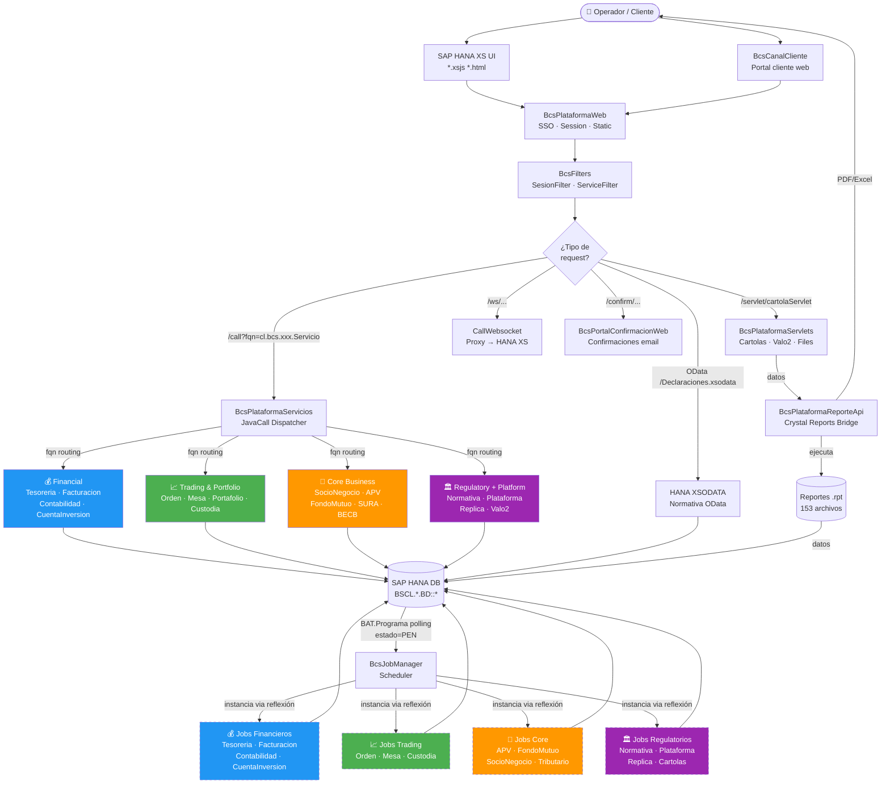

# Informe de Arquitectura del Sistema Legado — otr-sva-optimus-corredores
**Fecha de análisis**: 2026-10-07  
**Fuente**: `legacy/otr-sva-optimus-corredores/BSCL/`  
**Propósito**: Guía de referencia para que un agente futuro realice la refactorización en dominios sin modificar ningún código

> **Instrucción para el agente de refactorización**: Este documento es de solo lectura. No modifiques nada bajo `legacy/`. La refactorización consiste únicamente en reorganizar los proyectos `modernized/otr-sva-optimus-corredores/Bcs*` en los cuatro dominios descritos en la Sección 5. No muevas ni alteres código fuente Java — solo reorganiza la estructura de carpetas y actualiza las referencias de build si corresponde.

---

## 1. Visión General del Sistema

**otr-sva-optimus-corredores** es un sistema de corredora de bolsa construido sobre **SAP HANA Extended Application Services (XS)** con una capa de servicios en **TomEE (JavaEE)**.

### Stack tecnológico legado
| Capa | Tecnología |
|---|---|
| Frontend / UI | SAP HANA XS JavaScript (.xsjs, .html) + Angular/jQuery |
| OData APIs | SAP HANA XSODATA (.xsodata) |
| Capa de servicios | TomEE 1.7 + Java EE 7 (JavaCall interface) |
| Scheduler / Dispatcher de jobs | TomEE MDB + HANA BAT polling (BcsJobManager) |
| Reportes | SAP Crystal Reports (.rpt) + Java API bridge |
| Base de datos | SAP HANA (HDBSQL, stored procedures, vistas columnar) |
| Motor de valorización | BcsValo2 (bonos y pagarés, cálculo de cupones) |

### Escala del sistema
| Componente | Cantidad |
|---|---|
| Clases Java (servicios + jobs) | ~3.600 |
| Archivos de UI (HANA XS) | ~3.300 |
| Reportes Crystal Reports (.rpt) | 153 |
| Dominios de negocio | 17 |
| Proyectos Java separados | ~45 |

---

## 2. Componentes del Sistema

### 2.1 Librería Compartida — `BcsUtils`
**Path legado**: `BSCL/Plataforma/JAVA/BcsUtils/`

La librería base de la que dependen TODOS los otros proyectos Java. Contiene:

| Clase | Función |
|---|---|
| `JavaCall` | Interfaz base que implementa todo servicio de negocio. Define `fqn()` y `logica()` |
| `JavaCallExtra` | Extensión de JavaCall con helpers para entrada/salida JSON |
| `JavaCallMetadata` | Metadatos de registro del servicio en el dispatcher |
| `JavaView` / `JavaViewCache` | Cache de vistas HANA para consultas frecuentes |
| `JdbcUtil` / `NuamPreparedStatement` | Capa JDBC sobre HANA (equivalente a JdbcTemplate) |
| `SQL` | Utilidad estática para ejecutar queries con mapping a POJO |
| `Crypto` / `CryptoUtils` | Cifrado 3DES y SHA256 para contraseñas y datos sensibles |
| `Fecha` | Manejo de fechas con calendario de días hábiles y feriados |
| `RutUtil` | Validación y formateo de RUT chileno |
| `StringUtils` | Utilidades de cadenas de texto |
| `FileUtils` / `JobFileManager` | Manejo de archivos para jobs batch |
| `Log` | Logging de auditoría persistido en HANA |
| `Locker` | Mecanismo de bloqueo distribuido (previene ejecución concurrente de jobs) |
| `ProcesaLlamadaServletCall` | Dispatcher HTTP interno entre proyectos Java |
| `ServletUtils` | Helpers para servlets HTTP |

### 2.2 Frontend — SAP HANA XS UI
**Path legado**: `BSCL/<Dominio>/UI/`

Cada dominio tiene su propia aplicación HANA XS con .xsjs (server-side JavaScript sobre HANA) y archivos HTML/JS/CSS. No hay framework SPA convencional — es HANA XS Native Application.

| Dominio | Archivos UI | Peso relativo |
|---|---|---|
| Plataforma | 964 | Shell principal, autenticación, navegación |
| Normativa | 457 | Mayor UI después de la plataforma |
| Mesa | 305 | Pantallas de trading |
| SocioNegocio | 280 | Gestión de clientes |
| Orden | 267 | Órdenes bursátiles |
| Custodia | 237 | Cartera de valores |
| FondoMutuo | 193 | APV y Fondos |
| Facturación | 138 | Comprobantes y cobros |
| Tesorería | 134 | Ingresos y egresos |
| APV | 113 | Ahorro previsional |
| Contabilidad | 75 | Interfaces contables |
| CuentaInversión | 70 | Saldos y movimientos |
| Portafolio | 63 | Vista de cartera |
| SocioNegocio | 280 | Clientes y personas |

### 2.3 Dispatcher / Entry Point Web — `BcsPlataformaWeb`
**Path legado**: `BSCL/Plataforma/JAVA/BcsPlataformaWeb/`

Puerta de entrada HTTP para el sistema. Contiene:
- `SSOInit` / `SSOLogout` / `SSOLogonBofa` / `SSOLogonLocalGoogle` — SSO con BofA y Google
- `ActualizarClave` / `ValidaClaveProvisoria` / `RecuperacionClave` — gestión de credenciales
- `CrearSesionCliente` — inicio de sesión para clientes (CanalCliente)
- `ContratosServlet` — firma digital de contratos
- `PingServlet` — health check
- `WebStaticServlet` / `RepoStaticServlet` / `ImageManagerServlet` — archivos estáticos
- `CallWebsocket` — proxy WebSocket hacia HANA XS

### 2.4 Filtros HTTP — `BcsFilters`
**Path legado**: `BSCL/Plataforma/JAVA/BcsFilters/`

Interceptan todas las peticiones entrantes:
- `SesionFilter` — valida que el usuario tenga sesión activa en HANA
- `ServiceFilter` — valida que el módulo/empresa esté habilitado para el usuario

### 2.5 Dispatcher de JavaCall — `BcsPlataformaServicios`
**Path legado**: `BSCL/Plataforma/JAVA/BcsPlataformaServicios/`

El núcleo del enrutamiento de servicios. Recibe peticiones con el FQN (fully qualified name) del servicio y lo instancia dinámicamente. Contiene ~326 servicios de negocio propios de plataforma (autenticación, configuración, autorización, parametrización, pauta, conciliación) más la lógica del dispatcher.

### 2.6 Scheduler de Jobs — `BcsJobManager`
**Path legado**: `BSCL/Plataforma/JAVA/BcsJobManager/`

Motor de ejecución de procesos batch:
- `BcsJobManager` — EJB que hace polling de la tabla `BAT.Programa` en HANA
- `BcsJob` — interfaz que implementan todos los jobs (`ejecutar(Programa)`)
- `BcsJobManagerSingleBean` — singleton que garantiza ejecución única por nodo
- `BcsJobListener` — listener de ciclo de vida del job
- `WebAdmin` — interfaz web de administración del scheduler
- `TransactionManager` — gestión de transacciones HANA para los jobs

El scheduler funciona por polling: lee `BAT.Programa` donde estado=PEN, bloquea el registro, instancia la clase del job via reflexión, ejecuta y actualiza estado (TER/ERR).

### 2.7 Servlets Especializados — `BcsPlataformaServlets`
**Path legado**: `BSCL/Plataforma/JAVA/BcsPlataformaServlets/`

- `GenerarCartolaServlet` / `SubirImagenServlet` — generación de cartolas de movimientos
- `ValoBonoServlet` / `CuponServlet` / `ValoPagareServlet` — API HTTP para valorización de bonos y pagarés
- `FileDownloadServlet` / `FileUploadServlet` — gestión de archivos normativos
- `MailTracker` — tracking de emails enviados

### 2.8 Motor de Valorización — `BcsValo2`
**Path legado**: `BSCL/Plataforma/JAVA/BcsValo2/`

Motor financiero de valorización de instrumentos de renta fija:
- `ValorizadorBonos` — valorización de bonos con cupones
- `ValorizadorPagares` — valorización de pagarés
- `ValorizadorInteractivo` — valorización interactiva en tiempo real
- `Cuponera` — generación de flujos de cupones
- `TipoInteres` — enum de tipos de interés (tasa real, nominal, efectiva)

### 2.9 API de Reportes — `BcsPlataformaReporteApi`
**Path legado**: `BSCL/Plataforma/JAVA/BcsPlataformaReporteApi/`

Bridge Java para Crystal Reports:
- `ReportDocument` — wrapper sobre CrystalReportEngine con data binding
- `SubreportDocument` — soporte a subreportes anidados
- `JsonResultSet` — adapta resultados HANA a ResultSet para Crystal Reports

### 2.10 Crystal Reports (153 reportes .rpt)
Distribuidos por dominio, ejecutados via `BcsPlataformaReporteApi`:

| Dominio | Reportes | Tipo de contenido |
|---|---|---|
| Mesa | 55 | Confirmaciones de operaciones, estados de cuenta |
| Normativa | 35 | Declaraciones CMF, NCG, D1516 |
| Custodia | 19 | Posiciones, movimientos de títulos |
| FondoMutuo | 18 | Cartolas de fondos, certificados |
| Tesorería | 7 | Comprobantes de ingreso/egreso |
| Contabilidad | 7 | Interfaces contables, balances |
| Facturación | 5 | Facturas, boletas |
| APV | 3 | Certificados tributarios APV |
| CuentaInversión | 2 | Cartolas de movimientos |
| Orden | 2 | Confirmaciones de órdenes |

### 2.11 Portal de Notificaciones — `BcsPortalConfirmacionWeb`
**Path legado**: `BSCL/Plataforma/JAVA/BcsPortalConfirmacionWeb/`

Portal web para confirmación de operaciones vía email:
- `NotificationsValidate` — valida tokens de confirmación
- `EvalTemplate` — renderiza plantillas de email con datos de operación
- Conecta directamente a HANA para obtener datos de la operación a confirmar

### 2.12 OData APIs — XSODATA (Normativa)
**Path legado**: `BSCL/Normativa/XSODATA/`

Cuatro endpoints OData sobre HANA para integración externa:
- `Declaraciones.xsodata` — declaraciones regulatorias
- `Esquemas.xsodata` — esquemas de datos normativos
- `Tributario.xsodata` — datos tributarios
- `Circular.xsodata` — circulares CMF

### 2.13 Integraciones Externas (Corredor)
**Path legado**: `BSCL/Corredor/`

- **BECB** (`BcsJobGenerarInformesRiesgoFinanciero`, `GenerarInformesRiesgoFinanciero`) — Generación de informes de riesgo financiero para el corredor de bolsa
- **SURA** (`CrearSocioNegocioModificarPerfilesPortafolio`, `ModificarClienteModificarPerfilesPortafolio`) — Integración con SURA para sincronización de perfiles de portafolio de clientes

### 2.14 Servicio Web Tesorería — `BcsTesoreriaWebServices`
**Path legado**: `BSCL/Tesoreria/JAVA/BcsTesoreriaWebServices/`

SOAP/REST endpoint externo para operaciones de tesorería interbancaria.

---

## 3. Mapa de Dependencias entre Componentes

```
                    ┌─────────────────────────────────────────────────────────┐
                    │                   SAP HANA XS UI                        │
                    │  (BSCL/<Dominio>/UI/*.xsjs — 3.300+ archivos)           │
                    └──────────────────────┬──────────────────────────────────┘
                                           │ HTTP
                    ┌──────────────────────▼──────────────────────────────────┐
                    │              BcsPlataformaWeb (SSO / Entry Point)        │
                    │   SSOInit · ActualizarClave · CrearSesionCliente ·       │
                    │   ContratosServlet · CallWebsocket                       │
                    └──────────────────────┬──────────────────────────────────┘
                                           │
                    ┌──────────────────────▼──────────────────────────────────┐
                    │              BcsFilters (HTTP Interceptors)              │
                    │           SesionFilter · ServiceFilter                   │
                    └──────┬────────────────────────────────┬─────────────────┘
                           │ /call?fqn=...                  │ /servlet/...
              ┌────────────▼──────────┐          ┌──────────▼──────────────────┐
              │  BcsPlataformaServicios│          │   BcsPlataformaServlets     │
              │  (JavaCall Dispatcher) │          │  Cartolas · Valo2 · Files   │
              │  326 servicios propios │          └──────────────────────────────┘
              └────────────┬──────────┘
                           │ instanceof JavaCall → logica()
        ┌──────────────────┼──────────────────────────────┐
        │                  │                              │
┌───────▼──────┐  ┌────────▼────────┐           ┌────────▼─────────┐
│  *Servicios  │  │  *Servicios     │           │  *Servicios      │
│  (dominio)   │  │  (dominio)      │    ...    │  (dominio)       │
└───────┬──────┘  └────────┬────────┘           └────────┬─────────┘
        │                  │                              │
        └──────────────────┴──────────────────────────────┘
                                    │
                    ┌───────────────▼───────────────────┐
                    │          SAP HANA Database         │
                    │   BSCL.*.BD::* (tablas, vistas,    │
                    │   stored procedures, secuencias)    │
                    └───────────────┬───────────────────┘
                                    │ BAT.Programa polling
                    ┌───────────────▼───────────────────┐
                    │         BcsJobManager              │
                    │    (Scheduler / Dispatcher batch)  │
                    └───────────────┬───────────────────┘
                                    │ instancia via reflexión
        ┌───────────────────────────┼───────────────────────────┐
        │                           │                           │
┌───────▼────────┐      ┌───────────▼─────────┐    ┌──────────▼──────────┐
│   *Jobs        │      │   *Jobs             │    │   *Jobs             │
│   (dominio)    │      │   (dominio)         │... │   (dominio)         │
└────────────────┘      └─────────────────────┘    └─────────────────────┘

                    ┌──────────────────────────────────────┐
                    │       BcsPlataformaReporteApi         │
                    │  (Crystal Reports Java Bridge)        │
                    │  ReportDocument · JsonResultSet        │
                    └──────────────┬───────────────────────┘
                                   │ ejecuta
                    ┌──────────────▼───────────────────────┐
                    │     Reportes .rpt (153 reportes)      │
                    │    Mesa·Normativa·Custodia·FondoMutuo │
                    │    Tesoreria·Contabilidad·Facturacion  │
                    └──────────────────────────────────────┘
```

---

## 4. Diagrama de Flujo de una Petición de Negocio



---

## 5. Propuesta de Reorganización en Dominios

La refactorización reorganiza los proyectos `modernized/otr-sva-optimus-corredores/Bcs*` en cuatro dominios de negocio + librería compartida. **No modifica ningún código fuente Java**.

### Estructura objetivo

```
modernized/otr-sva-optimus-corredores/
│
├── shared/                          ← Librería compartida
│   └── BcsSharedLib/
│
├── financial/                       ← Dominio Financiero
│   ├── BcsTesoreriaServicios/
│   ├── BcsTesoreriaJobs/
│   ├── BcsFacturacionServicios/
│   ├── BcsFacturacionJobs/
│   ├── BcsContabilidadServicios/
│   ├── BcsContabilidadJobs/
│   ├── BcsCuentaInversionServicios/
│   └── BcsCuentaInversionJobs/
│
├── trading/                         ← Dominio Trading & Portfolio
│   ├── BcsOrdenServicios/
│   ├── BcsOrdenJobs/
│   ├── BcsJobOrders/
│   ├── BcsMesaServicios/
│   ├── BcsMesaJobs/
│   ├── BcsPortafolioServicios/
│   ├── BcsCustodiaServicios/
│   └── BcsCustodiaJobs/
│
├── core/                            ← Dominio Core Business
│   ├── BcsSocioNegocioServicios/
│   ├── BcsSocioNegocioJobs/
│   ├── BcsAPVServicios/
│   ├── BcsAPVJobs/
│   ├── BcsFondoMutuoServicios/
│   ├── BcsJobsFondoMutuo/
│   ├── BcsSURA/
│   ├── BcsBECB/
│   ├── BcsCanalAgenteServicios/
│   └── BcsCartolas/                 (cartolas de movimientos)
│
├── regulatory/                      ← Dominio Regulatory + Platform
│   ├── BcsNormativaServicios/
│   ├── BcsNormativaCore/
│   ├── BcsNormativaJobs/
│   ├── BcsTributarioJobs/
│   ├── BcsPlataformaServicios/
│   ├── BcsPlataformaJobs/
│   ├── BcsPlataformaWeb/            (SSO entry point)
│   ├── BcsPlataformaReporteApi/     (Crystal Reports bridge)
│   ├── BcsFilters/
│   ├── BcsGateway/
│   ├── BcsValo2/                    (motor valorización RF)
│   ├── BcsReplica/
│   ├── BcsJobManager/               (scheduler)
│   ├── BcsCartolasJobs/
│   └── BcsJobOrders/
│
└── reports/                         ← Crystal Reports (separado)
    ├── BcsCrystalReports/           (motor de reportes)
    └── BcsPlataformaReporteApi/     (bridge Java ↔ Crystal)
```

### Tabla de asignación completa

| Proyecto legado | Proyecto modernizado | Dominio | Tipo | Clases Java |
|---|---|---|---|---|
| `Plataforma/JAVA/BcsUtils` | `BcsSharedLib` | **shared** | lib | ~20 |
| `Tesoreria/JAVA/BcsTesoreriaServicios` | `BcsTesoreriaServicios` | **financial** | service | 146 |
| `Tesoreria/JAVA/BcsTesoreriaJobs` | `BcsTesoreriaJobs` | **financial** | job | — |
| `Facturacion/JAVA/BcsFacturacionServicios` | `BcsFacturacionServicios` | **financial** | service | 118 |
| `Facturacion/JAVA/BcsFacturacionJobs` | `BcsFacturacionJobs` | **financial** | job | — |
| `Contabilidad/JAVA/BcsContabilidadServicios` | `BcsContabilidadServicios` | **financial** | service | 115 |
| `Contabilidad/JAVA/BcsContabilidadJobs` | `BcsContabilidadJobs` | **financial** | job | — |
| `CuentaInversion/JAVA/BcsCuentaInversionServicios` | `BcsCuentaInversionServicios` | **financial** | service | 68 |
| `CuentaInversion/JAVA/BcsCuentaInversionJobs` | `BcsCuentaInversionJobs` | **financial** | job | — |
| `Orden/JAVA/BcsOrdenServicios` | `BcsOrdenServicios` | **trading** | service | 224 |
| `Orden/JAVA/BcsOrdenJobs` + `BcsJobOrders` | `BcsOrdenJobs` / `BcsJobOrders` | **trading** | job | — |
| `Mesa/JAVA/BcsMesaServicios` | `BcsMesaServicios` | **trading** | service | 141 |
| `Mesa/JAVA/BcsMesaJobs` | `BcsMesaJobs` | **trading** | job | — |
| `Portafolio/JAVA/BcsPortafolioServicios` | `BcsPortafolioServicios` | **trading** | service | 25 |
| `Custodia/JAVA/BcsCustodiaServicios` | `BcsCustodiaServicios` | **trading** | service | 323 |
| `Custodia/JAVA/BcsCustodiaJobs` | `BcsCustodiaJobs` | **trading** | job | — |
| `SocioNegocio/JAVA/BcsSocioNegocioServicios` | `BcsSocioNegocioServicios` | **core** | service | 571 |
| `SocioNegocio/JAVA/BcsSocioNegocioJobs` | `BcsSocioNegocioJobs` | **core** | job | — |
| `APV/JAVA/BcsAPVServicios` | `BcsAPVServicios` | **core** | service | 77 |
| `APV/JAVA/BcsAPVJobs` | `BcsAPVJobs` | **core** | job | — |
| `FondoMutuo/JAVA/BcsFondoMutuoServicios` + Jobs | `BcsFondoMutuoServicios` + `BcsJobsFondoMutuo` | **core** | service+job | 193 |
| `Corredor/SURA/JAVA/Servicios` | `BcsSURA` | **core** | service | 5 |
| `Corredor/BECB/JAVA/Servicios` + Jobs | `BcsBECB` | **core** | service+job | 5 |
| `CanalAgente/JAVA/BcsCanalAgenteServicios` | `BcsCanalAgenteServicios` | **core** | service | 1 |
| `Plataforma/JAVA/BcsCartolas*` / `BcsPlataformaServlets` cartolas | `BcsCartolas` + `BcsCartolasMaster` + `BcsCartolasJobs` | **core** | service+job | — |
| `Normativa/JAVA/BcsNormativaServicios` | `BcsNormativaServicios` | **regulatory** | service | 603 |
| `Normativa/JAVA/*NormativaCore*` | `BcsNormativaCore` | **regulatory** | lib | — |
| Normativa jobs | `BcsNormativaJobs` + `BcsTributarioJobs` | **regulatory** | job | — |
| `Plataforma/JAVA/BcsPlataformaServicios` | `BcsPlataformaServicios` | **regulatory** | service | 995 |
| `Plataforma/JAVA/BcsPlataformaJobs` | `BcsPlataformaJobs` | **regulatory** | job | — |
| `Plataforma/JAVA/BcsPlataformaWeb` | `BcsPlataformaWeb` | **regulatory** | web | — |
| `Plataforma/JAVA/BcsFilters` | `BcsFilters` | **regulatory** | infra | — |
| `Plataforma/JAVA/BcsGateway` | `BcsGateway` | **regulatory** | infra | — |
| `Plataforma/JAVA/BcsValo2` | `BcsValo2` | **regulatory** | engine | — |
| `Plataforma/JAVA/BcsReplica*` | `BcsReplica` | **regulatory** | service | 6 |
| `Plataforma/JAVA/BcsJobManager` | `BcsJobManager` | **regulatory** | scheduler | — |
| `Plataforma/JAVA/BcsPortalConfirmacionWeb` | `BcsPortalConfirmacionWeb` | **regulatory** | web | — |
| `Plataforma/JAVA/BcsPlataformaReporteApi` | `BcsPlataformaReporteApi` | **reports** | lib | — |
| Crystal Reports .rpt (todos los dominios) | `BcsCrystalReports` | **reports** | reports | 153 .rpt |

---

## 6. Dominios Detallados

### 6.1 💰 Financial — Dominio Financiero

**Propósito**: Gestión de flujos de dinero, comprobantes contables y posiciones de cuentas de inversión.

**Módulos**:
- **BcsTesoreriaServicios** — Motor de ingreso/egreso de tesorería. Crea comprobantes, liquida movimientos, gestiona formas de pago (cheques, transferencias, efectivo). Clave: `CrearIngresoEgreso` es el servicio más complejo del dominio (1707 líneas en legado).
- **BcsFacturacionServicios** — Facturación electrónica de comisiones y servicios. Integra con SII. Genera facturas, boletas, notas de crédito.
- **BcsContabilidadServicios** — Centralización contable. Genera asientos, interfaces con SAP FI y sistemas externos (Broad, BPC). Incluye cálculo de devengos.
- **BcsCuentaInversionServicios** — Cuentas de inversión de clientes: saldos, cargos/abonos, cartola de movimientos, reporte de antigüedad de deudas.

**Jobs**:
- BcsTesoreriaJobs, BcsFacturacionJobs, BcsContabilidadJobs, BcsCuentaInversionJobs

**Dependencias externas**: SII (facturación), SAP FI (contabilidad), BancoEstado (transferencias)

---

### 6.2 📈 Trading & Portfolio — Dominio de Operaciones

**Propósito**: Ciclo completo de operaciones bursátiles: ingreso de órdenes, ejecución en mesa, liquidación y custodia.

**Módulos**:
- **BcsOrdenServicios** — Órdenes bursátiles: ingreso, modificación, asignación, liquidación, cuadratura. Integra con bolsa vía FIX/ITCH.
- **BcsMesaServicios** — Mesa de dinero: operaciones Spot, FWD (forward), pactos, renta fija. Alto volumen transaccional.
- **BcsPortafolioServicios** — Gestión de carteras de inversión de clientes. Réplica automática de portafolios modelo.
- **BcsCustodiaServicios** — Custodia de valores: ingreso/retiro de títulos, garantías, préstamos de valores, eventos de capital (dividendos, splits, canjes, cortes de cupón). DCV integration.

**Jobs**:
- BcsOrdenJobs, BcsJobOrders, BcsMesaJobs, BcsCustodiaJobs

**Dependencias externas**: DCV (Depósito Central de Valores), Bolsa de Santiago, CCLV (contraparte central)

---

### 6.3 🏢 Core Business — Dominio de Negocio Central

**Propósito**: Gestión de clientes, productos de inversión (APV, FondoMutuo) y canales de distribución.

**Módulos**:
- **BcsSocioNegocioServicios** — Maestro de clientes (RUT, nombre, dirección, perfil de riesgo), personas, ejecutivos de cuenta, documentos KYC. Mayor código del sistema: 571 clases Java.
- **BcsAPVServicios** — Ahorro Previsional Voluntario: contratos APV, traspasos entre administradoras, recaudación mensual, bonificaciones fiscales, PAC (cargo automático).
- **BcsFondoMutuoServicios** — Fondos Mutuos: solicitudes de aporte/rescate/traspaso, valorización cuota, liquidación. Integra con AGF (administradora de fondos).
- **BcsSURA** — Integración con SURA Seguros para sincronización de perfiles de portafolio de clientes con seguro de vida vinculado.
- **BcsBECB** — Informes de riesgo financiero específicos del corredor de bolsa (BECB = Bolsa Electrónica de Chile Brokers).
- **BcsCanalAgenteServicios** — API para agentes externos que operan en nombre de clientes.
- **BcsCartolas** — Cartolas de movimientos de clientes (generación y distribución).

**Jobs**:
- BcsAPVJobs, BcsJobsFondoMutuo, BcsSocioNegocioJobs, BcsCartolasJobs

**Dependencias externas**: SURA Seguros, AGF (administradoras de fondos mutuos), Previred (AFP para APV), CMF (regulador)

---

### 6.4 🏛️ Regulatory + Platform — Dominio Regulatorio y Plataforma

**Propósito**: Infraestructura del sistema (autenticación, autorización, configuración) y cumplimiento regulatorio.

**Sub-dominio Plataforma**:
- **BcsPlataformaServicios** — Dispatcher JavaCall + servicios de plataforma: gestión de usuarios (`CrearUsuario`, `CambiarClave`), autorizaciones (`CrearEventoAutorizacion`), configuración de sistema, parametrización, módulos/empresas, pauta diaria (valorización masiva al cierre), conciliación.
- **BcsPlataformaWeb** — Punto de entrada HTTP: SSO (BofA, Google), gestión de sesiones, archivos estáticos.
- **BcsFilters** — Middleware HTTP: validación de sesión y habilitación de módulos.
- **BcsGateway** — API Gateway para enrutamiento externo.
- **BcsValo2** — Motor de valorización de renta fija (bonos, pagarés). Usado por Mesa y BcsPlataformaServicios.
- **BcsReplica** — Replicación de datos entre esquemas HANA.
- **BcsJobManager** — Scheduler de jobs batch (polling BAT.Programa).

**Sub-dominio Regulatorio**:
- **BcsNormativaServicios** — Declaraciones CMF (D1516, NCG365, Circular 3538), FATCA/CRS, informes SBif. Mayor microservicio regulatorio: 603 clases Java.
- **BcsNormativaCore** — Librería compartida de objetos normativos.
- **BcsNormativaJobs** — Generación automática de archivos regulatorios (plazo diario/mensual/anual).
- **BcsTributarioJobs** — Generación de certificados tributarios para clientes (F1887, F22).
- **BcsPlataformaJobs** — Pauta diaria: valorización de carteras al cierre, vencimientos, réplica de portafolios, facturación mensual.

**OData APIs**: 4 endpoints XSODATA de Normativa (Declaraciones, Esquemas, Tributario, Circular)

---

### 6.5 📊 Reports — Crystal Reports

**Propósito**: Generación de reportes en PDF/Excel para clientes y reguladores.

**Componentes**:
- **BcsPlataformaReporteApi** — Bridge Java → Crystal Reports engine. Adapta datos HANA a `ResultSet` para Crystal.
- **BcsCrystalReports** — Contiene los 153 archivos .rpt organizados por dominio de origen.

**Reportes de mayor impacto**:
- Mesa: 55 reportes (confirmaciones de operaciones, estados de cuenta de operaciones)
- Normativa: 35 reportes (declaraciones regulatorias CMF/SBif)
- Custodia: 19 reportes (posiciones, movimientos de títulos)
- FondoMutuo: 18 reportes (cartolas, certificados de inversión)

---

## 7. Separación Services vs Jobs

Cada dominio de negocio tiene dos tipos de componentes:

| Tipo | Patrón legado | Trigger | Responsabilidad |
|---|---|---|---|
| **Service** | `implements JavaCall` | HTTP request sincrono | Operaciones CRUD, consultas, validaciones iniciadas por un usuario o sistema externo |
| **Job** | `implements BcsJob` | BcsJobManager (polling HANA BAT.Programa) | Procesos batch asíncronos: cierre de día, generación de archivos, reportes masivos, pauta |

**Regla**: Un job NUNCA responde directamente a un usuario. Un service NUNCA hace tareas de larga duración — si necesita más de 5 segundos, delega a un job via `AgregarPrograma`.

---

## 8. Librería Compartida (BcsSharedLib)

Todo el código en `BcsUtils` (interfaz `JavaCall`, utilitarios JDBC, crypto, fechas, logging) debe consolidarse en `BcsSharedLib` ya que:
1. Es la única dependencia transitiva de todos los otros módulos
2. No contiene lógica de negocio propia
3. Su modificación afecta a todos los dominios simultáneamente

**Clases clave a incluir**: `JavaCall`, `JavaCallExtra`, `SQL`, `JdbcUtil`, `Crypto`, `Fecha`, `RutUtil`, `Log`, `Locker`, `FileUtils`, `StringUtils`

---

## 9. Containerización — Dockerfiles y docker-compose

Esta sección es la guía ejecutable para el agente de refactorización. Cada componente separado en su dominio recibe su propio contenedor. **No se modifica ningún código Java ni HTML/JS** — solo se cambia el empaquetado y la forma de comunicación entre dominios.

### 9.1 Decisiones de versión (obligatorias, no negociables)

| Componente | Imagen base | Razón |
|---|---|---|
| **Builder Java** | `eclipse-temurin:11-jdk-alpine` | JDK 11 para compilar, bytecode Java 8 (`-source 1.8 -target 1.8`) igual que el build.gradle actual |
| **Runtime servicios** | `tomee:8.0.15-plus` | TomEE 8 = Java EE 8 con namespace `javax.*` — misma API que el legado (`javaee-api:8.0.1`) |
| **Runtime jobs** | `tomee:8.0.15-plus` | Misma imagen — los jobs son WARs/JARs desplegados en TomEE |
| **UI web** | `nginx:1.25-alpine` | AngularJS 1.4.7 son archivos estáticos; nginx los sirve y hace reverse-proxy a los dominios |
| **Reports** | `eclipse-temurin:11-jre-alpine` | Crystal Reports runtime no requiere contenedor de aplicaciones |
| **Base de datos** | Externo (SAP HANA) | No se containeriza — se referencia via `HANA_URL` en env vars |

> El `build.gradle` legado ya especifica `sourceCompatibility = VERSION_1_8` y `targetCompatibility = VERSION_1_8` con JDK 11 como builder. El agente NO debe cambiar estas flags.

### 9.2 Arquitectura de red de contenedores

```
                           ┌─────────────────────────────────┐
                           │      docker-compose network      │
                           │      bcs-network (bridge)        │
                           └─────────────────────────────────┘
                                          │
              ┌───────────────────────────┼────────────────────────────┐
              │                           │                            │
   ┌──────────▼──────────┐   ┌───────────▼──────────┐    ┌───────────▼──────────┐
   │     bcs-web          │   │   bcs-financial       │    │   bcs-trading         │
   │  nginx:1.25-alpine   │   │   tomee:8.0.15-plus   │    │   tomee:8.0.15-plus   │
   │  puerto 80/443       │   │   puerto 8080         │    │   puerto 8080         │
   │  AngularJS 1.4.7     │   │   Tesoreria           │    │   Orden               │
   │  reverse-proxy →     │   │   Facturacion         │    │   Mesa                │
   │  /api/financial/...  │   │   Contabilidad        │    │   Portafolio          │
   │  /api/trading/...    │   │   CuentaInversion     │    │   Custodia            │
   │  /api/core/...       │   └───────────────────────┘    └───────────────────────┘
   │  /api/regulatory/... │
   └──────────────────────┘   ┌───────────▼──────────┐    ┌───────────▼──────────┐
                               │   bcs-core            │    │   bcs-regulatory      │
                               │   tomee:8.0.15-plus   │    │   tomee:8.0.15-plus   │
                               │   puerto 8080         │    │   puerto 8080         │
                               │   SocioNegocio        │    │   Normativa           │
                               │   APV                 │    │   Plataforma          │
                               │   FondoMutuo          │    │   JobManager          │
                               │   SURA, BECB          │    │   Gateway             │
                               └───────────────────────┘    └───────────────────────┘

                               ┌───────────▼──────────┐
                               │   bcs-reports         │
                               │   temurin:11-jre      │
                               │   puerto 8090         │
                               │   Crystal Reports     │
                               │   ReporteApi          │
                               └───────────────────────┘
                                          │
                               ┌──────────▼──────────┐
                               │   SAP HANA (externo) │
                               │   jdbc:sap://host:port│
                               └──────────────────────┘
```

### 9.3 Patrón de Dockerfile — Servicios TomEE (multi-stage)

Este es el template que aplica a `bcs-financial`, `bcs-trading`, `bcs-core` y `bcs-regulatory`. El agente crea un Dockerfile por dominio cambiando únicamente las variables marcadas con `# <-- CAMBIAR`.

```dockerfile
# ── Stage 1: Builder ─────────────────────────────────────────────────────────
FROM eclipse-temurin:11-jdk-alpine AS builder

WORKDIR /build

# Gradle wrapper y archivos de build
COPY gradlew .
COPY gradle/ gradle/
COPY build.gradle .
COPY settings.gradle .

# Dependencias privadas (ngdbc, Crystal Reports, etc.)
COPY libs-private/ libs-private/

# Código fuente del dominio                               # <-- CAMBIAR por dominio
COPY BSCL/Plataforma/JAVA/BcsUtils/             BSCL/Plataforma/JAVA/BcsUtils/
COPY BSCL/Tesoreria/JAVA/BcsTesoreriaServicios/ BSCL/Tesoreria/JAVA/BcsTesoreriaServicios/
COPY BSCL/Facturacion/JAVA/BcsFacturacionServicios/ BSCL/Facturacion/JAVA/BcsFacturacionServicios/
# ... agregar todos los módulos del dominio

# Build: bytecode Java 8, compilado con JDK 11
RUN ./gradlew buildDomain -Pdomain=financial --no-daemon   # <-- CAMBIAR nombre dominio

# ── Stage 2: Runtime ─────────────────────────────────────────────────────────
FROM tomee:8.0.15-plus

LABEL domain="financial"                                    # <-- CAMBIAR
LABEL maintainer="cl.bcs"

# Remover apps de ejemplo
RUN rm -rf /usr/local/tomee/webapps/ROOT \
           /usr/local/tomee/webapps/examples

# Librería compartida en TomEE shared lib
COPY --from=builder /build/build/libs/PLUGIN_OPTIMUS.jar /usr/local/tomee/lib/

# Runtime JARs (ngdbc, commons, etc.)
COPY --from=builder /build/build/runtime-libs/ /usr/local/tomee/lib/lib/

# WAR del dominio
COPY --from=builder /build/build/libs/financial.war /usr/local/tomee/webapps/  # <-- CAMBIAR

# Configuración TomEE
COPY docker/tomee/conf/tomee.xml        /usr/local/tomee/conf/tomee.xml
COPY docker/tomee/conf/system.properties /usr/local/tomee/conf/system.properties

# Datadog agent (APM)
COPY libs-private/dd-java-agent.jar /opt/dd-java-agent.jar
ENV JAVA_OPTS="-javaagent:/opt/dd-java-agent.jar \
               -Ddd.service=bcs-financial \
               -Ddd.env=${DD_ENV:-dev} \
               -Xms512m -Xmx1024m"

EXPOSE 8080
HEALTHCHECK --interval=30s --timeout=10s --retries=3 \
  CMD curl -f http://localhost:8080/financial/health || exit 1
```

### 9.4 Dockerfile — bcs-web (nginx + AngularJS 1.4.7)

```dockerfile
FROM nginx:1.25-alpine

# Archivos estáticos del frontend AngularJS (sin modificar)
# El agente copia todos los archivos de BSCL/*/UI/ a la carpeta pública de nginx
COPY BSCL/Plataforma/UI/     /usr/share/nginx/html/plataforma/
COPY BSCL/Mesa/UI/           /usr/share/nginx/html/mesa/
COPY BSCL/Orden/UI/          /usr/share/nginx/html/orden/
COPY BSCL/Custodia/UI/       /usr/share/nginx/html/custodia/
COPY BSCL/FondoMutuo/UI/     /usr/share/nginx/html/fondomutuo/
COPY BSCL/SocioNegocio/UI/   /usr/share/nginx/html/socionegocio/
COPY BSCL/Normativa/UI/      /usr/share/nginx/html/normativa/
COPY BSCL/Tesoreria/UI/      /usr/share/nginx/html/tesoreria/
COPY BSCL/Facturacion/UI/    /usr/share/nginx/html/facturacion/
COPY BSCL/Contabilidad/UI/   /usr/share/nginx/html/contabilidad/
COPY BSCL/CuentaInversion/UI/ /usr/share/nginx/html/cuentainversion/
COPY BSCL/APV/UI/            /usr/share/nginx/html/apv/
COPY BSCL/Portafolio/UI/     /usr/share/nginx/html/portafolio/

# Configuración nginx con reverse-proxy a cada dominio
COPY docker/nginx/nginx.conf /etc/nginx/nginx.conf
COPY docker/nginx/conf.d/    /etc/nginx/conf.d/

EXPOSE 80 443
```

**Archivo `docker/nginx/conf.d/bcs.conf`** (template — el agente genera este archivo):

```nginx
upstream bcs_financial  { server bcs-financial:8080; }
upstream bcs_trading    { server bcs-trading:8080; }
upstream bcs_core       { server bcs-core:8080; }
upstream bcs_regulatory { server bcs-regulatory:8080; }
upstream bcs_reports    { server bcs-reports:8090; }

server {
    listen 80;
    server_name _;

    # Archivos estáticos AngularJS — sin cambios en JS/HTML
    location /plataforma/  { root /usr/share/nginx/html; try_files $uri $uri/ /plataforma/index.html; }
    location /mesa/        { root /usr/share/nginx/html; try_files $uri $uri/ /mesa/index.html; }
    location /orden/       { root /usr/share/nginx/html; try_files $uri $uri/ /orden/index.html; }
    # ... repetir para cada dominio UI

    # Reverse-proxy a microservicios Java (reemplaza las llamadas HANA XS)
    # Las URLs que antes iban a /sap/hana/xs/... ahora van a los contenedores TomEE
    location /api/financial/  { proxy_pass http://bcs_financial/financial/;  proxy_set_header Host $host; }
    location /api/trading/    { proxy_pass http://bcs_trading/trading/;      proxy_set_header Host $host; }
    location /api/core/       { proxy_pass http://bcs_core/core/;            proxy_set_header Host $host; }
    location /api/regulatory/ { proxy_pass http://bcs_regulatory/regulatory/; proxy_set_header Host $host; }
    location /api/reports/    { proxy_pass http://bcs_reports/reports/;      proxy_set_header Host $host; }

    # Health check
    location /health { return 200 'ok'; add_header Content-Type text/plain; }
}
```

### 9.5 Dockerfile — bcs-reports (Crystal Reports)

```dockerfile
FROM eclipse-temurin:11-jre-alpine

WORKDIR /app

# API bridge y runtime de Crystal Reports (JARs privados)
COPY libs-private/CrystalReportsRuntime.jar lib/
COPY libs-private/CrystalCommon2.jar        lib/
COPY libs-private/cvom.jar                  lib/
COPY libs-private/DatabaseConnectors.jar    lib/
COPY libs-private/ngdbc-2.8.12.jar          lib/
COPY libs-private/JDBInterface.jar          lib/

# Reportes .rpt compilados
COPY BSCL/Mesa/CrystalReports/          reports/mesa/
COPY BSCL/Normativa/CrystalReports/     reports/normativa/
COPY BSCL/Custodia/CrystalReports/      reports/custodia/
COPY BSCL/FondoMutuo/CrystalReports/    reports/fondomutuo/
COPY BSCL/Contabilidad/CrystalReports/  reports/contabilidad/
COPY BSCL/Tesoreria/CrystalReports/     reports/tesoreria/
COPY BSCL/Facturacion/CrystalReports/   reports/facturacion/
COPY BSCL/APV/CrystalReports/           reports/apv/
COPY BSCL/CuentaInversion/CrystalReports/ reports/cuentainversion/
COPY BSCL/Orden/CrystalReports/         reports/orden/

# JAR de BcsPlataformaReporteApi
COPY --from=builder /build/build/libs/BcsPlataformaReporteApi.jar app.jar

ENV JAVA_OPTS="-Xms256m -Xmx512m"
EXPOSE 8090
CMD ["sh", "-c", "java $JAVA_OPTS -cp 'app.jar:lib/*' cl.bcs.plataforma.report.api.ReportServer"]
```

### 9.6 docker-compose.yml completo

```yaml
version: '3.9'

# ── Variables de entorno compartidas ─────────────────────────────────────────
x-hana-env: &hana-env
  HANA_URL:    ${HANA_URL:-jdbc:sap://161.238.15.29:30441/}
  HANA_SCHEMA: ${HANA_SCHEMA:-BSCL}
  HANA_USER:   ${HANA_USER:?Variable HANA_USER requerida}
  HANA_PASS:   ${HANA_PASS:?Variable HANA_PASS requerida}
  DD_ENV:      ${DD_ENV:-dev}
  DD_AGENT_HOST: ${DD_AGENT_HOST:-datadog-agent}

x-tomee-opts: &tomee-opts
  JAVA_OPTS: >-
    -javaagent:/opt/dd-java-agent.jar
    -Xms512m -Xmx1024m
    -Dfile.encoding=UTF-8

services:

  # ── Web UI (AngularJS 1.4.7 + nginx) ──────────────────────────────────────
  bcs-web:
    build:
      context: .
      dockerfile: docker/web/Dockerfile
    image: bcs/web:${VERSION:-latest}
    ports:
      - "80:80"
      - "443:443"
    depends_on:
      bcs-financial:  { condition: service_healthy }
      bcs-trading:    { condition: service_healthy }
      bcs-core:       { condition: service_healthy }
      bcs-regulatory: { condition: service_healthy }
    networks:
      - bcs-network
    restart: unless-stopped

  # ── Dominio Financial ──────────────────────────────────────────────────────
  bcs-financial:
    build:
      context: .
      dockerfile: docker/financial/Dockerfile
    image: bcs/financial:${VERSION:-latest}
    environment:
      <<: [*hana-env, *tomee-opts]
      DOMAIN_NAME: financial
      # Service discovery: URLs de los otros dominios
      URL_REGULATORY: http://bcs-regulatory:8080/regulatory
      URL_TRADING:    http://bcs-trading:8080/trading
      URL_CORE:       http://bcs-core:8080/core
      URL_REPORTS:    http://bcs-reports:8090/reports
    volumes:
      - financial-logs:/usr/local/tomee/logs
    networks:
      - bcs-network
    healthcheck:
      test: ["CMD", "curl", "-f", "http://localhost:8080/financial/health"]
      interval: 30s
      timeout: 10s
      retries: 5
      start_period: 60s
    restart: unless-stopped

  # ── Dominio Trading & Portfolio ────────────────────────────────────────────
  bcs-trading:
    build:
      context: .
      dockerfile: docker/trading/Dockerfile
    image: bcs/trading:${VERSION:-latest}
    environment:
      <<: [*hana-env, *tomee-opts]
      DOMAIN_NAME: trading
      URL_REGULATORY: http://bcs-regulatory:8080/regulatory
      URL_FINANCIAL:  http://bcs-financial:8080/financial
      URL_CORE:       http://bcs-core:8080/core
      URL_REPORTS:    http://bcs-reports:8090/reports
    volumes:
      - trading-logs:/usr/local/tomee/logs
    networks:
      - bcs-network
    healthcheck:
      test: ["CMD", "curl", "-f", "http://localhost:8080/trading/health"]
      interval: 30s
      timeout: 10s
      retries: 5
      start_period: 60s
    restart: unless-stopped

  # ── Dominio Core Business ──────────────────────────────────────────────────
  bcs-core:
    build:
      context: .
      dockerfile: docker/core/Dockerfile
    image: bcs/core:${VERSION:-latest}
    environment:
      <<: [*hana-env, *tomee-opts]
      DOMAIN_NAME: core
      URL_REGULATORY: http://bcs-regulatory:8080/regulatory
      URL_FINANCIAL:  http://bcs-financial:8080/financial
      URL_TRADING:    http://bcs-trading:8080/trading
      URL_REPORTS:    http://bcs-reports:8090/reports
    volumes:
      - core-logs:/usr/local/tomee/logs
    networks:
      - bcs-network
    healthcheck:
      test: ["CMD", "curl", "-f", "http://localhost:8080/core/health"]
      interval: 30s
      timeout: 10s
      retries: 5
      start_period: 60s
    restart: unless-stopped

  # ── Dominio Regulatory + Platform ─────────────────────────────────────────
  bcs-regulatory:
    build:
      context: .
      dockerfile: docker/regulatory/Dockerfile
    image: bcs/regulatory:${VERSION:-latest}
    environment:
      <<: [*hana-env, *tomee-opts]
      DOMAIN_NAME: regulatory
      URL_FINANCIAL:  http://bcs-financial:8080/financial
      URL_TRADING:    http://bcs-trading:8080/trading
      URL_CORE:       http://bcs-core:8080/core
      URL_REPORTS:    http://bcs-reports:8090/reports
    volumes:
      - regulatory-logs:/usr/local/tomee/logs
    networks:
      - bcs-network
    healthcheck:
      test: ["CMD", "curl", "-f", "http://localhost:8080/regulatory/health"]
      interval: 30s
      timeout: 10s
      retries: 5
      start_period: 60s
    restart: unless-stopped

  # ── Reportes Crystal Reports ───────────────────────────────────────────────
  bcs-reports:
    build:
      context: .
      dockerfile: docker/reports/Dockerfile
    image: bcs/reports:${VERSION:-latest}
    environment:
      <<: *hana-env
      REPORTS_DIR: /app/reports
    volumes:
      - reports-output:/app/output
    networks:
      - bcs-network
    healthcheck:
      test: ["CMD", "curl", "-f", "http://localhost:8090/reports/health"]
      interval: 30s
      timeout: 10s
      retries: 3
      start_period: 30s
    restart: unless-stopped

# ── Redes ─────────────────────────────────────────────────────────────────────
networks:
  bcs-network:
    driver: bridge
    name: bcs-network

# ── Volúmenes ─────────────────────────────────────────────────────────────────
volumes:
  financial-logs:
  trading-logs:
  core-logs:
  regulatory-logs:
  reports-output:
```

### 9.7 Comunicación REST entre dominios

Actualmente los servicios se llaman entre sí via `ProcesaLlamadaServletCall` (HTTP interno en el mismo TomEE). En el modelo containerizado, cada llamada cross-dominio pasa por HTTP entre contenedores usando las URLs en las env vars.

**El agente NO modifica la clase `ProcesaLlamadaServletCall`**. En su lugar, actualiza la configuración de la URL base de cada dominio para que apunte al contenedor correcto:

```
# Antes (mismo proceso TomEE):
http://localhost:8080/call?fqn=cl.bcs.tesoreria.CrearIngresoEgreso

# Después (dominio financial → dominio trading):
http://bcs-trading:8080/trading/call?fqn=cl.bcs.orden.RutearOrdenes
```

**Tabla de enrutamiento FQN → contenedor**:

| Prefijo FQN | Contenedor destino | URL base |
|---|---|---|
| `cl.bcs.tesoreria.*` | `bcs-financial` | `http://bcs-financial:8080/financial` |
| `cl.bcs.facturacion.*` | `bcs-financial` | `http://bcs-financial:8080/financial` |
| `cl.bcs.contabilidad.*` | `bcs-financial` | `http://bcs-financial:8080/financial` |
| `cl.bcs.cuentaInversion.*` | `bcs-financial` | `http://bcs-financial:8080/financial` |
| `cl.bcs.ordenes.*` | `bcs-trading` | `http://bcs-trading:8080/trading` |
| `cl.bcs.mesa.*` | `bcs-trading` | `http://bcs-trading:8080/trading` |
| `cl.bcs.portafolio.*` | `bcs-trading` | `http://bcs-trading:8080/trading` |
| `cl.bcs.custodia.*` | `bcs-trading` | `http://bcs-trading:8080/trading` |
| `cl.bcs.socionegocio.*` | `bcs-core` | `http://bcs-core:8080/core` |
| `cl.bcs.APV.*` | `bcs-core` | `http://bcs-core:8080/core` |
| `cl.bcs.fondoMutuo.*` | `bcs-core` | `http://bcs-core:8080/core` |
| `cl.bcs.sura.*` | `bcs-core` | `http://bcs-core:8080/core` |
| `cl.bcs.becb.*` | `bcs-core` | `http://bcs-core:8080/core` |
| `cl.bcs.plataforma.*` | `bcs-regulatory` | `http://bcs-regulatory:8080/regulatory` |
| `cl.bcs.normativa.*` | `bcs-regulatory` | `http://bcs-regulatory:8080/regulatory` |
| `cl.bcs.scheduler.*` | `bcs-regulatory` | `http://bcs-regulatory:8080/regulatory` |
| `cl.bcs.plataforma.report.*` | `bcs-reports` | `http://bcs-reports:8090/reports` |

### 9.8 Variables de entorno requeridas (.env)

El agente debe crear el archivo `.env.example` (nunca `.env` con valores reales):

```bash
# SAP HANA
HANA_URL=jdbc:sap://HANA_HOST:30441/
HANA_SCHEMA=BSCL
HANA_USER=CHANGE_ME
HANA_PASS=CHANGE_ME

# Versión de imagen
VERSION=1.0.0

# Entorno (dev | qa | prod)
DD_ENV=dev
DD_AGENT_HOST=localhost

# TLS (opcional para producción)
TLS_CERT_PATH=/etc/ssl/certs/bcs.crt
TLS_KEY_PATH=/etc/ssl/private/bcs.key
```

> ⚠️ **IMPORTANTE**: El archivo `connections.properties` del legado contiene credenciales en texto plano (`HANA_PASS=${HANA_PASSWORD}`). El agente **no debe copiar este archivo al contexto Docker**. Agregar `connections.properties` al `.dockerignore`.

### 9.9 Estructura de archivos Docker que debe crear el agente

```
docker/
├── .dockerignore
├── financial/
│   └── Dockerfile
├── trading/
│   └── Dockerfile
├── core/
│   └── Dockerfile
├── regulatory/
│   └── Dockerfile
├── reports/
│   └── Dockerfile
├── web/
│   ├── Dockerfile
│   └── nginx.conf
│       conf.d/
│           bcs.conf
└── tomee/
    └── conf/
        ├── tomee.xml         (datasource HANA, recursos JMS si aplica)
        └── system.properties (timeouts, logging)
docker-compose.yml
.env.example
```

## 10. Instrucciones para el Agente de Refactorización

1. **Leer este documento completo** antes de cualquier acción.
2. **No modificar ningún archivo `.java`** — solo mover carpetas de proyecto entre dominios.
3. **Verificar** que cada proyecto modernizado `Bcs*` existe antes de asignarlo a un dominio.
4. **Actualizar** `settings.gradle` (o `pom.xml`) del proyecto raíz para referenciar los nuevos paths relativos.
5. **No cambiar** nombres de paquetes Java (`cl.bcs.*`) — esto requeriría modificar código.
6. **Respetar** las dependencias: `shared` no puede depender de ningún dominio; los dominios pueden depender de `shared` y de otros dominios solo según la tabla de dependencias.
7. **Tabla de dependencias permitidas entre dominios**:

```
shared     ← todos dependen de shared
financial  ← depende de shared, regulatory (autenticación)
trading    ← depende de shared, regulatory, financial (CuentaInversión para garantías)
core       ← depende de shared, regulatory, financial, trading (portafolio)
regulatory ← depende solo de shared
reports    ← depende de shared, todos los dominios (datos)
```

8. **No crear** ningún archivo de documentación adicional — este informe es suficiente para el agente.
9. **Verificar** al final que todos los proyectos `Bcs*` del directorio modernizado quedaron asignados a exactamente un dominio.
