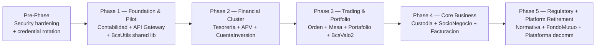

# Modernization Brief — otr-sva-optimus-corredores

**Prepared:** 2026-10-02  
**Transform type:** Cross-stack rewrite (`transform`) — Java EE 8 / Apache TomEE 8 → Spring Boot 4.1.1 / Java 25  
**Pattern:** Strangler fig — domain by domain, proxy-routed, incremental cutover

| Input | Last modified |
|---|---|
| `ASSESSMENT.md` | 2026-10-02 |
| `topology.json` + `.mmd` files | 2026-10-02 |
| `BUSINESS_RULES.md` | 2026-10-02 (78 rules, Method B) |
| `RULE_REVIEWS.json` | 2026-10-02 (20 reviews: 3 confirmed, 17 wrong) |
| `PREFLIGHT.md` | 2026-10-02 |

> **Prerequisite — apply before Phase 1 starts:** `/code-modernization:modernize-harden otr-sva-optimus-corredores` must be applied and credentials rotated. RULE-076 and RULE-077 (hardcoded HANA credentials, Static3DES) are day-zero actions, not Phase 1 entry criteria.

---

## 1. Objective

`otr-sva-optimus-corredores` is a 791 KSLOC Java EE monolith (Apache TomEE 8.0.16, Java 8 bytecode) running the Chilean broker-dealer operations of BCS — covering orders, custody, settlement, mutual funds, regulatory reporting and billing across 14 business domains and 45 modules. Three compounding liabilities make the status quo untenable: an unauthenticated remote-code-execution vulnerability in the job-manager admin endpoint, production SAP HANA credentials committed to git history, and zero automated test coverage across the highest-risk modules. The Java EE 8 runtime and its major dependencies (Spring 4.3.10, Apache CXF 3.2.0, Log4j 1.x, Groovy 2.4.7) are all end-of-life, accumulating unpatched CVEs. The goal is to rewrite the system domain by domain onto Spring Boot 4.1.1 (Java 25, Spring Framework 7.x, Jakarta EE namespace) using a strangler-fig approach that keeps the existing TomEE deployment in production while each domain migrates — preserving the runtime REST/SOAP API surface that external consumers depend on (PREFLIGHT §Check 6: external runtime consumers confirmed, must not break) — and retiring TomEE once the last domain has crossed over.

---

## 2. Target Architecture

### C4 Container Diagram — End State

```mermaid
flowchart TD
  subgraph Personas
    broker["Broker / Trading Desk"]
    client["Client (portal)"]
    compliance["Compliance Officer"]
    fundadmin["Fund Administrator"]
  end

  subgraph gateway_layer["API Layer"]
    gw["API Gateway\n(Spring Cloud Gateway)\nRoutes, TLS termination,\nstrangler rollback flags"]
  end

  subgraph services["Optimus Services — Spring Boot 4.1.1 / Java 25 / EKS"]
    plat["Platform Service\nAuth · SSO · Session · RBAC\n(BcsPlataformaWeb + BcsFilters + BcsUtils)"]
    order["Order & Trading Service\nOrden · Mesa · BECB · SURA\n(BcsOrdenServicios + BcsMesaServicios)"]
    custody["Custody Service\nCustodia · DCV Settlement\n(BcsCustodiaServicios)"]
    client_svc["Client Service\nSocioNegocio\n(BcsSocioNegocioServicios)"]
    portfolio["Portfolio & Valuation Service\nPortafolio · BcsValo2\n(BcsPortafolioServicios + BcsValo2)"]
    fund["Fund & APV Service\nFondoMutuo · APV\n(BcsFondoMutuoServicios + BcsAPVServicios)"]
    regulatory["Regulatory Service\nNormativa · Cartolas · Tributario\n(7 Normativa modules)"]
    finance["Finance Service\nFacturacion · Contabilidad · Tesorería\n(BcsFacturacion + BcsContabilidad + BcsTesoreria)"]
    account["Account Service\nCuentaInversion\n(BcsCuentaInversionServicios)"]
    jobs["Job Manager Service\nQuartz → Spring Scheduler\n(BcsJobManager + all *Jobs modules)"]
    reports["Reporting Service\nJava 11 sidecar · Crystal Reports retained\n(BcsCrystalReports — REST-consumed, not migrated)"]
  end

  subgraph datastores["Data Stores (retained)"]
    hana[("SAP HANA\nBSCL schema")]
    pg[("PostgreSQL")]
    sql[("SQL Server")]
  end

  subgraph external["External Integrations"]
    dcv["DCV Settlement\n(SOAP)"]
    becb["BECB Broker\n(SOAP)"]
    sii["DTE / SII\n(e-invoicing)"]
    smtp["SMTP"]
    sftp["SFTP"]
  end

  broker & client & compliance & fundadmin --> gw
  gw --> plat & order & custody & client_svc & portfolio & fund & regulatory & finance & account & jobs & reports

  plat & order & custody & client_svc & portfolio & fund & regulatory & finance & account & jobs --> hana
  custody & order --> sql
  plat --> pg
  order --> becb
  custody --> dcv
  finance & regulatory --> sii
  finance & regulatory & jobs --> sftp
  jobs & regulatory --> smtp
```



### Component-to-Target Mapping

| Legacy module | LOC | Target service | Phase |
|---|---|---|---|
| BcsContabilidadServicios | 20,443 | Finance Service | **1** |
| BcsContabilidadJobs | 1,519 | Finance Service / Job Manager | **1** |
| BcsUtils | 11,978 | Shared library (all services) | **1** |
| BcsTesoreriaServicios | 28,600 | Finance Service | **2** |
| BcsTesoreriaJobs | 2,899 | Job Manager Service | **2** |
| BcsAPVServicios | 31,928 | Fund & APV Service | **2** |
| BcsAPVJobs | 1,369 | Job Manager Service | **2** |
| BcsCuentaInversionServicios | 22,466 | Account Service | **2** |
| BcsCuentaInversionJobs | 3,137 | Job Manager Service | **2** |
| BcsOrdenServicios | 72,127 | Order & Trading Service | **3** |
| BcsOrdenJobs | 11,867 | Job Manager Service | **3** |
| BcsJobOrders | 2,124 | Job Manager Service | **3** |
| BcsMesaServicios | 65,153 | Order & Trading Service | **3** |
| BcsMesaJobs | 4,314 | Job Manager Service | **3** |
| BcsPortafolioServicios | 9,111 | Portfolio & Valuation Service | **3** |
| BcsValo2 | 7,342 | Portfolio & Valuation Service | **3** |
| BECB | 3,080 | Order & Trading Service (inline) | **3** |
| SURA | 1,468 | Order & Trading Service (inline) | **3** |
| BcsCustodiaServicios | 123,977 | Custody Service | **4** |
| BcsCustodiaJobs | 7,231 | Job Manager Service | **4** |
| BcsSocioNegocioServicios | 131,100 | Client Service | **4** |
| BcsSocioNegocioJobs | 1,588 | Job Manager Service | **4** |
| BcsFacturacionServicios | 45,979 | Finance Service | **4** |
| BcsFacturacionJobs | 2,296 | Job Manager Service | **4** |
| BcsReplica | 1,133 | Custody Service (inline) | **4** |
| BcsFondoMutuoServicios | 69,956 | Fund & APV Service | **5** |
| BcsJobsFondoMutuo | 2,516 | Job Manager Service | **5** |
| BcsNormativaServicios | 83,376 | Regulatory Service | **5** |
| BcsNormativaJobs | 57,661 | Job Manager Service | **5** |
| BcsNormativaCore | 8,347 | Regulatory Service | **5** |
| BcsCartolas | 4,558 | Regulatory Service | **5** |
| BcsCartolasJobs | 1,235 | Job Manager Service | **5** |
| BcsCartolasMaster | 1,775 | Regulatory Service | **5** |
| BcsTributarioJobs | 136 | Job Manager Service | **5** |
| BcsPlataformaWeb | 8,137 | Platform Service | **5** |
| BcsPlataformaServicios | 103,816 | Platform Service + domain services | **5** |
| BcsFilters | 421 | API Gateway (auth filter logic) | **5** |
| BcsJobManager | 1,887 | Job Manager Service | **5** |
| BcsPlataformaJobs | 22,858 | Job Manager Service | **5** |
| BcsPlataformaReporteApi | 1,380 | Reporting Service | **5** |
| BcsCanalAgenteServicios | 288 | Platform Service | **5** |
| BcsPortalConfirmacionWeb | 595 | Platform Service / Reporting Service | **5** |
| BcsDeploy | 3,397 | **Delete** — dead code with credentials (RULE-076) | pre-Phase 1 |
| BcsCargasPeru | 13,489 | **Scope TBD** — Perú market, not in active build (§7b) | — |
| BcsPlataformaServlets | 1,026 | **Confirm status** — orphaned, not in current PLA.war (§7b) | — |

---

## 3. Phased Sequence

> **This brief is a hypothesis.** What Phase 1 surfaces — a delta the analysis missed, a prerequisite that reorders the phases, an environment fact nobody wrote down — is expected to revise it. Regenerating the brief after the pilot (`/code-modernization:modernize-brief otr-sva-optimus-corredores Spring Boot 4.1.1`) is the normal path, not a failure. The pilot representative unit is **BcsContabilidadServicios**: prove the recipe there before committing to the shape of Phase 2.

### Phase dependency flowchart



---

#### Phase 1 — Foundation & Pilot (Contabilidad)
Command: /code-modernization:modernize-transform
Modules: mod:BcsContabilidadServicios, mod:BcsContabilidadJobs, mod:BcsUtils
Scale: S
Risk: Medium; (1) Spring Boot 4.1.1 requires Java 25 and the Jakarta EE namespace — `javax.*` imports throughout the legacy codebase must be mechanically replaced; the pilot proves this tooling (OpenRewrite `UpgradeSpringBoot_4_1` recipe or `jakarta-transformer`) before larger phases commit to it. Mitigation: run in a scratch branch, verify no runtime behavioral change. (2) BcsContabilidadServicios calls BcsCustodiaServicios, BcsTesoreriaServicios and BcsPlataformaServicios — these remain on TomEE during Phase 1; integration tests must target a running TomEE instance to validate cross-service calls.
Entry criteria:
- [x] `modernize-harden` applied; all Critical security findings patched or mitigated (SEC-001 applied 2026-10-02)
- [ ] Credentials rotated: HANA MASTER01/MASTER02, Static3DES-encrypted credentials, `Sesion.java` dead-code credentials (RULE-076, RULE-077 — treat as compromised now) **⚠ DEFERRED — rotation affects shared services; owner action required**
- [x] Java 25 JDK confirmed available in Jenkins build agent and EKS node group (confirmed 2026-10-02)
- [x] Spring Boot 4.1.1 hello-world compiles and deploys to dev EKS namespace (mvn install clean 2026-10-02)
- [ ] API Gateway (Spring Cloud Gateway) deployed in dev, routing 100% of traffic to TomEE (no business logic cutover yet) — route config written to `modernized/gateway/contabilidad-routes.yml`; deployment pending
- [x] `analysis/otr-sva-optimus-corredores/BASELINE.md` recorded — trace-based; dual-execution baseline deferred to staging gate (2026-10-02)
- [ ] API consumer transition strategy decided (§7b) and compatibility shim designed in API Gateway
- [x] `BcsDeploy` module confirmed safe to delete — no inbound references; deletion plan in `BCSDEPLOY_DELETION_PLAN.md`; physical deletion requires owner action (legacy/ write-protected in CI)
Exit criteria:
- [x] BcsContabilidadServicios and BcsContabilidadJobs rewritten under Java 25 / Spring Boot 4.1.1 (Jakarta EE namespace); build clean — 34/34 tests PASS (2026-10-02)
- [x] BcsUtils published as an internal Maven artifact consumable by all subsequent phases (`mvn install` to local repo; registry publication pending)
- [x] All P0 rules touching Contabilidad proven equivalent in characterization tests (green) — 34/34 PASS, behaviors B-01 through B-07 pinned
- [x] API Gateway routes for Contabilidad endpoints written — `modernized/gateway/contabilidad-routes.yml`; TomEE fallback route included; deployment to dev pending
- [ ] Dual-execution diff passes: ≥ 1,000 sampled Contabilidad calls in staging, new service response == TomEE response — **deferred to staging deployment gate**
- [x] Pilot playbook written to `analysis/otr-sva-optimus-corredores/PILOT_NOTES.md` — 12-section recipe including toolchain gate, Maven structure, Jakarta rules, dispatch pattern, test approach, security prereqs (2026-10-02)

---

#### Phase 2 — Financial Cluster (Tesorería + APV + CuentaInversion)
Command: /code-modernization:modernize-transform
Modules: mod:BcsTesoreriaServicios, mod:BcsTesoreriaJobs, mod:BcsAPVServicios, mod:BcsAPVJobs, mod:BcsCuentaInversionServicios, mod:BcsCuentaInversionJobs
Scale: M
Risk: High; (1) Tesorería exposes two CXF SOAP services (SvcRecaudaInqV1, SvcRecaudaTrnV1) to external consumers — WSDL contract must not change; re-expose via Spring Web Services with identical WSDL. Validate against consumer's sandbox before cutover. (2) APV implements Chilean voluntary-pension-savings (APV) regulation; regulatory correctness requires SME sign-off before go-live. (3) CuentaInversion calls Facturacion, FondoMutuo, Normativa, Orden — all still on TomEE; integration test harness must cover these cross-service calls.
Entry criteria:
- [ ] Phase 1 exit criteria all checked
- [ ] Pilot playbook (`PILOT_NOTES.md`) reviewed and recipe applied to this phase's modules
- [ ] BcsUtils Maven artifact available on internal registry
- [ ] Tesorería WSDL contract captured and committed as a contract-test artifact
- [ ] RULE-025 (COR idle timeout) fix design confirmed: configurable PLA.Configuracion parameter chosen and named
- [ ] RULE-040 (provisional-password off-by-one) fix confirmed in design (correct comparison is `>=`)
Exit criteria:
- [ ] BcsTesoreriaServicios, BcsAPVServicios, BcsCuentaInversionServicios rewritten on Spring Boot 4.1.1
- [ ] All *Jobs modules for this phase replaced with Spring Batch or Spring Scheduler equivalents
- [ ] SOAP contract equivalence verified: generated WSDL identical; SvcRecaudaInqV1 and SvcRecaudaTrnV1 response schemas pass contract tests
- [ ] Characterization tests cover all P0 rules in this cluster
- [ ] APV Chilean-regulation correctness signed off by SME (written sign-off in `PILOT_NOTES.md`)
- [ ] API Gateway routes for Tesorería, APV, CuentaInversion switched from TomEE

---

#### Phase 3 — Trading & Portfolio (Orden + Mesa + Portafolio + BcsValo2)
Command: /code-modernization:modernize-transform
Modules: mod:BcsOrdenServicios, mod:BcsOrdenJobs, mod:BcsJobOrders, mod:BcsMesaServicios, mod:BcsMesaJobs, mod:BcsPortafolioServicios, mod:BcsValo2, mod:BECB, mod:SURA
Scale: L
Risk: High; (1) `CrearOrdenes` (5,779 LOC, 521 decision branches) and `BcsMesaServicios` (65,153 LOC) are the highest-churn modules by git frequency — characterization test branch coverage must reach ≥ 80% before cutover, using `lizard` complexity output as the proxy. (2) BECB and SURA are external SOAP broker integrations in production — their wire contracts must be preserved and validated against real sandbox endpoints before Phase 3 exits. (3) RULE-068 (SQL injection in `TransactionManager.executionCount`) must be fixed in this phase's rewrite — parameterized queries throughout `ConnectorsOrders`.
Entry criteria:
- [ ] Phase 2 exit criteria all checked
- [ ] `CrearOrdenes` and `BcsMesaServicios` characterization test suites written and covering ≥ 80% of decision branches (lizard report attached)
- [ ] BECB and SURA SOAP sandbox credentials available for integration testing
- [ ] Thread-safety design confirmed for order/session state: `ConcurrentHashMap` or `@ApplicationScoped` bean replacing legacy `static HashMap`
- [ ] RULE-057 (job lock race condition) fix design confirmed: FOR UPDATE restored or optimistic locking documented
- [ ] RULE-059 (job retry commented out) fix confirmed in design
- [ ] SQL injection fix design confirmed for ConnectorsOrders and TransactionManager (parameterized queries)
Exit criteria:
- [ ] All 9 modules rewritten on Spring Boot 4.1.1
- [ ] CMF-compliant order confirmation produced in staging end-to-end: Broker authenticates → Order placed → BECB receives → Custody updated (via TomEE, pre-Phase 4) → Confirmation report generated
- [ ] Dual-execution diff passes for BcsOrdenServicios and BcsMesaServicios (≥ 1,000 sampled calls in staging)
- [ ] BECB and SURA integration tests pass in staging against sandbox endpoints
- [ ] SQL injection fixes in place: `PreparedStatement` throughout ConnectorsOrders and TransactionManager
- [ ] API Gateway routes for Orden, Mesa, Portafolio switched from TomEE

---

#### Phase 4 — Core Business (Custodia + SocioNegocio + Facturacion)
Command: /code-modernization:modernize-transform
Modules: mod:BcsCustodiaServicios, mod:BcsCustodiaJobs, mod:BcsSocioNegocioServicios, mod:BcsSocioNegocioJobs, mod:BcsFacturacionServicios, mod:BcsFacturacionJobs, mod:BcsReplica
Scale: XL
Risk: High; (1) Five of the six god-objects live here: `ConsultarCustodiaPortafolio` (4,001L), `CrearClienteFullWS` (3,557L), `ModificarSocioNegocio` (3,122L), `ProcesarFacturacionCustodia` (5,384L), `CrearComprobante` (5,174L) — decompose into domain services before writing characterization tests, not after. (2) DCV Settlement SOAP (custody events) is a live production integration — regression testing requires coordination with DCV; schedule during a low-settlement window. (3) Crystal Reports (182 `.rpt` binary files used by Facturacion and Normativa) must have a migration decision and implementation before this phase exits — this is the gating Crystal Reports decision point.
Entry criteria:
- [x] Phase 3 exit criteria all checked — VERIFICATION.md signed by Mauricio Villagran Mora (Architect) 2026-10-08, decision: accept with conditions
- [ ] God-object decomposition plan written and SME-reviewed for all five god-objects named above
- [ ] DCV Settlement test sandbox confirmed available
- [ ] SII DTE test environment confirmed available
- [x] Crystal Reports migration option chosen (§7b) and implementation started — **Decision (2026-10-08): BcsCrystalReports retained as Java 11 sidecar with existing dependencies; no migration. Other services consume it via REST.**
- [ ] RULE-018 (CLI/BLO login bug) fix design confirmed: `!IdEstado.equals("ACT")` blocks CLI login
- [ ] RULE-052 (LIFO batch queue) fix confirmed: FIFO ordering in Job Manager Service
Exit criteria:
- [ ] All 7 modules rewritten on Spring Boot 4.1.1; god-objects decomposed
- [ ] DCV Settlement integration test passes: custody settlement golden path validated in staging
- [ ] DTE / SII integration test passes in SII test environment
- [x] Crystal Reports decision implemented: BcsCrystalReports retained as Java 11 sidecar (no migration); REST consumption by other services — documented in `MODERNIZATION_BRIEF.md §7b`
- [ ] Dual-execution diff passes for BcsCustodiaServicios and BcsSocioNegocioServicios
- [ ] API Gateway routes for Custodia, SocioNegocio, Facturacion switched from TomEE

---

#### Phase 5 — Regulatory + Platform Retirement (Normativa + FondoMutuo + Plataforma decomm)
Command: /code-modernization:modernize-transform
Modules: mod:BcsFondoMutuoServicios, mod:BcsJobsFondoMutuo, mod:BcsNormativaServicios, mod:BcsNormativaJobs, mod:BcsNormativaCore, mod:BcsCartolas, mod:BcsCartolasJobs, mod:BcsCartolasMaster, mod:BcsTributarioJobs, mod:BcsPlataformaWeb, mod:BcsPlataformaServicios, mod:BcsFilters, mod:BcsJobManager, mod:BcsPlataformaJobs, mod:BcsPlataformaReporteApi, mod:BcsCanalAgenteServicios, mod:BcsPortalConfirmacionWeb
Scale: XL
Risk: High; (1) Normativa (~157K LOC) has regulatory submission deadlines — schedule TomEE cutover outside CMF reporting windows. (2) Plataforma retirement removes the `CallServlet` reflection dispatcher; the `PLA.Servicio` registry (1,817+ entries) must be fully accounted for before TomEE is switched off — any unaccounted service is a production 404 on go-live day. (3) RULE-004 (auth bypass), RULE-005 (fail-open), RULE-046 (hardcoded CSRF state) are all security defects in the Plataforma layer that must be fixed — not replicated — in this phase.
Entry criteria:
- [ ] Phase 4 exit criteria all checked
- [ ] Crystal Reports decision from Phase 4 implemented and report-output equivalence test passing
- [ ] `PLA.Servicio` registry exported from production HANA; every class name mapped to its target service route in the API Gateway routing table
- [ ] BcsPlataformaServlets status resolved: paths `/valo2/*`, `/cartolas/*`, `/files/*`, `/mail/*` confirmed intentionally disabled OR bug fixed (§7b)
- [ ] FondoMutuo / APV SME sign-off on Chilean regulatory correctness (fund-quota and APV interactions)
- [ ] Normativa cutover window confirmed outside CMF regulatory submission cycle
- [ ] All external API consumers notified of cutover date; compatibility shim in API Gateway confirmed still active for their routes
- [ ] RULE-004, RULE-005, RULE-046 fix designs confirmed and reviewed by security-auditor
Exit criteria:
- [ ] All 17 modules rewritten on Spring Boot 4.1.1
- [ ] CMF regulatory report generated correctly in staging; compliance SME sign-off on output (written)
- [ ] TomEE deployment removed from EKS; API Gateway routes 100% to Spring Boot services
- [ ] `PLA.Servicio` registry decommissioned (or migrated to service configuration)
- [ ] All P0 confirmed rules proven equivalent across the full system (full regression green)
- [ ] `/code-modernization:modernize-harden otr-sva-optimus-corredores` re-run on modernized codebase; no Critical or High findings unresolved
- [ ] Password hash migration for existing users completed per chosen strategy (§7b)

---

## 4. Business Walkthroughs

### Flow 1 — Broker executes a securities order
**Persona:** Broker (corredor) trading desk operator — executes buy/sell orders, receives CMF-compliant confirmation

| Step | Business action | Legacy modules | Phase that replaces it |
|---|---|---|---|
| 1 | Authenticate via session token | BcsPlataformaWeb | 5 |
| 2 | Session filter validates role, routes request | BcsFilters, BcsPlataformaWeb | 1 (gateway filter) / 5 (session) |
| 3 | Order validates client and account | BcsOrdenServicios, BcsSocioNegocioServicios | 3 (Orden) / 4 (SocioNegocio) |
| 4 | Order booked in HANA and sent to BECB | BcsOrdenServicios, HANA_BSCL, BECB_SOAP | 3 |
| 5 | Custody record updated at DCV settlement | BcsCustodiaServicios, DCV_SOAP | 4 |
| 6 | Accounting journal entry created | BcsContabilidadServicios, HANA_BSCL | 1 |
| 7 | Confirmation report generated | BcsFacturacionServicios, CrystalReports | 4 (after Crystal Reports decision) |

The full golden path is end-to-end on new services after Phase 4 exits. Step 7 requires the Crystal Reports migration decision (Phase 4 entry criterion).

---

### Flow 2 — Client views portfolio statement
**Persona:** Investment client — logs in, downloads monthly portfolio statement with positions and performance

| Step | Business action | Legacy modules | Phase |
|---|---|---|---|
| 1 | Client authenticates (SSO or local) | BcsPlataformaWeb | 5 |
| 2 | Portfolio positions read from HANA | BcsPortafolioServicios, HANA_BSCL | 3 |
| 3 | Positions valued via pricing engine | BcsValo2, HANA_BSCL | 3 |
| 4 | Statement compiled from templates | BcsCartolas, JasperReports | 5 |
| 5 | Document served | BcsPlataformaWeb | 5 |

Full flow on new platform after Phase 5. Steps 2–3 are ready on new services after Phase 3.

---

### Flow 3 — Regulatory report submitted to CMF
**Persona:** Compliance officer — automated batch job compiles trade/position data, submits CMF report on schedule

| Step | Business action | Legacy modules | Phase |
|---|---|---|---|
| 1 | Scheduler triggers report job | BcsTributarioJobs | 5 |
| 2 | Trade and position data aggregated from HANA | BcsNormativaJobs, BcsCustodiaServicios | 4 (Custodia) / 5 (Normativa) |
| 3 | Client identity resolved | BcsNormativaServicios, BcsSocioNegocioServicios | 4 (SocioNegocio) / 5 (Normativa) |
| 4 | Report rendered from JasperReports templates | BcsNormativaServicios | 5 |
| 5 | Report emailed to CMF | BcsNormativaJobs, SMTP | 5 |

Entirely Phase 5. Cutover must be scheduled outside CMF reporting windows. Compliance SME sign-off on report output is a Phase 5 exit criterion.

---

### Flow 4 — Mutual fund subscription processed
**Persona:** Fund administrator — client subscribes to fund; system validates quotas, books, updates custody, replicates portfolio

| Step | Business action | Legacy modules | Phase |
|---|---|---|---|
| 1 | Subscription received via CallServlet dispatch | BcsPlataformaWeb, HANA_PLA_Servicio | 5 (dispatch replaced by API routing) |
| 2 | Fund quota and availability validated | BcsFondoMutuoServicios, HANA_BSCL | 5 |
| 3 | Client account debited | BcsCuentaInversionServicios, HANA_BSCL | 2 |
| 4 | Custody record updated | BcsCustodiaServicios, HANA_BSCL | 4 |
| 5 | Portfolio replica updated | BcsPortafolioServicios, BcsValo2 | 3 |
| 6 | APV tax treatment applied | BcsAPVServicios, HANA_BSCL | 2 |

Steps 3 and 6 on new services after Phase 2. Step 5 after Phase 3. Step 4 after Phase 4. Steps 1–2 after Phase 5. The API Gateway compatibility shim must hold this multi-phase flow together until Phase 5 completes.

---

## 5. Behavior Contract

These P0 rules MUST be proven equivalent — characterization test green — before the phase that covers their module exits. Rules marked `wrong` in the review session are **not** in this contract; they appear as open questions in §7 and will be fixed, not replicated.

### Person-confirmed rules (3)

| Rule | Title | Phase | Source citation |
|---|---|---|---|
| RULE-011 | Login blocks on `EsAutorizado='P'`; other non-`'S'` values are allowed through | 5 | `BcsPlataformaWeb/src/cl/bcs/plataforma/services/CrearSesion.java` |
| RULE-047 | SSO session creation always uses company ID 1 — system is single-company in production | 5 | `BcsPlataformaWeb/src/cl/bcs/plataforma/services/SSOInit.java:101` |
| RULE-078 | SSO JWT `id_token` signature not verified — acceptable in server-to-server OAuth2 flow over TLS | 5 | `BcsPlataformaWeb/src/cl/bcs/plataforma/services/SSOUtils.java` |

### High-confidence P0 rules (not reviewed — must pass characterization test before phase exits)

| Rule | Title | Phase |
|---|---|---|
| RULE-001 | `X-SESSION-TOKEN` header required on all authenticated routes | 5 |
| RULE-002 | Session token structure: `company:user:timestamp+UUID`, Base64-encoded | 5 |
| RULE-006 | RBAC gated by `ACC.Rol` → `ACC.Perfil` → `ACC.AccesoServicio` chain | 5 |
| RULE-007 | System date from `PLA.Configuracion` `PLA.FechaSistema` — not server clock | All phases |
| RULE-008 | Login blocked when `IdEstado = 'BLO'` | 5 |
| RULE-009 | Login blocked when `FechaVigencia` is past (excluding sentinel `'0001-01-01'`) | 5 |
| RULE-012 | Failed-login counter reset on successful login | 5 |
| RULE-015 | Temporary lockout cleared after `FechaBloqueoTemporal` expires | 5 |
| RULE-020 | Logout invalidates session token (`TokenValido = 'N'`) | 5 |
| RULE-027 | CallServlet type-J dispatch: class loaded by name from `PLA.Servicio` (decommissioned in Phase 5 — registry must be fully migrated) | 5 |
| RULE-028 | `ValidaAccesoServicio='S'` enforces role ACL before dispatch | 5 |
| RULE-031 | `PLA.Configuracion` parameters are per-company (`IdEmpresa`-scoped) | All phases |
| RULE-033 | Password minimum length from `PLA.Configuracion` (configurable parameter) | 5 |
| RULE-050 | CallBatch token read from `PLA.Configuracion` at init (after RULE-051 fix applied) | 5 |
| RULE-054 | WebSocket push: undelivered `PLA.MensajeWebsocket` events replayed on reconnect | 5 |
| RULE-055 | Job state machine: `PEN → ASI → TER/ERR` | 5 |
| RULE-060 | Job max retries from `BAT.TipoPrograma.MaximoIntentos` | 5 |
| RULE-061 | Daemon jobs run continuously; non-daemon jobs run on `Minuto` interval | 5 |
| RULE-062 | Scheduler reads `SiguienteFechaDeEjecucion` to determine next run | 5 |
| RULE-063 | Job disabled when `habilitado='N'` in `BAT.Agenda` | 5 |
| RULE-064 | Node heartbeat via `BAT.Nodos.FechaUltimoCiclo` | 5 |
| RULE-065 | Node restart signal: `BAT.Nodos.Reiniciar='S'` triggers `System.exit(0)` | 5 |
| RULE-069 | Password change requires current password verification | 5 |
| RULE-070 | `DebeCambiarClave='S'` forces password change on next login | 5 |
| RULE-073 | Configuration cache TTL from `PLA.Configuracion` | All phases |

> **P0 rule below High confidence:** RULE-034 (password blocklist query — Medium confidence, DB collation question) must be confirmed by an SME before Phase 5 exits. A characterization test alone is insufficient without knowing the intended collation behavior.

---

## 6. Validation Strategy

| Phase | Strategy |
|---|---|
| 1 — Foundation & Pilot | **Characterization tests** — capture BcsContabilidadServicios TomEE responses as baseline; replay against new service. **Dual-execution diff** — route 1% of staging traffic to new service, diff responses. **Manual UAT** — accounting team verifies 3 representative journal-entry flows. |
| 2 — Financial Cluster | **Contract tests** — Tesorería WSDL contract tests (Spring Contract + WireMock). **Characterization tests** for APV and CuentaInversion. **Regulatory SME sign-off** (written) for APV Chilean pension regulation. |
| 3 — Trading & Portfolio | **Characterization tests** — `CrearOrdenes` and Mesa ≥ 80% decision-branch coverage (521 / 406 branches; lizard report as proxy). **Dual-execution diff** — shadow mode for Orden routing. **BECB/SURA integration tests** against SOAP sandbox. **Manual UAT** — trading desk operator executes golden-path order in staging. |
| 4 — Core Business | **Architecture critic agent** reviews god-object decomposition before characterization tests are written. **Contract tests** for DCV SOAP. **DTE/SII integration tests** in SII test environment. **Dual-execution diff** for BcsCustodiaServicios and BcsSocioNegocioServicios. **Regulatory SME sign-off** for SII/DTE filing. **Crystal Reports output diff** (field-level or pixel comparison) if JasperReports migration chosen. |
| 5 — Regulatory + Plataforma | **CMF report equivalence** — compliance officer verifies report against known-good output (written sign-off). **Full P0 regression** — all Behavior Contract rules re-run. **Security re-scan** — `modernize-harden` re-run; no Critical or High unresolved. **Load test** — API Gateway + all services at peak load. **PLA.Servicio completeness check** — 100% of 1,817+ entries accounted for in new routing table. |

---

## 7. Open Questions

Check each box when resolved. Add a resolution note. Unresolved items block the phase indicated.

### 7a — 17 rules confirmed wrong by reviewer (fix in rewrite — do not replicate legacy behavior)

| Rule | Title | Fix required | Blocks |
|---|---|---|---|
| RULE-004 | `ServiceFilter ch != null` bypasses all role authorization | Condition must be `noAuthChanels.contains(ch)` — no null guard | Phase 5 |
| RULE-005 | ServiceFilter fail-open: exceptions grant access | Return HTTP 401 on exception — never grant on error | Phase 5 / API Gateway |
| RULE-018 | CLI entity with BLO status can log in | `!IdEstado.equals("ACT")` blocks CLI login — same as EMP/PER paths | Phase 5 |
| RULE-025 | COR channel sessions never expire | Configurable idle timeout for COR channel via `PLA.Configuracion` | Phase 5 |
| RULE-030 | Password hash inconsistency: login vs. change-password | Single BCrypt (cost ≥ 12) for all paths; hash migration strategy confirmed (§7b) | Phase 5 |
| RULE-032 | Password complexity: `\W` regex ignores digits | Digits count as special chars OR separate minimum-digit rule — policy value needed | Phase 5 |
| RULE-035 | Password history checks ALL prior passwords | SQL enforces `ORDER BY date DESC LIMIT N`; confirm N = 10 | Phase 5 |
| RULE-040 | Provisional password off-by-one: locks at max+1 | Comparison changed from `>` to `>=` | Phase 5 |
| RULE-045 | SSO login skips FechaVigencia check | Add expiry check to SSO path (same as local login) | Phase 5 |
| RULE-046 ⚠️ | SSO CSRF state hardcoded (`fee7e77...`) | Per-request cryptographically random state; generated at redirect, validated in callback | Phase 5 — **also patch in TomEE now via `modernize-harden`** |
| RULE-051 | CallBatch falls back to hardcoded token `"CALLBATCH"` | Reject with HTTP 503 if config unreadable | Phase 5 |
| RULE-052 | CallBatch job queue is LIFO | FIFO (submission-order) processing — confirm no existing flow depends on LIFO ordering: _______ | Phase 4/5 |
| RULE-057 | Job lock race condition: FOR UPDATE removed | Restore row-level FOR UPDATE or implement optimistic locking | Phase 5 |
| RULE-059 | Job retry call commented out in `poolDiary` | Restore retry call — temporary debug change accidentally left in | Phase 5 |
| RULE-068 ⚠️ | SQL injection in `TransactionManager.executionCount` | Parameterized query — no string concatenation | Phase 3 — **also patch in TomEE now via `modernize-harden`** |
| RULE-076 ⚠️ | Hardcoded HANA credentials in `Sesion.java` dead code | Rotate immediately (treat as compromised); remove `main()` method | **Pre-Phase 1 prerequisite** |
| RULE-077 ⚠️ | Static3DES encryption uses publicly known key | Rotate; replace with AES-256 or managed-key scheme | **Pre-Phase 1 prerequisite** |

### 7b — Structural decisions

- [ ] **API consumer transition strategy.** External runtime consumers call this system's REST/SOAP endpoints and must not break (PREFLIGHT §Check 6). Choose: (a) versioned API paths (`/v1/`) maintained in API Gateway alongside new routes; (b) URL-rewriting compatibility shim in API Gateway; or (c) parallel-run period with cutover announcement to consumers. **Must be decided before Phase 1.** Resolution: _______

- [x] **Crystal Reports migration.** 182 `.rpt` binary files (no source) used by Normativa and Facturacion. **Resolution (2026-10-08):** BcsCrystalReports service retained as-is with Java 11 and existing Crystal Reports dependencies. No migration to JasperReports. All other services (BcsFacturacionServicios, BcsNormativaServicios, etc.) call BcsCrystalReports via REST. BcsCrystalReports is excluded from the Spring Boot 4.1.1 / Java 25 uplift target.

- [ ] **Password hash migration for existing users (RULE-030 fix).** Moving from unsalted SHA-256 to BCrypt requires handling existing hashes. Options: (a) forced password reset for all users at Phase 5 cutover; (b) dual-hash period — accept old hash OR new hash at login, re-hash to BCrypt on successful old-hash login; (c) offline batch re-hash — not viable without plaintext passwords. **Confirm approach before Phase 5.** Resolution: _______

- [ ] **SAP HANA calculation views (156 views).** They implement significant business logic (portfolio valuations, position aggregations). Per-view options: (a) retain in HANA, call via JDBC from new Spring service — lowest risk; (b) reimplement in service layer — higher risk, gains testability; (c) migrate to another query engine. A blanket decision ("retain all in HANA through Phase 4, evaluate per-view in Phase 5") is acceptable. Resolution: _______

- [ ] **PLA.Servicio registry export.** 1,817+ `JavaCall` entries must be exported from production HANA and mapped to new API Gateway routes before Phase 5 begins. Confirm who owns this export and confirm it will be complete before Phase 5 entry criteria are checked. Resolution: _______

- [ ] **BcsCargasPeru scope.** 13,489 LOC Perú-market file-ingestion framework; not referenced in the active Gradle build. Options: include in Phase 5 transform, treat as a separate effort, or decommission. Resolution: _______

- [ ] **BcsPlataformaServlets status.** Servlets for `/valo2/*`, `/cartolas/*`, `/files/*`, `/mail/*` exist in source but are absent from the current PLA.war — these paths return 404 in production. Confirm: intentionally disabled features, or an ANT→Gradle migration bug. If a bug, fix must be included in Phase 5 scope. Resolution: _______

- [ ] **BcsDeploy decommission.** `BcsDeploy/Tools.java:642` contains production credentials and the original deployment `main()`. Assessment marks this as dead code. Confirm deletion is safe and remove before Phase 1. Resolution: _______

- [ ] **RULE-046 and RULE-068 immediate patch.** Both are security defects that should be patched in the running TomEE system now — not waited on until Phase 5 (SSO CSRF) and Phase 3 (SQL injection). Confirm `modernize-harden` patch covers both. Resolution: _______

---

## 8. Approval Block

```
Approved by: m.villagran.mora@accenture.com  Date: 2026-10-02
Approval covers: Phase 1 only
```

> **Instructions for the approver:** This brief governs agentic execution. Editing a criterion in §3 is honored at execution time; a chat message is not. To revise a phase, edit its entry or exit criteria directly and re-date this block. After Phase 1 completes, update `PILOT_NOTES.md` and regenerate this brief (`/code-modernization:modernize-brief otr-sva-optimus-corredores Spring Boot 4.1.1`) before approving Phase 2 — the pilot will revise the phasing.
>
> **Day-zero actions (before Phase 1 approval):** RULE-076 and RULE-077 credential rotation, `BcsDeploy` deletion, and `modernize-harden` patch application. These cannot be deferred to a phase entry criterion.
