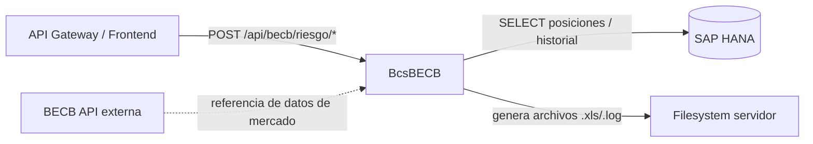

# BcsBECB — Conector BECB (Bolsa Electrónica de Chile)

## Descripción

Conector con la **Bolsa Electrónica de Chile (BECB)**. Genera informes de riesgo financiero (`RIFI`, `DIFI`, `ALL`) consultando posiciones en HANA y produciendo archivos `.xls` y `.log`. Aplica agrupación run-length sobre filas de riesgo por Rango e InstrumentoEmisor, determina si se usan tablas de datos actuales (`CUS`) o históricas (`HIS`) según la fecha del informe, y expone lógica pura de clasificación para consumo desde el gateway.

## Tecnología

- **Framework:** Spring Boot 4.1.1 / Java 25
- **Puerto:** 8091
- **Artifact:** `cl.bcs:becb-service`
- **Persistencia:** SAP HANA (`com.sap.db.jdbc.Driver`)

## Requisitos

| Variable | Descripción |
|---|---|
| `HANA_URL` | URL JDBC de la base de datos HANA |
| `HANA_USER` | Usuario de HANA |
| `HANA_PASSWORD` | Contraseña de HANA |

## Endpoints

| Método | Ruta | Descripción |
|---|---|---|
| `GET` | `/api/becb/riesgo/tabla` | Determina si se usa tabla `CUS` (hoy) o `HIS` (histórica) según `fechaSistema` y `fechaInforme` |
| `GET` | `/api/becb/riesgo/tipo-informe/{codigo}` | Resuelve código de informe (`RIFI`, `DIFI`, `ALL`) a `TipoInforme` |
| `POST` | `/api/becb/riesgo/agrupar-rifi` | Agrupa filas de riesgo financiero por Rango + InstrumentoEmisor (run-length, case-insensitive) |
| `POST` | `/api/becb/riesgo/generar` | Generación completa del informe (requiere HANA + filesystem — diferido a Fase 4, retorna 503) |

## Dependencias de runtime

| Dependencia | Tipo | Descripción |
|---|---|---|
| SAP HANA | Base de datos | Consulta posiciones y datos históricos de riesgo financiero |
| Filesystem del servidor | Almacenamiento | Escritura de archivos `.xls` y `.log` (diferido a Fase 4) |

## Diagrama

## Notas de implementación

- **Tabla CUS vs HIS:** `fechaSistema == fechaInforme` → tabla `CUS`; cualquier otra fecha → tabla `HIS` (B-BECB-01).
- **Agrupación run-length (`agruparFilasRifi`):** mismo `Rango` + `InstrumentoEmisor` (case-insensitive) acumula `ValorPresente` y toma `max(Duracion)`; el **primer grupo siempre tiene `Volatilidad=ZERO` y `Var=ZERO`** — comportamiento legacy preservado deliberadamente (B-BECB-03).
- **Nombre de archivo:** `Informe_<codigo>_<tabla>_<timestamp>.xls` (B-BECB-05).
- **Generación completa diferida:** `GenerarInformeVencimientosGenerales.java` (1 625 LOC, PDFBox + ZIP + XLS múltiple) no migrado — Fase 4.
- **Jobs de scheduling:** `BcsJobGenerarInformesRiesgoFinanciero` y `BcsJobGenerarInformeVencimientosGenerales` pendientes de migración como `@Scheduled` en módulo `BcsBECBJobs`.
- **Endpoints HANA-deferred:** retornan HTTP 503 via `GlobalExceptionHandler` cuando el adaptador lanza `UnsupportedOperationException`.
