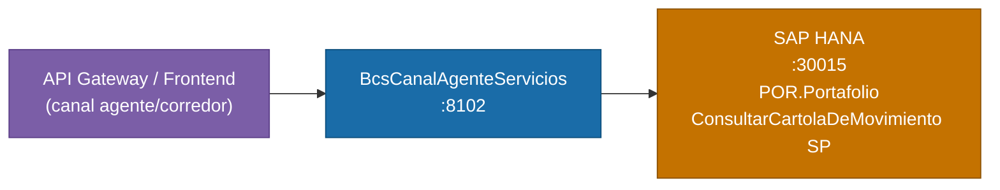

# BcsCanalAgenteServicios

## Descripción

Microservicio del canal de agente/corredor de bolsa. Consulta el historial de movimientos de cuentas de inversion para un portafolio dado, enriqueciendo el resultado con datos de comprobantes (folio, codigo de portafolio, respuesta DTE, PDF DTE, documento de identidad) mediante un patron HANA de tabla temporal INSERT/SELECT/DELETE. Es consumido directamente por el API Gateway o el frontend del canal agente.

## Tecnología

- **Framework:** Spring Boot 4.1.1 / Java 25
- **Puerto:** 8102
- **Artifact:** `cl.bcs.canalagente:bcs-canal-agente-servicios`
- **Arquitectura:** Hexagonal (domain / port/in / port/out / service / adapter/in / adapter/out)

## Requisitos

| Variable de entorno | Descripcion | Obligatoria |
|---|---|---|
| `HANA_URL` | URL JDBC de SAP HANA | Si |
| `HANA_USER` | Usuario de HANA | Si |
| `HANA_PASSWORD` | Contrasena de HANA | Si |

## Endpoints

| Metodo | Ruta | Descripcion |
|---|---|---|
| `POST` | `/canal-agente/historial-movimientos` | Consulta el historial de movimientos de cuenta de inversion para un portafolio |
| `GET` | `/canal-agente/health` | Health check del servicio |

### Parametros del request `POST /canal-agente/historial-movimientos` (body JSON)

| Campo | Tipo | Descripcion | Requerido |
|---|---|---|---|
| `idPortafolio` | Long | Identificador del portafolio | Si |
| `idMatrizAgrupador` | String | Matriz de agrupacion (opcional) | No |
| `esADC` | String | Indicador ADC (opcional) | No |

### Logica de negocio del endpoint

1. Se busca `IdCliente` en `POR.Portafolio` a partir de `idPortafolio`. Si no se encuentra, retorna `"Cliente no encontrado."`.
2. Se delega a `ConsultarCartolaDeMovimiento` (dominio de BcsCuentaInversionServicios) con `p_UsaReglasNegocio = "S"` y `p_SaldoPorFechaEfectiva = "N"`.
3. Los movimientos se enriquecen con datos de comprobante. Si un `IdCargoAbonoMovimiento` no tiene comprobante, los campos de comprobante son `null` (no es error).

## Dependencias de runtime

| Servicio | Puerto | Rol |
|---|---|---|
| SAP HANA | 30015 | Consultas de portafolio, historial de movimientos (SP chain) y tabla temporal de comprobantes |

## Diagrama



## Notas de implementacion

### Reglas de negocio

| ID | Descripcion |
|---|---|
| **B-CA-01** | Dado `idPortafolio`, buscar `IdCliente` en `BSCL.Portafolio.BD::POR.Portafolio`. Si no se encuentra, retornar error `"Cliente no encontrado."`. |
| **B-CA-02** | Delegar a `ConsultarCartolaDeMovimiento` con `p_UsaReglasNegocio = "S"` y `p_SaldoPorFechaEfectiva = "N"`. |
| **B-CA-03** | Enriquecer resultados con `FolioComprobante`, `CodigoPortafolio`, `IdRespuestaDTE`, `RespuestaPdfDTE` y `DocumentoIdentidad` via patron de tabla temporal HANA (INSERT/SELECT/DELETE sobre 5 tablas). |
| **B-CA-04** | Si un `IdCargoAbonoMovimiento` no tiene comprobante, todos los campos de comprobante son `null` (no es un error). |
| **B-CA-05** | `idMatrizAgrupador` y `esADC` son opcionales (`null` por defecto); se propagan a `ConsultarCartolaDeMovimiento`. |

### Split H2 vs HANA

| Operacion | Testeable con H2 | Razon |
|---|---|---|
| `findIdClienteByPortafolio` | Si | `SELECT` simple sobre tabla `PORTAFOLIO_T` |
| `consultarHistorialCompleto` | No (`@Disabled`) | Cadena de SPs HANA + patron de tabla temporal con 5 tablas HANA |

### Arquitectura hexagonal

```
adapter/in/CanalAgenteController     <- POST /canal-agente/historial-movimientos
service/CanalAgenteService           <- logica; helper estatico buildClienteNoEncontradoResponse()
port/in/ConsultarHistorialMovimientosUseCase
port/out/CanalAgenteDataPort         <- findIdClienteByPortafolio + consultarHistorialCompleto
adapter/out/CanalAgenteRepositoryAdapter <- NamedParameterJdbcTemplate (H2-compatible para lookup)
```

### Manejo de errores

| Excepcion | HTTP |
|---|---|
| `NullPointerException` | 400 |
| `IllegalArgumentException` | 400 |
| `NumberFormatException` | 400 |
| `UnsupportedOperationException` | 503 |

### Tests

16 tests — 8 unitarios (`CanalAgenteServiceTest`, sin Spring), 8 de integracion H2-backed (6 activos + 2 deshabilitados que requieren HANA). BUILD SUCCESS.
