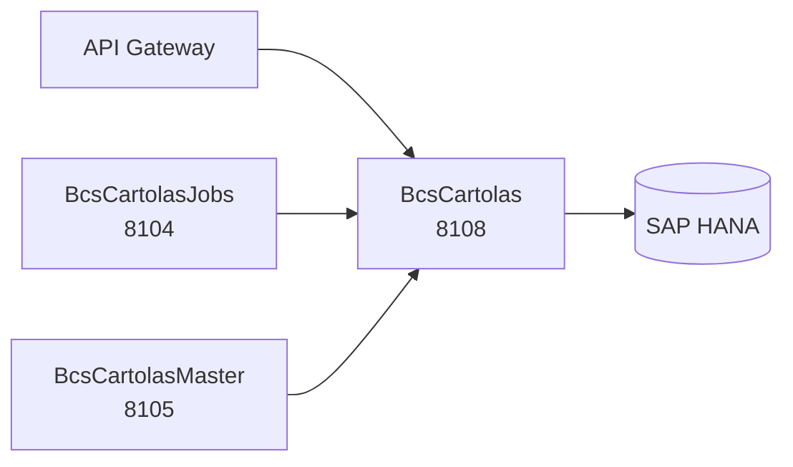

# BcsCartolas

## Descripción

Servicio de datos para cartolas de inversión. Expone las operaciones de consulta y resolución de nombres de archivo del dominio de cartolas: nóminas, parámetros, datos CSV y patrones de nombre. Es el repositorio central que BcsCartolasMaster y BcsCartolasJobs consumen para leer el estado del portafolio de cada cliente y para poblar nóminas de generación masiva.

Las operaciones que requieren SAP HANA (SPs de grabado y carga de datos) responden **503** via `GlobalExceptionHandler` hasta que se conecte HANA en Phase 3.

## Tecnología

- **Framework:** Spring Boot 4.1.1 / Java 25
- **Puerto:** 8108
- **Artifact:** `cl.bcs:bcs-cartolas`
- **Arquitectura:** Hexagonal (adapter/in → port/in → service → port/out → adapter/out)
- **Base de datos:** SAP HANA (driver `com.sap.db.jdbc.Driver`, `NamedParameterJdbcTemplate`)
- **Reportes:** Metadata de plantillas JasperReports almacenada en HANA (`CAR.Recurso`); rendering delegado a BcsCartolasMaster

## Requisitos

| Variable de entorno | Descripción |
|---|---|
| `HANA_URL` | JDBC URL de SAP HANA (ej. `jdbc:sap://host:30015`) |
| `HANA_USER` | Usuario de SAP HANA |
| `HANA_PASSWORD` | Contraseña de SAP HANA |

## Endpoints

| Método | Ruta | Descripción |
|---|---|---|
| `GET` | `/cartolas/nominas/{idNomina}` | Retorna la nómina con el id dado |
| `GET` | `/cartolas/nominas/programadas` | Retorna nóminas de tipo PROGRAMADO |
| `GET` | `/cartolas/nominas/{idNomina}/parametros` | Parámetros de una nómina |
| `GET` | `/cartolas/{idCartola}` | Retorna la cartola con el id dado |
| `GET` | `/cartolas?idNomina={}&soloReproceso=false` | Cartolas de una nómina (opcionalmente solo las de reproceso) |
| `GET` | `/cartolas/config?idEmpresa={}` | Configuración de una empresa |
| `GET` | `/cartolas/{idCartola}/datos` | Datos CSV almacenados para una cartola |
| `GET` | `/cartolas/nombre-archivo/cartola?patron={}&<contexto>` | Resuelve el nombre de archivo de una cartola (lógica pura) |
| `GET` | `/cartolas/nombre-archivo/nomina?patron={}&<contexto>` | Resuelve el nombre de archivo de una nómina (lógica pura) |
| `GET` | `/cartolas/nombre-archivo/zip?patron={}&<contexto>` | Resuelve el nombre de archivo ZIP (lógica pura) |
| `POST` | `/cartolas/nominas/{idNomina}/poblar` | Ejecuta SP HANA `CAR.PoblarNomina` — **responde 503 sin HANA** |
| `POST` | `/cartolas/carga-datos?idNomina={}` | Proceso de carga de datos — **responde 503 sin HANA** |

## Dependencias de runtime

| Servicio | Rol |
|---|---|
| SAP HANA | Fuente de datos principal: tablas `car_cartola`, `car_nomina`, `car_config`, etc. |

## Diagrama

## Notas de implementación

- **Lógica pura promovida a `static`:** `CartolasService.resolverNombre()`, `CartolasService.extractKeys()`, `NominaService.getPeriodoCartolas()`, `NominaService.condicionesEjecucionCumplidas()`. Testeable sin Spring context.
- **Naming convention:** Las tablas HANA usan nombres con namespace (`"BSCL.Normativa.BD::CAR.Cartola"`); el perfil de test mapea a H2 con nombres planos (`car_cartola`, `car_nomina`).
- **HANA-only → 503:** Todos los SPs (`CAR.GrabarCartola`, `CAR.GrabarNomina`, `CAR.PoblarNomina`, `CAR.ActualizarReproceso`) lanzan `UnsupportedOperationException` mapeada a 503.
- **JasperReports:** El módulo solo persiste metadata de plantillas. El rendering PDF/Excel lo orquesta BcsCartolasMaster (puerto 8105).
- **Tests:** 62 tests de integración (H2) cubriendo B-CAR-01 a B-CAR-07; 2 tests marcados `@Disabled("requires HANA")`.
