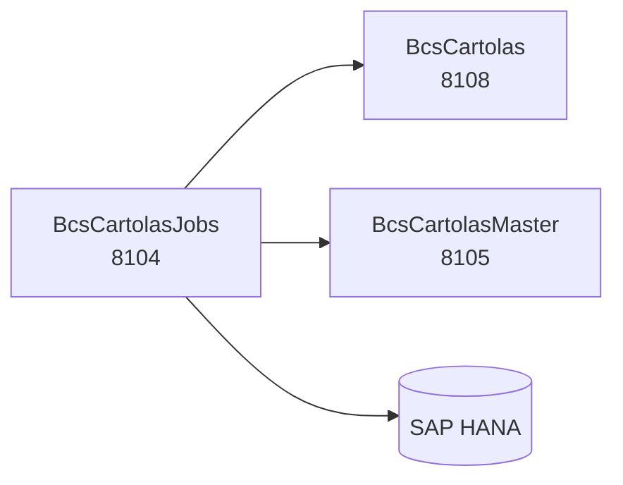

# BcsCartolasJobs

## Descripción

Servicio de jobs programados para la generación de cartolas de inversión. Orquesta el proceso completo de emisión de cartolas según el tipo de proceso solicitado: `PROGRAMADO`, `NORMAL`, `RECURRENTE`, `REPROCESO` y `REEMPAQUETA`. Cada tipo activa un conjunto distinto de pasos (guardar parámetros, poblar nómina, cargar datos, emitir).

Es la modernización de los componentes legados `BcsJobCartolas` y `BcsScheduledJobCartolas` del scheduler TomEE.

## Tecnología

- **Framework:** Spring Boot 4.1.1 / Java 25
- **Puerto:** 8104 (configurable con `SERVER_PORT`)
- **Artifact:** `cl.bcs:bcs-cartolas-jobs`
- **Arquitectura:** Hexagonal (adapter/in → service → port/out → adapter/out)
- **Base de datos:** SAP HANA (`NamedParameterJdbcTemplate`)
- **Scheduling:** `@Scheduled(fixedDelay=30000)` para el proceso programado (reemplaza `Thread.sleep(30000)` del legado)

## Requisitos

| Variable de entorno | Descripción | Valor por defecto |
|---|---|---|
| `HANA_URL` | JDBC URL de SAP HANA | `jdbc:sap://localhost:30015` |
| `HANA_USER` | Usuario de SAP HANA | — |
| `HANA_PASSWORD` | Contraseña de SAP HANA | — |
| `SERVER_PORT` | Puerto HTTP | `8104` |
| `CARTOLAS_SCHEMA` | Esquema HANA de cartolas | `BSCL` |

## Endpoints

| Método | Ruta | Descripción |
|---|---|---|
| `POST` | `/api/jobs/cartolas/ejecutar` | Ejecuta el proceso principal de cartolas (B-CAR-01). Body: `{ "jobId": long, "idEmpresa": long, "tipoProceso": string }` |
| `POST` | `/api/jobs/cartolas/programado/ejecutar` | Ejecuta el proceso programado de cartolas (B-CAR-07). Body: `{ "idEmpresa": long }` |
| `GET` | `/api/jobs/cartolas/flujo/{tipoProceso}` | Describe los pasos activos para un tipo de proceso (lógica pura, sin HANA) |

### Tipos de proceso y pasos

| TipoProceso | Pasos activos | Descripción |
|---|---|---|
| `PROGRAMADO` | 1 | Solo guarda parámetros |
| `NORMAL` | 4 | Parámetros + poblar nómina + carga de datos + emisión |
| `RECURRENTE` | 4 | Igual que NORMAL |
| `REPROCESO` | 2 | Carga de datos + emisión (sin repoblar nómina) |
| `REEMPAQUETA` | 1 | Solo emisión (sin recargar datos) |

## Dependencias de runtime

| Servicio | Puerto | Rol |
|---|---|---|
| BcsCartolas | 8108 | Consulta y escritura de nóminas y cartolas |
| BcsCartolasMaster | 8105 | Orquestación de generación masiva de PDFs |
| SAP HANA | — | Stored procedures de nóminas, parámetros, carga y emisión |

## Diagrama

## Notas de implementación

- **Regla B-CAR-02:** Si la nómina ya está certificada, el proceso lanza `IllegalStateException`.
- **Ciclo de vida de nómina:** `nomina.abrir()` antes del proceso, `nomina.cerrar()` en éxito, `nomina.cerrarConError()` en excepción.
- **Lógica pura:** `CartolasJobService.describirFlujo()` y `CartolasJobService.contarPasosActivos()` son `public static` — testeable directamente sin Spring context.
- **Adaptadores HANA:** Los 5 adaptadores (`HanaNominaAdapter`, `HanaParametroAdapter`, `HanaCargaDatosAdapter`, `HanaEmisionAdapter`, `HanaProgramacionAdapter`) lanzan `UnsupportedOperationException` (503) hasta Phase 3. Los SPs a conectar tienen prefijo `BSCL.Normativa.BD.Servicios::CAR.*`.
- **Tests:** 35 tests ejecutados, 3 `@Disabled("requires HANA")`; BUILD SUCCESS.
