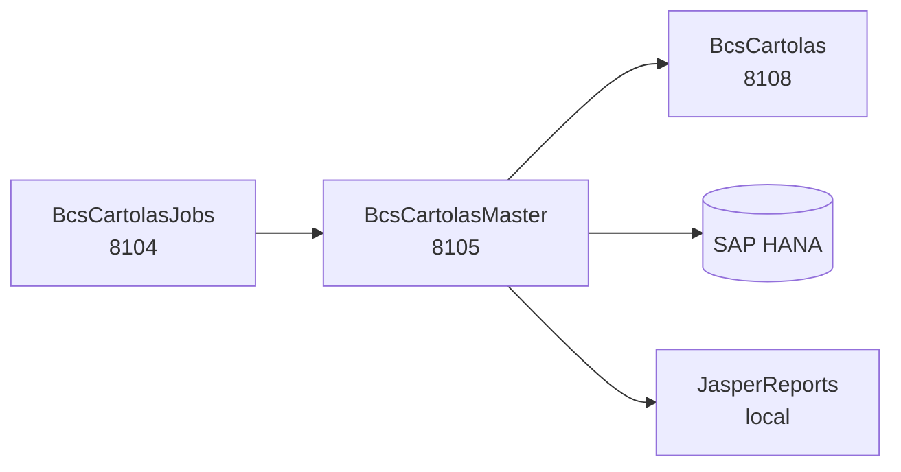

# BcsCartolasMaster

## Descripción

Servicio orquestador de la generación masiva de cartolas de inversión en formato PDF. Genera **Cartolas Master** — estados de cuenta multi-página para clientes de la corredora — usando JasperReports (hasta 4 páginas: portada con resumen consolidado, detalle de portafolio, próximos eventos y grillas de cartera por tipo de instrumento) y gráficos embebidos JFreeChart (torta de composición del activo y serie temporal de patrimonio).

Soporta dos modos de generación:
- **Online** (`generarOnline`): para visualización inmediata de un cliente/portafolio.
- **Batch** (`generarPorIdCartola`): dentro de un thread pool paralelo sobre una nómina completa; archivado en ZIP.

## Tecnología

- **Framework:** Spring Boot 4.1.1 / Java 25
- **Puerto:** 8105
- **Artifact:** `cl.bcs.cartolas.master:bcs-cartolas-master`
- **Arquitectura:** Hexagonal (adapter/in → port/in → service → port/out → adapter/out)
- **Base de datos:** SAP HANA (`NamedParameterJdbcTemplate`)
- **Reportes:** JasperReports 6.x — templates `.jrxml` almacenados en HANA (`CAR.Plantilla`, `CAR.Recurso`)
- **Gráficos:** JFreeChart — pie 217×152 px, line series 780×570 px

## Requisitos

| Variable de entorno | Descripción |
|---|---|
| `HANA_URL` | JDBC URL de SAP HANA (ej. `jdbc:sap://host:30015`) |
| `HANA_USER` | Usuario de SAP HANA |
| `HANA_PASSWORD` | Contraseña de SAP HANA |

## Endpoints

| Método | Ruta | Descripción |
|---|---|---|
| `GET` | `/cartolas-master/configuracion/{idEmpresa}` | Retorna la configuración de cartolas de una empresa |
| `GET` | `/cartolas-master/parametros/{idNomina}` | Retorna los parámetros de una nómina de cartolas |
| `POST` | `/cartolas-master/generar-online?idCliente={}&idPortafolio={}&fechaDesde={}&fechaHasta={}` | Genera una cartola online para un cliente/portafolio — **requiere HANA**, responde 503 sin él |
| `POST` | `/cartolas-master/generar/{idCartola}` | Genera una cartola por su id HANA en proceso batch — **requiere HANA**, responde 503 sin él |

## Dependencias de runtime

| Servicio / Sistema | Rol |
|---|---|
| BcsCartolas (8108) | Lectura de datos de cartola y nómina |
| SAP HANA | Templates JasperReports (`CAR.Plantilla`, `CAR.Recurso`), SPs de escritura |
| JasperReports (local) | Rendering de PDFs multi-página (en proceso) |

## Diagrama

## Notas de implementación

- **ReporteMaster enum:** 31 constantes que preservan toda la configuración de reportes del legado (`nombreArchivo`, `nombreDataSource`, `tipoSubReport`, `reportePadre`, etc.) más el método `tieneParametroInclusion()`.
- **GraficadorPastelService / GraficadorSerieService:** Lógica de gráficos como métodos `public static` — testeable sin Spring context. El pie chart excluye valores cero automáticamente.
- **PaletaColores:** Mapa estático con 7 colores por clase de activo; retorna `null` para claves desconocidas.
- **HANA-only → 503:** `generarOnline` y `generarPorIdCartola` lanzan `UnsupportedOperationException` en producción sin HANA; `GlobalExceptionHandler` los mapea a 503.
- **Credenciales eliminadas:** El `main()` del legado `GeneradorMaster` contenía credenciales hardcodeadas (`RULLOA` / `B0lsa123456`); fueron eliminadas en la modernización. Solo existe el `main()` de `BcsCartolasMasterApplication`.
- **Naming H2:** Las tablas HANA con namespace (`"BSCL.Normativa.BD::CAR.Config"`) se mapean a nombres planos (`car_config`, `car_parametro`) en el perfil de test con H2.
- **Tests:** 40 tests ejecutados (17 unitarios + 8 de integración REST + 15 adicionales), 0 fallos, 2 `@Disabled("requires HANA")`; BUILD SUCCESS.
