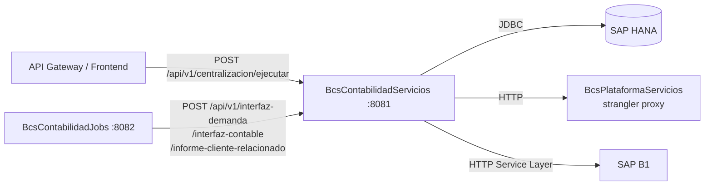

# BcsContabilidadServicios

## Descripción

Servicio REST de centralización contable. Orquesta la ejecución de más de 30 tipos de
asientos contables (Centraliza*) sobre SAP HANA y genera el archivo de interfaz diaria
para SAP B1. Es el núcleo del módulo contable: recibe las solicitudes de centralización
multi-selección del frontend/API Gateway, las despacha al servicio correspondiente y
acumula los resultados.

## Tecnología

- **Framework:** Spring Boot 4.1.1 / Java 25
- **Puerto:** 8081
- **Artifact:** `cl.bcs:contabilidad-service`
- **Patrón:** Hexagonal (ports-and-adapters), strangler-fig hacia TomEE hasta Phase 5

## Requisitos

Variables de entorno requeridas (sin valor por defecto — la aplicación no arranca sin ellas):

| Variable | Descripción |
|---|---|
| `HANA_URL` | URL JDBC SAP HANA (`jdbc:sap://<host>:<port>`) |
| `HANA_USER` | Usuario HANA |
| `HANA_PASSWORD` | Contraseña HANA |
| `PLATAFORMA_BASE_URL` | URL base de BcsPlataformaServicios (por defecto `http://localhost:8080`) |

## Endpoints

Los siguientes endpoints son invocados por `BcsContabilidadJobs` vía `ContabilidadServiciosRestClient`.
Los controladores REST son parte del plan de implementación; la lógica de dominio ya existe.

| Método | Ruta | Descripción |
|---|---|---|
| `POST` | `/api/v1/centralizacion/ejecutar` | Ejecuta centralización multi-selección (orquestador principal) |
| `POST` | `/api/v1/interfaz-demanda/archivo` | Crea un archivo de interfaz por tipo para SAP B1 |
| `POST` | `/api/v1/interfaz-contable/generar-asiento` | Genera JSON de asiento para un precomprobante |
| `POST` | `/api/v1/interfaz-contable/actualizar-estado` | Actualiza estado de precomprobante a `CON` |
| `POST` | `/api/v1/interfaz-contable/marcar-errores` | Marca en batch los precomprobantes con error |
| `POST` | `/api/v1/informe-cliente-relacionado` | Genera informe de clientes relacionados |
| `GET`  | `/api/v1/configuracion/ruta-base-archivos` | Devuelve `PLA.RutaBaseArchivos` para una empresa |
| `GET`  | `/actuator/health` | Health check de Spring Boot Actuator |

## Endpoint interno de dispatcher

### `POST /internal/java-call`
Recibe despachos J-type desde `BcsPlataformaWeb/CallController`. No expuesto en el gateway.

**Body:**
```json
{
  "class": "cl.bcs.dominio.NombreClase",
  "params": { ... },
  "skip": 0,
  "take": -1
}
```

**Activación progresiva:** Para registrar una clase JavaCall migrada, agregar un `case` en `InternalJavaCallController`:
```java
case "cl.bcs.dominio.NombreClase" -> service.ejecutar(params);
```

**Estado actual:** Todas las clases retornan 503 → BcsGateway hace fallback a TomEE.

## Dependencias de runtime

| Sistema | Detalles |
|---|---|
| **SAP HANA** | Fuente principal de datos operativos; driver `com.sap.db.jdbc.Driver` |
| **BcsPlataformaServicios** | Proxy TomEE durante la transición strangler-fig (`PLATAFORMA_BASE_URL`) |
| **SAP B1** | Via `SapB1Gateway`; integración con el ERP para generación de asientos |

## Diagrama



## Notas de implementación

- **Orquestador por reflexión reemplazado:** El `Class.forName()` del legacy es ahora un
  `Map<String, BcsCentralizacionService>` inyectado por Spring, clave = nombre de bean de configuración.
- **Acumulación de errores (DEV-01):** El contador de errores usa `+=` en lugar de `=` del legacy;
  preserva el total real en ejecuciones multi-tipo.
- **Simulación:** El flag `simulaOperacion="S"` se propaga a cada servicio delegate y suprime
  escrituras HANA sin cortar el flujo de cálculo.
- **REST controllers pendientes:** Los endpoints documentados arriba son los que consume
  `ContabilidadServiciosRestClient` en BcsContabilidadJobs. La lógica de dominio existe en
  `CentralizacionOrchestrator` y `Centraliza*` services; los `@RestController` son parte
  del siguiente pass de implementación.
- **Spring Batch:** `CreaInterfazDiariaJob` (Spring Batch) vive en este módulo; el schema
  se inicializa automáticamente (`spring.batch.jdbc.initialize-schema=always`).
- **`Crypto.java` excluido (RULE-077):** El Static3DES del legacy tiene clave pública conocida;
  no se porta. Los consumidores deben migrar a AES-256 antes de la transformación de sus módulos.
- **HANA credentials comprometidas:** Las credenciales hardcoded en `Sesion.java` legacy
  (`<HANA_QA_HOST>`, usuario `DESARROLLO`) deben rotarse.
