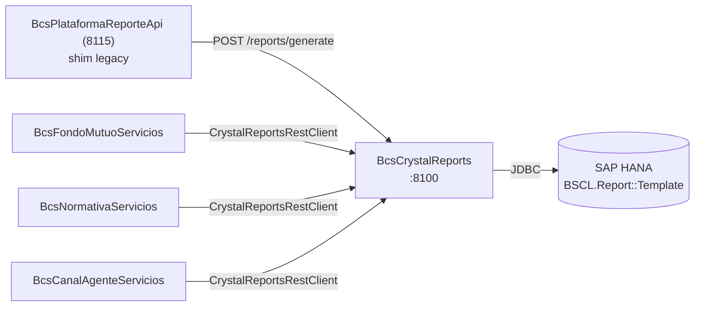

# BcsCrystalReports

## Descripción

Microservicio sidecar que encapsula el SDK Java de SAP Crystal Reports (JRC v14.1) como un servicio REST aislado. Recibe peticiones de generación de reportes con datos en JSON, aplica el template `.rpt` almacenado en SAP HANA y devuelve el archivo binario en el formato solicitado (PDF, Excel, Word, RTF o TXT). Es el único módulo del sistema que corre en Java 11, dado que el SDK de Crystal Reports es incompatible con versiones superiores de Java.

## Tecnología

- **Framework:** Spring Boot 2.7.18 / Java 11
- **Puerto:** 8100
- **Artifact:** `cl.bcs:BcsCrystalReports`
- **Nota:** Módulo INDEPENDIENTE del pom padre Java 25. No actualizar a Java 12+.

## Requisitos

### Variables de entorno

| Variable | Descripción | Ejemplo |
|---|---|---|
| `HANA_URL` | URL JDBC para SAP HANA | `jdbc:sap://host:39015` |
| `HANA_USER` | Usuario de base de datos HANA | `BSCL_USER` |
| `HANA_PASSWORD` | Contraseña de la cuenta HANA | — |
| `HANA_SCHEMA` | Schema HANA (default: `BSCL`) | `BSCL` |

### JARs privativos de Crystal Reports

Los JARs del SDK (`CrystalReportsRuntime.jar`, `CrystalCommon2.jar`, etc.) **no se distribuyen en Git** y deben instalarse en el repositorio Maven local (`~/.m2`) antes de compilar. Fuente: `legacy/otr-sva-optimus-corredores/libs-private/`. Ver `TRANSFORMATION_NOTES.md` para el comando de instalación.

## Endpoints

| Método | Ruta | Descripción |
|---|---|---|
| `POST` | `/reports/generate` | Genera un reporte Crystal Reports y devuelve el archivo binario |
| `GET` | `/reports/health` | Health check — devuelve `200 OK` con cuerpo `BcsCrystalReports UP` |
| `GET`/`POST` | `/report` | Contrato fiel del `CallReportServlet` legado (requiere `X-Internal-Token`, env `INTERNAL_TOKEN`; vacío = rechaza todo). Render (cuerpo JSON `reportId`, `exportFormat`, `configuration.mainReport/subReports`, datos como arreglo de filas), `?rpt`, `?upload`, `?update` (multipart, parte `data`). Detalle y mapeo de errores en `TRANSFORMATION_NOTES.md` |

### Cuerpo de la petición — POST /reports/generate

```json
{
  "templateId":   "<UUID del template en BSCL.Report::Template>",
  "format":       "pdf | excel | word | rtf | txt",
  "beanData":     { "campo": "valor" },
  "imageBase64":  "<imagen base64>",
  "imageName":    "<nombre del campo de imagen en el template>",
  "barcodeData":  "<datos del código de barras>",
  "barcodeName":  "<nombre del campo de barras en el template>"
}
```

**Respuesta exitosa:** Binario del reporte con `Content-Type` apropiado y `Content-Disposition: inline; filename=report.<ext>`.

**Respuesta de error (400 / 500):**
```json
{ "error": "<mensaje>" }
```

## Dependencias de runtime

| Dependencia | Tipo | Descripción |
|---|---|---|
| SAP HANA | Base de datos | Lee templates `.rpt` de la tabla `BSCL.Report::Template` |
| Crystal Reports SDK v14.1 | JARs locales | Renderizado de reportes (no disponible en Maven Central) |

## Diagrama



## Notas de implementación

- **Java 11 obligatorio.** El SDK de Crystal Reports JRC no es compatible con Java 12+. Este módulo no debe actualizarse a versiones superiores de Java.
- `ReportDocument.java` es una adaptación del legado `BcsPlataformaReporteApi/src/cl/bcs/plataforma/report/api/ReportDocument.java` con los siguientes cambios: paquete renombrado, migración a SLF4J, y Apache POI fijado en 3.17 como el legado (se conserva `Cell.CELL_TYPE_NUMERIC`; con POI 5.x el export TXT cambia, ver TRANSFORMATION_NOTES.md). `ListMapResultSet` es un port fiel de la clase legacy (`extends com.sun.rowset.CachedRowSetImpl`); antes era un stub que impedía renderizar cualquier template con datos.
- JVM: requiere `--add-exports/--add-opens java.sql.rowset/com.sun.rowset=ALL-UNNAMED`, `-Djava.awt.headless=true` y `-Dfile.encoding=UTF-8` (ya en Dockerfile, surefire y spring-boot:run). La imagen instala fuentes (JRC falla sin `${java.home}/lib/fonts`).
- Los tests (`mvn -o test`, JDK 11) incluyen un render real de `ComprobanteCuentaInversion.rpt` (H2) a PDF/Excel/Word/RTF/TXT (`CrystalRenderTest`); reemplaza al antiguo test `@Disabled`. Preparación local única: `install-libs.sh`. Ver `TRANSFORMATION_NOTES.md`.
- Los servicios Java 25 del sistema consumen este servicio a través de `CrystalReportsRestClient` (en `bcs-utils`), no directamente.
