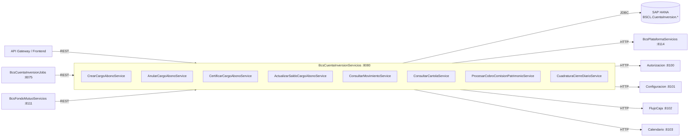

# BcsCuentaInversionServicios

## Descripción

Servicio central de **Cuenta de Inversión en valores financieros**. Gestiona el ciclo de vida de cargos y abonos (creación, anulación, certificación y actualización de saldos), la consulta de movimientos e historial, el cálculo de saldo de cartera, la cuadratura de cierre diario, el cobro de comisiones de patrimonio y la generación de cartolas. Es el núcleo de cuenta que consumen los jobs de inversión, FondoMutuo y el API Gateway.

## Tecnología

- **Framework:** Spring Boot 4.1.1 / Java 25
- **Puerto:** 8080
- **Artifact:** `cl.bcs:bcs-cuenta-inversion-servicios`
- **Patrón:** Strangler-fig, hexagonal (ports-and-adapters)
- **Fase actual:** 2 — stub (todas las llamadas HANA diferidas a Fase 3)

## Requisitos

| Variable de entorno | Descripción | Valor por defecto |
|---|---|---|
| `HANA_URL` | URL JDBC de SAP HANA | `jdbc:sap://localhost:30015?databaseName=BCS` |
| `HANA_USER` | Usuario de base de datos HANA | *(sin default — obligatorio)* |
| `HANA_PASSWORD` | Contraseña HANA | *(sin default — obligatorio)* |
| `AUTORIZACION_URL` | URL del servicio de autorización | `http://localhost:8100` |
| `CONFIGURACION_URL` | URL del servicio de configuración | `http://localhost:8101` |
| `FLUJO_CAJA_URL` | URL del servicio de flujo de caja | `http://localhost:8102` |
| `CALENDARIO_URL` | URL del servicio de calendario | `http://localhost:8103` |
| `REQUISITOS_URL` | URL del servicio de requisitos | `http://localhost:8104` |
| `LOG_URL` | URL del servicio de log | `http://localhost:8105` |
| `PROGRAMA_URL` | URL del servicio de programa | `http://localhost:8106` |
| `PRECIOS_TASAS_URL` | URL del servicio de precios y tasas | `http://localhost:8107` |
| `PARIDAD_URL` | URL del servicio de paridad | `http://localhost:8108` |
| `COMPROBANTE_URL` | URL del servicio de comprobante | `http://localhost:8109` |
| `EVENTOS_URL` | URL del servicio de eventos | `http://localhost:8110` |

## Endpoints

| Método | Ruta | Descripción |
|---|---|---|
| `POST` | `/api/v1/cargo-abono` | Crea uno o más cargos/abonos en cuenta de inversión (reemplaza operación SOAP `CrearCargoAbono`) |
| `GET` | `/api/v1/movimientos` | Consulta movimientos de una cuenta de inversión en un rango de fechas |

### Parámetros — `GET /api/v1/movimientos`

| Parámetro | Tipo | Descripción |
|---|---|---|
| `idEmpresa` | `Long` | Identificador de empresa |
| `idCuentaInversion` | `Long` | Identificador de cuenta de inversión |
| `fechaDesde` | `LocalDate` (ISO) | Fecha inicio del rango |
| `fechaHasta` | `LocalDate` (ISO) | Fecha fin del rango |
| `incluyeAnulados` | `boolean` | Incluye movimientos anulados (default `false`) |

### Body — `POST /api/v1/cargo-abono`

```json
{
  "idEmpresa": 1,
  "idUsuario": 100,
  "idModulo": "string",
  "simularOperacion": "S|N",
  "usaReglasNegocio": "S|N",
  "fechaSistema": "yyyy-MM-dd",
  "esIngresoManual": "S|N",
  "cargosAbonos": [ { ... } ]
}
```

## Endpoint interno de dispatcher

### `POST /internal/java-call`
Recibe despachos J-type desde `BcsPlataformaWeb/CallController`. No expuesto en el gateway.

**Body:**
```json
{
  "class": "cl.bcs.dominio.NombreClase",
  "params": { ... },
  "skip": 0,
  "take": -1
}
```

**Activación progresiva:** Para registrar una clase JavaCall migrada, agregar un `case` en `InternalJavaCallController`:
```java
case "cl.bcs.dominio.NombreClase" -> service.ejecutar(params);
```

**Estado actual:** Todas las clases retornan 503 → BcsGateway hace fallback a TomEE.

## Dependencias de runtime

| Servicio | URL configurada | Descripción |
|---|---|---|
| SAP HANA | `HANA_URL` | Base de datos principal — vistas y SPs de cuenta inversión |
| BcsPlataformaServicios | `:8114` | `PLA.FechaSistema`, `PLA.FechaGoLive`, flags de configuración |
| Autorización | `AUTORIZACION_URL:8100` | Validación de autorización de operaciones |
| Configuración | `CONFIGURACION_URL:8101` | Parámetros operacionales |
| Flujo de Caja | `FLUJO_CAJA_URL:8102` | Registro de movimientos de caja |
| Calendario | `CALENDARIO_URL:8103` | Días hábiles y fechas de liquidación |
| Requisitos | `REQUISITOS_URL:8104` | Validación de requisitos previos |
| Log | `LOG_URL:8105` | Auditoría |
| Programa | `PROGRAMA_URL:8106` | Programas batch |
| Precios y Tasas | `PRECIOS_TASAS_URL:8107` | Valorización de instrumentos |
| Paridad | `PARIDAD_URL:8108` | Tipos de cambio |
| Comprobante | `COMPROBANTE_URL:8109` | Emisión de comprobantes |
| Eventos | `EVENTOS_URL:8110` | Publicación de eventos de negocio |

## Diagrama



## Notas de implementación

- **B-CTA-01 — dual-path dispatch** — `ConfiguracionSistemaPort.usaCargoAbonoJava(idEmpresa)` decide entre la ruta SP HANA y la ruta Java pura. El valor de producción de `PLA.UsaCargoAbonoJava` es una pregunta pendiente de SME.
- **B-CTA-01b — monto negativo** — la guardia usa `monto.compareTo(BigDecimal.ZERO) == -1` (exactamente `-1`, no `< 0`). Monto = 0 no activa el error.
- **B-CTA-04 — saldo serializable** — `ActualizarSaldoCargoAbonoService` está anotado con `@Transactional(isolation = SERIALIZABLE)` para proteger el patrón read-modify-write de saldos acumulados con `MathContext.DECIMAL128`.
- **B-CTA-06 — truncado CLP** — se usa `RoundingMode.DOWN` (truncar hacia cero, **no** `FLOOR`). Afecta saldos negativos.
- **B-CTA-07 — routing Go-Live** — los movimientos se enrutan a `HISTORICAL_ONLY`, `CURRENT_ONLY` o `HYBRID` según la fecha de go-live (`PLA.FechaGoLive`). El valor exacto es pregunta de SME pendiente.
- **B-CTA-11 — origen APV vs NOAPV** — `codigoPortafolio.startsWith("APV") || codigoPortafolio.startsWith("DC")` determina origen `"APV"`, caso contrario `"NOAPV"`. Lógica en el servicio, no en el controlador.
- **B-CTA-12 — índice de rentabilidad** — `(pf / pi - 1) × 100`, escala 4 intermedia `HALF_UP`, escala 2 final `HALF_UP`.
- **B-CTA-14 — SOAP → REST** — la operación SOAP `CrearCargoAbono` fue remapeada a `POST /api/v1/cargo-abono`. Los campos MOVTRN del legado se traducen al record `CrearCargoAbonoEntrada`.
- **B-CTA-03 — pendiente Fase 3** — la comparación `totalMontoPortafolio.doubleValue() > saldoCajaPortafolio.doubleValue()` del legado tiene riesgo de precisión; debe reemplazarse por `compareTo() > 0` en Fase 3.
- **Seguridad** — `HANA_USER`/`HANA_PASSWORD` sin valores por defecto en `application.yml` (deben inyectarse en runtime). Sin credenciales hardcodeadas en código modernizado.
- **Health check** — disponible en `/actuator/health` (port 8080).
