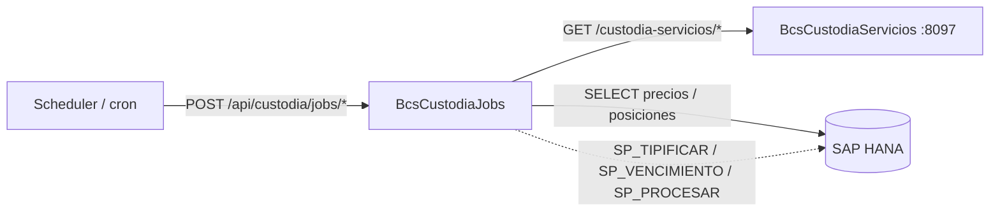

# BcsCustodiaJobs — Jobs de Custodia de Valores

## Descripción

Servicio de **ejecución de jobs de custodia de valores financieros**. Procesa operaciones batch de custodia: registra y actualiza precios de instrumentos, consulta posiciones de clientes, valida horarios de bloqueo de opciones, y ejecuta stored procedures HANA para tipificación de instrumentos y vencimiento de productos. Actúa como cliente del servicio BcsCustodiaServicios (puerto 8097) para lógica de dominio reutilizable.

## Tecnología

- **Framework:** Spring Boot 4.1.1 / Java 25
- **Puerto:** 8096
- **Artifact:** `cl.bcs.custodia:bcs-custodia-jobs`
- **Persistencia:** SAP HANA (`com.sap.db.jdbc.Driver`)

## Requisitos

| Variable | Descripción |
|---|---|
| `HANA_URL` | URL JDBC de la base de datos HANA |
| `HANA_USER` | Usuario de HANA |
| `HANA_PASSWORD` | Contraseña de HANA |

## Endpoints

| Método | Ruta | Descripción |
|---|---|---|
| `GET` | `/api/custodia/jobs/fecha-sistema` | Retorna la fecha de sistema configurada para la empresa |
| `GET` | `/api/custodia/jobs/precios` | Consulta precios de instrumentos por empresa y fecha |
| `PUT` | `/api/custodia/jobs/precio` | Actualiza el precio de un instrumento |
| `GET` | `/api/custodia/jobs/posiciones` | Consulta posiciones de custodia de clientes por empresa y fecha |
| `POST` | `/api/custodia/jobs/vencimiento` | Procesa vencimiento de productos via SP HANA (retorna 503 sin HANA) |
| `POST` | `/api/custodia/jobs/tipificar` | Tipifica instrumentos via SP HANA (retorna 503 sin HANA) |
| `POST` | `/api/custodia/jobs/validar-horario` | Valida si una fecha/hora cae dentro de una ventana de horario (lógica pura, sin DB) |

## Dependencias de runtime

| Dependencia | Tipo | Descripción |
|---|---|---|
| SAP HANA | Base de datos | Precios de instrumentos, posiciones, fecha de sistema, SPs de tipificación y vencimiento |
| BcsCustodiaServicios (8097) | Servicio interno | Lógica de dominio de custodia (cálculo de interés, hash, rangos de fecha) |

## Diagrama

## Notas de implementación

- **Constantes de decimales:** `DECIMALES_TASAS=6`, `DECIMALES_PRECIOS=2`, `DECIMALES_UF=4`, `DECIMALES_USD_EUR=2`, `DECIMALES_CLP=0`, `DECIMALES_PORCENTAJES=2` — preservadas del legacy `GenerarArchivoInformeMayorMenorValor`.
- **`DIFERENCIADORES_PACTOS`:** lista `["PP","PC","PD"]` para clasificación de pactos en informes.
- **`obtenerDecimalesCantidad`:** UF→4, USD/EUR→2, cualquier otra moneda→0.
- **Validación de horario (`esEnHorario`):** verifica estrictamente `horaIni < hora < horaTer` (exclusivo en ambos extremos).
- **`determinarEventoHorario`:** retorna `INICIO`, `TERMINO` o `null` según posición relativa al intervalo.
- **`notificarHorario`** del legacy no migrado: dependía de infraestructura EJB/JNDI de TomEE.
- **SQL plano vs SP:** `obtenerFechaSistema`, `consultarPreciosInstrumentos`, `actualizarPrecioInstrumento`, `consultarPosicionesCliente` usan SQL directo (testeable con H2). Las SPs `SP_PROCESAR_VENCIMIENTO_PRODUCTOS`, `SP_TIPIFICAR_INSTRUMENTOS` y `SP_EJECUTAR_VENCIMIENTO` retornan HTTP 503 sin HANA.
- **Spring Batch deshabilitado:** `spring.batch.job.enabled: false` — los jobs se invocan por HTTP, no por el runner de Batch.
