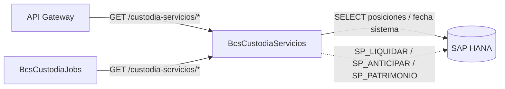

# BcsCustodiaServicios — Servicios de Custodia de Valores

## Descripción

Servicio REST de **custodia de valores financieros** (acciones, bonos, préstamos). Expone lógica pura de cálculo (conteo de días hábiles/calendario, cálculo de interés, hash de búsqueda de posición, rangos de fechas) junto con endpoints de datos que consultan posiciones de custodia y fecha de sistema desde HANA. Las operaciones que requieren stored procedures HANA (liquidar empréstito, anticipar préstamo, guardar patrimonio retroactivo) retornan HTTP 503 hasta que el entorno HANA esté disponible.

## Tecnología

- **Framework:** Spring Boot 4.1.1 / Java 25
- **Puerto:** 8097
- **Artifact:** `cl.bcs.custodia:bcs-custodia-servicios`
- **Persistencia:** SAP HANA (`com.sap.db.jdbc.Driver`)

## Requisitos

| Variable | Descripción |
|---|---|
| `HANA_URL` | URL JDBC de la base de datos HANA |
| `HANA_USER` | Usuario de HANA |
| `HANA_PASSWORD` | Contraseña de HANA |

## Endpoints

| Método | Ruta | Descripción |
|---|---|---|
| `POST` | `/custodia-servicios/cuenta-dias` | Cuenta días entre dos fechas (`tipo`: `C`=calendario, `L`=laborables) |
| `POST` | `/custodia-servicios/calculo-interes` | Calcula interés: `monto * (plazo/base) * (tasa/100)` |
| `GET` | `/custodia-servicios/hash-busqueda` | Genera clave hash de búsqueda por `idInstrumento`, `idPortafolio`, `idCliente`, `nemosvs` |
| `GET` | `/custodia-servicios/rango-fechas` | Retorna lista de fechas (`yyyy-MM-dd`) entre `fechaInicio` y `fechaTermino` |
| `GET` | `/custodia-servicios/tipo-busquedas` | Retorna la constante `TIPO_BUSQUEDAS` (15 entradas) |
| `GET` | `/custodia-servicios/posicion/{idPortafolio}` | Consulta posiciones de custodia por portafolio (SQL plano, testeable con H2) |
| `GET` | `/custodia-servicios/fecha-sistema/{idEmpresa}` | Retorna fecha de sistema configurada para la empresa |
| `POST` | `/custodia-servicios/liquidar-emprestito` | Liquida empréstito via SP HANA (retorna 503 sin HANA) |
| `POST` | `/custodia-servicios/anticipar-prestamo` | Anticipa préstamo via SP HANA (retorna 503 sin HANA) |
| `POST` | `/custodia-servicios/guardar-patrimonio` | Guarda patrimonio retroactivo via SP HANA (retorna 503 sin HANA) |

## Endpoint interno de dispatcher

### `POST /internal/java-call`
Recibe despachos J-type desde `BcsPlataformaWeb/CallController`. No expuesto en el gateway.

**Body:**
```json
{
  "class": "cl.bcs.dominio.NombreClase",
  "params": { ... },
  "skip": 0,
  "take": -1
}
```

**Activación progresiva:** Para registrar una clase JavaCall migrada, agregar un `case` en `InternalJavaCallController`:
```java
case "cl.bcs.dominio.NombreClase" -> service.ejecutar(params);
```

**Estado actual:** Todas las clases retornan 503 → BcsGateway hace fallback a TomEE.

## Dependencias de runtime

| Dependencia | Tipo | Descripción |
|---|---|---|
| SAP HANA | Base de datos | Posiciones de custodia, fecha de sistema, SPs de liquidación/anticipación/patrimonio |
| BcsCustodiaJobs | Consumidor | Invoca endpoints de lógica pura y datos desde los jobs de custodia |
| API Gateway | Consumidor | Exposición de consultas de posición a capas superiores |

## Diagrama



## Notas de implementación

- **Bug legacy preservado — `cuentaDias`:** el loop avanza `ld.plusDays(asd)` en lugar de `plusDays(1)`, generando progresión no lineal de fechas. Preservado por compatibilidad con consumidores downstream; debe coordinarse antes de corregir.
- **Bug legacy preservado — `calculoInteres`:** `.divide()` sin `RoundingMode` lanza `ArithmeticException` para decimales no terminantes (e.g. tasa=5, base=360). Los llamadores deben usar combinaciones terminantes o capturar la excepción.
- **`TIPO_PRESTAMO_VENTA_CORTA`:** constante `"PRTVTC"` preservada del legacy.
- **`TIPO_BUSQUEDAS`:** lista de 15 entradas de tipos de búsqueda de custodia.
- **SQL plano vs SP:** sólo `consultarPosicion` y `obtenerFechaSistema` usan SQL directo (testeable con H2); todas las SPs retornan `UnsupportedOperationException` → HTTP 503.
- **Sin Spring Batch:** módulo exclusivamente REST, sin dependencia `spring-batch`.
