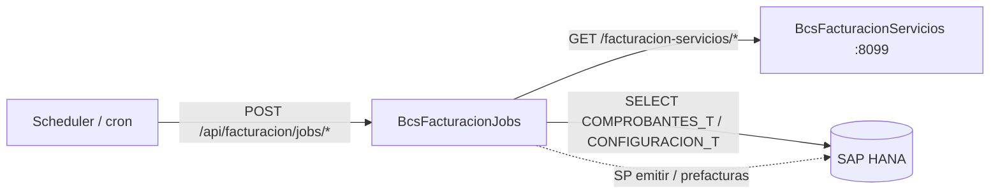

# BcsFacturacionJobs — Jobs de Facturación Electrónica

## Descripción

Servicio de **ejecución de jobs de facturación electrónica**. Procesa resúmenes de facturación por cliente y rango de fechas, formatea campos de archivos planos de facturación según configuración de tipos y decimales (lógica pura migrada desde `FormatoArchivo`), y expone operaciones de emisión masiva de comprobantes y generación de prefacturas (estas últimas diferidas por requerir stored procedures HANA). Actúa como cliente del servicio BcsFacturacionServicios (puerto 8099).

## Tecnología

- **Framework:** Spring Boot 4.1.1 / Java 25
- **Puerto:** 8095 (override via `SERVER_PORT`)
- **Artifact:** `cl.bcs:facturacion-jobs`
- **Persistencia:** SAP HANA (`com.sap.db.jdbc.Driver`)

## Requisitos

| Variable | Descripción |
|---|---|
| `HANA_URL` | URL JDBC de la base de datos HANA (default `jdbc:sap://localhost:30015`) |
| `HANA_USER` | Usuario de HANA |
| `HANA_PASSWORD` | Contraseña de HANA |
| `SERVER_PORT` | Puerto del servidor (opcional, default 8095) |

## Endpoints

| Método | Ruta | Descripción |
|---|---|---|
| `GET` | `/api/facturacion/jobs/resumen` | Consulta resúmenes de facturación por empresa, fechaDesde y fechaHasta |
| `GET` | `/api/facturacion/jobs/fecha-sistema` | Retorna fecha de sistema configurada para la empresa |
| `POST` | `/api/facturacion/jobs/emitir-masivo` | Emite comprobantes masivos via SP HANA (retorna 503 sin HANA) |
| `POST` | `/api/facturacion/jobs/prefacturas-masivas` | Genera prefacturas masivas via SP HANA (retorna 503 sin HANA) |
| `POST` | `/api/facturacion/jobs/formato-campo` | Formatea un campo de archivo plano según configuración (`CHAR`, `NUM`, `DEC`, `DATE`) |

## Dependencias de runtime

| Dependencia | Tipo | Descripción |
|---|---|---|
| SAP HANA | Base de datos | Tabla `COMPROBANTES_T`, `CONFIGURACION_T`, SPs de emisión y prefacturas |
| BcsFacturacionServicios (8099) | Servicio interno | Consultas de comprobantes y clasificación de tipos de documento |

## Diagrama

## Notas de implementación

- **Formateo de campos (`FormatoArchivoService`):** métodos `public static` que cubren los tipos `CHAR`, `NUM`, `DEC` y `DATE`:
  - `CHAR`: padding por la derecha con espacios, truncado a `largo`, aplicación de `valorDefecto`, trim previo.
  - `NUM`: padding con ceros a la izquierda según `rellenar`.
  - `DEC`: separador decimal **no** cuenta hacia `largo`; parte entera → ceros a la izquierda; parte decimal → ceros a la derecha. Edge case: si el valor no contiene `"."`, se trata el valor completo como `"0"` (regla B-FAJ-11, canary `OE-80`).
  - `DATE`: formateado con `formato` si se especifica (parse `yyyy-MM-dd`, reformat); sin formato → valor crudo alineado a la izquierda.
- **Resultado vacío por tipo desconocido:** `tipoRegistro` o `campo` no reconocidos → retorna `""` (B-FAJ-17).
- **`consultarResumenFacturas`:** reemplaza `ResumenFacturacionCliente_Select.sql` (Sql2o) con SQL directo sobre `COMPROBANTES_T` via `NamedParameterJdbcTemplate`.
- **SP `ObtenerConfiguracion` reemplazado:** `obtenerFechaSistema` usa `SELECT VALOR FROM CONFIGURACION_T` directamente.
- **Emisión masiva y prefacturas diferidas:** `emitirComprobantesMasivos` y `generarPrefacturasMasivas` lanzan `UnsupportedOperationException` → HTTP 503.
- **Pipeline de notificación no migrado:** inserción en tabla temporal de notificaciones y llamada a `FAC.NotificarResumenFacturasCliente` son responsabilidad de un componente separado.
