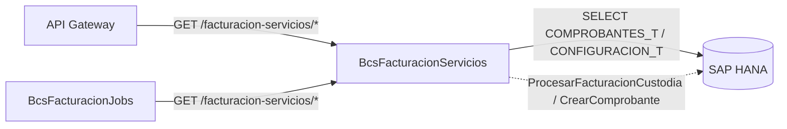

# BcsFacturacionServicios — Servicios de Facturación Electrónica

## Descripción

Servicio REST de **facturación electrónica de comisiones y servicios financieros**. Expone clasificación de tipos de documentos (facturas, notas de crédito, anticipos de simultáneas), consultas de comprobantes y fecha de sistema desde HANA, y operaciones de procesamiento de facturación de custodia y creación de comprobantes (estas últimas diferidas a Fase 5 por depender de god-objects 100% HANA-driven).

## Tecnología

- **Framework:** Spring Boot 4.1.1 / Java 25
- **Puerto:** 8099
- **Artifact:** `cl.bcs.facturacion:bcs-facturacion-servicios`
- **Persistencia:** SAP HANA (`com.sap.db.jdbc.Driver`)

## Requisitos

| Variable | Descripción |
|---|---|
| `HANA_URL` | URL JDBC de la base de datos HANA |
| `HANA_USER` | Usuario de HANA |
| `HANA_PASSWORD` | Contraseña de HANA |

## Endpoints

| Método | Ruta | Descripción |
|---|---|---|
| `GET` | `/facturacion-servicios/tipos-factura` | Retorna lista de tipos de factura (`TIPOS_FACTURA`) |
| `GET` | `/facturacion-servicios/tipos-nota-credito` | Retorna lista de tipos de nota de crédito (`TIPOS_NOTA_CREDITO`) |
| `GET` | `/facturacion-servicios/es-factura/{tipo}` | Verifica si un código es tipo factura |
| `GET` | `/facturacion-servicios/fecha-sistema/{idEmpresa}` | Retorna fecha de sistema configurada para la empresa |
| `GET` | `/facturacion-servicios/comprobantes/{idEmpresa}` | Consulta comprobantes por empresa y estado (`?estado=`) |
| `POST` | `/facturacion-servicios/procesar-facturacion-custodia` | Procesa facturación de custodia via HANA (retorna 503 sin HANA) |
| `POST` | `/facturacion-servicios/crear-comprobante` | Crea comprobante via HANA (retorna 503 sin HANA) |

## Endpoint interno de dispatcher

### `POST /internal/java-call`
Recibe despachos J-type desde `BcsPlataformaWeb/CallController`. No expuesto en el gateway.

**Body:**
```json
{
  "class": "cl.bcs.dominio.NombreClase",
  "params": { ... },
  "skip": 0,
  "take": -1
}
```

**Activación progresiva:** Para registrar una clase JavaCall migrada, agregar un `case` en `InternalJavaCallController`:
```java
case "cl.bcs.dominio.NombreClase" -> service.ejecutar(params);
```

**Estado actual:** Todas las clases retornan 503 → BcsGateway hace fallback a TomEE.

## Dependencias de runtime

| Dependencia | Tipo | Descripción |
|---|---|---|
| SAP HANA | Base de datos | Tablas `COMPROBANTES_T`, `CONFIGURACION_T`; god-objects `ProcesarFacturacionCustodia`, `CrearComprobante`, `ProcesarGananciaCapital` |
| BcsFacturacionJobs | Consumidor | Consulta comprobantes y fecha de sistema para procesar jobs de facturación |
| API Gateway | Consumidor | Exposición de servicios de facturación a capas superiores |

## Diagrama



## Notas de implementación

- **Constantes de clasificación:** `TIPOS_FACTURA`, `TIPOS_NOTA_CREDITO` y `TIPOS_ANTICIPO_SIMULTANEA` son listas `public static` en `FacturacionServiciosService`, migradas desde `ConstantesFacturacion`.
- **`esTipoFactura`, `esTipoNotaCredito`, `esTipoAnticipoSimultanea`:** verificaciones `List.contains(tipo)` sobre las constantes anteriores.
- **God-objects diferidos:** `ProcesarFacturacionCustodia` (5 384 LOC), `CrearComprobante` y `ProcesarGananciaCapital` reciben `Connection` directamente — sin lógica pura extraíble. Gateados con `UnsupportedOperationException` → HTTP 503.
- **Crystal Reports diferido (blocker Fase 4):** `DatosComprobanteCrystal.java` requiere reemplazo arquitectónico por microservicio de reporting (JasperReports o similar) — decisión pendiente.
- **SQL plano vs HANA:** `consultarComprobantes` y `obtenerFechaSistema` usan `NamedParameterJdbcTemplate` (testeable con H2); el resto retorna 503.
- **Tests de integración:** usan `MockMvcBuilders.webAppContextSetup()` directamente (Spring Boot 4.x eliminó `@AutoConfigureMockMvc` y `@WebMvcTest` de `spring-boot-test-autoconfigure`).
