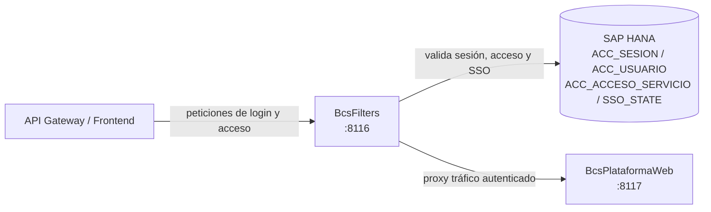

# BcsFilters

## Descripción

Gateway de autenticación y control de acceso de la plataforma BCS. Provee los endpoints de login local (usuario y contraseña), login SSO (OAuth2/OIDC), y actúa como filtro de sesión para el tráfico entrante hacia los servicios de backend. Valida tokens de sesión, controla el acceso a servicios según el perfil del usuario y aplica timeouts de inactividad por canal. Es el punto de entrada de autenticación para el API Gateway y el frontend.

## Tecnología

- **Framework:** Spring Boot 4.1.1 / Java 25
- **Puerto:** 8116
- **Artifact:** `cl.bcs:bcs-filters`
- **Patrón de arquitectura:** Hexagonal (domain / port / adapter)

## Requisitos

### Variables de entorno

| Variable | Descripción | Default |
|---|---|---|
| `HANA_URL` | URL JDBC para SAP HANA | — (requerida) |
| `HANA_USER` | Usuario de base de datos HANA | — (requerida) |
| `HANA_PASSWORD` | Contraseña HANA | — (requerida) |
| `COR_SESSION_TIMEOUT_MINUTES` | Timeout de sesión para canal COR (corredores) | `30` |
| `SECURITY_REHASH_ENABLED` | Activa re-hash de passwords legados SHA-256 a BCrypt | `false` |

### Dependencias externas

- **SAP HANA:** Tablas `ACC_SESION`, `ACC_USUARIO`, `ACC_ACCESO_SERVICIO`, `SSO_STATE`, `PLA_CONFIGURACION`

## Endpoints

| Método | Ruta | Auth requerida | Descripción |
|---|---|---|---|
| `POST` | `/PLA/CrearSesion` | No | Login local con usuario y contraseña; devuelve token de sesión |
| `POST` | `/PLA/LoginCliente` | No | Alias de `/PLA/CrearSesion` para aplicaciones cliente |
| `GET` | `/PLA/SSOInit` | No | Inicia flujo SSO; devuelve estado CSRF único (UUID) |
| `GET` | `/PLA/SSOLogon` | No | Callback del IdP SSO con `code`, `state` y `codigoUsuario` |
| `GET` | `/api/PLA/Ping` | No | Health check sin autenticación |
| `GET` | `/api/status` | Sí (X-SESSION-TOKEN) | Probe de estado (requiere sesión válida) |

### Cuerpo de login — POST /PLA/CrearSesion

```json
{ "codigo": "usuario", "clave": "contraseña", "canal": "WEB" }
```

**Respuesta exitosa:** `{ "token": "<session-token>" }`

## Dependencias de runtime

| Dependencia | Tipo | Descripción |
|---|---|---|
| SAP HANA | Base de datos | Validación de sesiones, usuarios, acceso a servicios y estado SSO |
| BcsPlataformaWeb (8117) | Servicio downstream | Destino del tráfico autenticado que pasa a través de los filtros |

## Diagrama



## Notas de implementación

- **6 correcciones de seguridad aplicadas** respecto al legado (Java EE 8 / TomEE servlet filters):
  - **RULE-004:** El legado permitía bypasear el control de acceso con cualquier valor no nulo en el parámetro `ch`. Corregido: solo los canales `WS`, `CLI` y `AGE` están en la lista de confianza.
  - **RULE-005 (fail-closed):** El legado concedía acceso en caso de excepción (`chain.doFilter` en el bloque `catch`). Corregido: cualquier error retorna `HTTP 401`.
  - **RULE-018:** El legado no validaba el campo `estado` del usuario. Corregido: solo usuarios con `estado=ACT` pueden iniciar sesión.
  - **RULE-025 (COR timeout):** Las sesiones del canal COR no tenían timeout configurado. Corregido: timeout configurable vía `COR_SESSION_TIMEOUT_MINUTES`.
  - **RULE-040 (off-by-one en bloqueo):** El legado usaba `>` en lugar de `>=` para el conteo de intentos fallidos. Corregido: el bloqueo ocurre exactamente al llegar al máximo de intentos.
  - **RULE-046 (SSO CSRF):** El estado SSO era una constante hardcodeada. Corregido: se genera un UUID por flujo y se valida su unicidad en base de datos.
- SQL migrado de notación de catálogo HANA (e.g. `"BSCL.Plataforma.BD::ACC.Sesion"`) a nombres de tabla portables compatibles con H2 para tests.
- `HybridPasswordEncoder` (de `bcs-utils`) permite la transición gradual de hashes SHA-256 legados a BCrypt sin forzar un cambio masivo de contraseñas.
