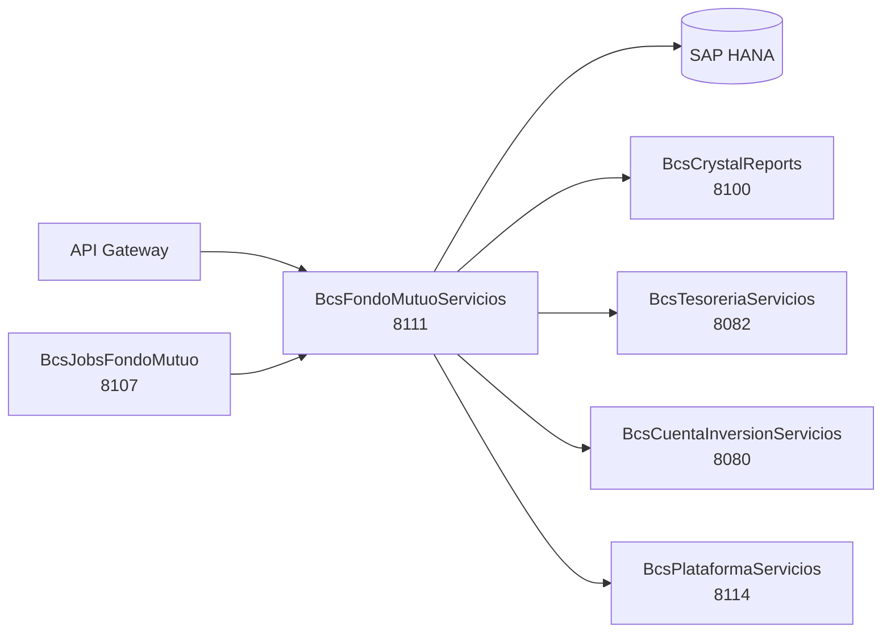

# BcsFondoMutuoServicios

## Descripción

Servicio de negocio para fondos mutuos. Gestiona el ciclo de vida completo de solicitudes de aporte y rescate, cálculo de cuotas y spread, traspasos, comisiones, custodia, valorización de cartera y archivos de transacciones. Es el servicio central del dominio FFMM al que se conectan el API Gateway y el motor de jobs `BcsJobsFondoMutuo`.

Los cálculos de cuotas y spread están completamente implementados con `BigDecimal` `MathContext.DECIMAL128` para precisión regulatoria CMF. Las operaciones que requieren SAP HANA (ciclo de vida de solicitudes, traspasos, etc.) responden **503** hasta Phase 3.

## Tecnología

- **Framework:** Spring Boot 4.1.1 / Java 25
- **Puerto:** 8111
- **Artifact:** `cl.bcs:bcs-fondo-mutuo-servicios`
- **Arquitectura:** Hexagonal (adapter/in → port/in → service → port/out → adapter/out)
- **Base de datos:** SAP HANA (`NamedParameterJdbcTemplate`)
- **Precisión numérica:** `BigDecimal` con `MathContext.DECIMAL128` para cálculos de cuotas y spread

## Requisitos

| Variable de entorno | Descripción | Valor por defecto |
|---|---|---|
| `HANA_URL` | JDBC URL de SAP HANA | `jdbc:sap://localhost:30015?databaseName=BCS` |
| `HANA_USER` | Usuario de SAP HANA | — |
| `HANA_PASSWORD` | Contraseña de SAP HANA | — |
| `PARIDAD_URL` | URL servicio de paridad cambiaria | `http://localhost:8200` |
| `PRECIOS_TASAS_URL` | URL servicio de precios y tasas | `http://localhost:8201` |
| `CONFIGURACION_URL` | URL servicio de configuración | `http://localhost:8202` |
| `CALENDARIO_URL` | URL servicio de calendario | `http://localhost:8203` |
| `TESORERIA_URL` | URL BcsTesoreriaServicios | `http://localhost:8204` |
| `CUENTA_INVERSION_URL` | URL BcsCuentaInversionServicios | `http://localhost:8205` |
| `CRYSTAL_REPORTS_URL` | URL BcsCrystalReports | `http://localhost:8206` |

## Endpoints

| Método | Ruta | Descripción |
|---|---|---|
| `POST` | `/api/fondo-mutuo/calcular-cuota` | Calcula monto o número de cuotas a partir de valor cuota, tipo solicitud y moneda (pura lógica, sin HANA) |
| `POST` | `/api/fondo-mutuo/calcular-spread` | Calcula el spread de rescate con factor de reajuste y paridad (pura lógica, sin HANA) |
| `POST` | `/api/fondo-mutuo/solicitud/crear` | Crea una solicitud de aporte/rescate normal — **requiere HANA** |
| `POST` | `/api/fondo-mutuo/solicitud/certificar` | Certifica una solicitud — **requiere HANA** |
| `POST` | `/api/fondo-mutuo/solicitud/anular` | Anula una solicitud — **requiere HANA** |
| `POST` | `/api/fondo-mutuo/solicitud/liquidar` | Liquida una solicitud — **requiere HANA** |

## Endpoint interno de dispatcher

### `POST /internal/java-call`
Recibe despachos J-type desde `BcsPlataformaWeb/CallController`. No expuesto en el gateway.

**Body:**
```json
{
  "class": "cl.bcs.dominio.NombreClase",
  "params": { ... },
  "skip": 0,
  "take": -1
}
```

**Activación progresiva:** Para registrar una clase JavaCall migrada, agregar un `case` en `InternalJavaCallController`:
```java
case "cl.bcs.dominio.NombreClase" -> service.ejecutar(params);
```

**Estado actual:** Todas las clases retornan 503 → BcsGateway hace fallback a TomEE.

## Dependencias de runtime

| Servicio | Puerto | Rol |
|---|---|---|
| SAP HANA | — | Stored procedures de solicitudes, traspasos, comisiones y custodia |
| BcsCrystalReports | 8100 | Generación de certificados y reportes regulatorios |
| BcsTesoreriaServicios | 8082 | Procesamiento de ingresos/egresos de tesorería |
| BcsCuentaInversionServicios | 8080 | Consulta de cuenta de inversión del cliente |
| BcsPlataformaServicios | 8114 | Servicios transversales de plataforma |

## Diagrama



## Notas de implementación

- **Cálculo de cuotas (B-FM-CUOTA-01/02):** `numeroCuotas = monto / valorCuota` (escala=`decimalesCuota`, HALF_DOWN); `monto = numeroCuotas * valorCuota` (`MathContext.DECIMAL128`). Para `RESREINV` con cuotas cero: escala=`decimalesCuota+1`, HALF_UP.
- **Cálculo de spread (B-FM-SPREAD-01/02):** `montoReajuste = valorFactorReajuste * costoFactorReajusteRescate` (escala=8, HALF_DOWN); `spread = (cantidadRescate * valorCuota) − montoReajuste`. Para monedas distintas se aplica conversión por paridad.
- **Diferido (B-FM-CUOTA-05):** `diferido = (idMonedaInversion != idMonedaFondo)`.
- **Tipo de cambio (B-FM-CUOTA-06):** `APO` → ValorDolarAporte; cualquier otro tipo → ValorDolarRescate.
- **Estado automático (B-FM-UTIL-05):** Si `certAuto=S` y 0 autorizaciones → estado `CRT`; de lo contrario `PEN`.
- **Canales web-service (B-FM-UTIL-03/04):** Los canales `WEB` y `EJE` se identifican como web-services.
- **Servicios HANA stubbeados:** 175 archivos legados mapeados; operaciones de ciclo de vida (solicitudes, traspasos, comisiones, custodia, cartera) lanzan `UnsupportedOperationException` (503) hasta Phase 3.
- **Tests:** 40 tests pasando (cálculos de cuota, spread, utilidades y constantes); BUILD SUCCESS.
