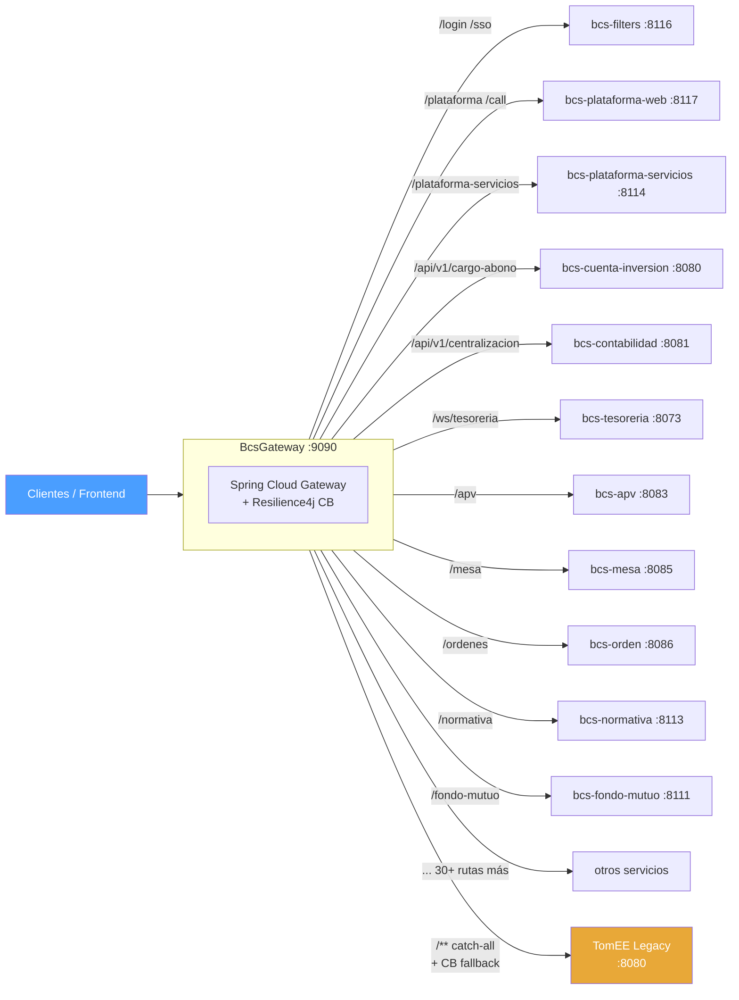

# BcsGateway — Canary Router

## Descripción

Punto de entrada único para todo el tráfico hacia `otr-sva-optimus-corredores`. Implementa el patrón **strangler fig** actuando como proxy inteligente: enruta cada petición al microservicio Spring Boot modernizado correspondiente y, si éste no responde (503 o circuit breaker abierto), hace fallback transparente al TomEE legacy en producción. Permite el despliegue canary sin reconfigurar clientes.

## Habilitar una ruta (opt-in) — regla: solo modulos PROVEN y firmados

**Estado por defecto: ninguna ruta esta habilitada; el gateway enruta el 100% del trafico al TomEE legacy.**
Cada ruta de `application.yml` lleva `enabled: false` y un comentario con su modulo y su estado de verificacion
(`analysis/otr-sva-optimus-corredores/VERIFICATION.md`). Una ruta deshabilitada se ignora como si no existiera.

**Regla: habilitar solo modulos PROVEN y firmados.** Hoy PROVEN (firma pendiente): BcsContabilidadServicios,
BcsContabilidadJobs, BcsCuentaInversionServicios, BcsTesoreriaServicios (y BcsUtils, que no tiene ruta). El resto es
PARTLY/NOT PROVEN y debe seguir en TomEE.

Dos formas de habilitar una ruta:

1. Editar la tabla: poner `enabled: true` en la ruta (cambio versionado, recomendado).
2. Sin editar la tabla (ops): `bcs.gateway.enabled-routes` = lista separada por comas de ids de ruta que se fuerzan a ON,
   por ejemplo `BCS_GATEWAY_ENABLED_ROUTES=bcs-tesoreria-servicios,bcs-contabilidad-servicios`.

Otras propiedades: `bcs.gateway.max-buffered-body-bytes` (default 10 MB) y `bcs.gateway.response-timeout-seconds` (default 30).

### Fallback seguro a TomEE

Una peticion que coincidio con una ruta activa se reenvia a TomEE **solo si el servicio nuevo no pudo ejecutarla**:

| Situacion | Resultado |
|---|---|
| El servicio responde HTTP 503 | fallback a TomEE (mismos bytes del body) |
| No se pudo establecer la conexion (rechazada, connect timeout, host no resuelto) | fallback a TomEE |
| Circuit breaker de la ruta abierto (no se llama al servicio) | fallback a TomEE |
| Cualquier otro 5xx (500, 502, 504...) | se entrega al cliente tal cual (status, headers, body); cuenta como fallo del breaker; **sin fallback** |
| Timeout de respuesta | 504 al cliente; cuenta como fallo; **sin fallback** |
| Corte/error despues de enviar la peticion | 502 al cliente; cuenta como fallo; **sin fallback** |

Motivo: reenviar a TomEE una escritura que el servicio nuevo pudo haber confirmado duplicaria movimientos de dinero.
El body se bufferiza una vez (hasta `max-buffered-body-bytes`) para poder reenviar los mismos bytes. Si es mas grande o
no tiene longitud (chunked) se transmite en streaming y **no** se hace fallback: un 503 o un fallo de conexion se
devuelven al cliente (503).

## Tecnología

- **Framework:** Spring Cloud Gateway 4.x / Spring Boot 4.1.1 / Java 25
- **Puerto:** `9090`
- **Artifact:** `cl.bcs:bcs-gateway`
- **Modelo de concurrencia:** reactivo (Netty + Project Reactor — no usa threads por petición)
- **Circuit breaker:** Resilience4j (`slidingWindowSize=10`, `failureRateThreshold=50%`, `waitDuration=30s`)

## Requisitos

| Variable | Default | Descripción |
|---|---|---|
| `GATEWAY_PORT` | `9090` | Puerto de escucha del gateway |
| `TOMEE_URL` | `http://tomee-legacy:8080` | URL base del TomEE legacy (fallback final) |

Todos los servicios modernizados deben estar en la red Docker `optimus-net`. El gateway los referencia por nombre de contenedor.

## Tabla de rutas

| Ruta (path predicate) | Servicio modernizado | Puerto | Fallback |
|---|---|---|---|
| `/login`, `/sso/**`, `/ping`, `/status/**` | bcs-filters | 8116 | TomEE |
| `/plataforma/**`, `/call`, `/CallBatch`, `/bootstrap/**` | bcs-plataforma-web | 8117 | TomEE |
| `/plataforma-servicios/**` | bcs-plataforma-servicios | 8114 | TomEE |
| `/plataforma-jobs/**` | bcs-plataforma-jobs | 8110 | TomEE |
| `/plataforma-reporte/**` | bcs-plataforma-reporte-api | 8115 | TomEE |
| `/api/v1/cargo-abono`, `/api/v1/movimientos/**` | bcs-cuenta-inversion-servicios | 8080 | TomEE |
| `/cuenta-inversion-jobs/**` | bcs-cuenta-inversion-jobs | 8075 | TomEE |
| `/api/v1/centralizacion/**`, `/api/v1/interfaz-**`, `/api/v1/informe-**`, `/api/v1/configuracion/**` | bcs-contabilidad-servicios | 8081 | TomEE |
| `/contabilidad-jobs/**` | bcs-contabilidad-jobs | 8082 | TomEE |
| `/ws/tesoreria/**`, `/svc-recauda/**` | bcs-tesoreria-servicios | 8073 | TomEE |
| `/tesoreria-jobs/**` | bcs-tesoreria-jobs | 8074 | TomEE |
| `/apv/**` | bcs-apv-servicios | 8083 | TomEE |
| `/apv-jobs/**` | bcs-apv-jobs | 8084 | TomEE |
| `/mesa/**` | bcs-mesa-servicios | 8085 | TomEE |
| `/mesa-jobs/**` | bcs-mesa-jobs | 8089 | TomEE |
| `/ordenes/**` | bcs-orden-servicios | 8086 | TomEE |
| `/orden-jobs/**` | bcs-orden-jobs | 8090 | TomEE |
| `/job-orders/**` | bcs-job-orders | 8088 | TomEE |
| `/portafolio/**` | bcs-portafolio-servicios | 8086 | TomEE |
| `/valo/**` | bcs-valo2 | 8087 | TomEE |
| `/becb/**` | bcs-becb | 8091 | TomEE |
| `/sura/**` | bcs-sura | 8092 | TomEE |
| `/replica/**` | bcs-replica | 8093 | TomEE |
| `/socio-negocio/**` | bcs-socio-negocio-servicios | 8098 | TomEE |
| `/socio-negocio-jobs/**` | bcs-socio-negocio-jobs | 8094 | TomEE |
| `/facturacion/**` | bcs-facturacion-servicios | 8099 | TomEE |
| `/facturacion-jobs/**` | bcs-facturacion-jobs | 8095 | TomEE |
| `/custodia/**` | bcs-custodia-servicios | 8097 | TomEE |
| `/custodia-jobs/**` | bcs-custodia-jobs | 8096 | TomEE |
| `/api/tributario/**` | bcs-tributario-jobs | 8101 | TomEE |
| `/canal-agente/**` | bcs-canal-agente-servicios | 8102 | TomEE |
| `/portal-confirmacion/**`, `/validate` | bcs-portal-confirmacion-web | 8103 | TomEE |
| `/cartolas/**` | bcs-cartolas | 8108 | TomEE |
| `/cartolas-master/**` | bcs-cartolas-master | 8105 | TomEE |
| `/cartolas-jobs/**` | bcs-cartolas-jobs | 8104 | TomEE |
| `/job-manager/**` | bcs-job-manager | 8106 | TomEE |
| `/fondo-mutuo/**` | bcs-fondo-mutuo-servicios | 8111 | TomEE |
| `/ffmm-jobs/**` | bcs-jobs-fondo-mutuo | 8107 | TomEE |
| `/normativa-core/**` | bcs-normativa-core | 8109 | TomEE |
| `/normativa-jobs/**` | bcs-normativa-jobs | 8112 | TomEE |
| `/normativa/**` | bcs-normativa-servicios | 8113 | TomEE |
| `/**` (catch-all) | tomee-legacy | `$TOMEE_URL` | — (es el fallback) |

> **Nota:** `bcs-crystal-reports` (8100) es un sidecar interno al que solo llaman otros servicios; no se expone en el gateway.

## Diagrama

## Notas de implementación

- **Sin `spring-boot-starter-web`:** Spring Cloud Gateway usa WebFlux (Netty). Incluir el starter MVC causa conflicto de contexto en el arranque.
- **Orden de rutas:** Las rutas más específicas van antes del catch-all `/**` → TomEE. Spring Cloud Gateway evalúa rutas en orden de declaración.
- **FallbackController:** En `/fallback/tomee` retorna 503 con JSON descriptivo cuando el circuit breaker está abierto y no puede enrutar ni al modernizado ni al fallback.
- **Habilitación progresiva:** Para retirar TomEE, basta con eliminar la ruta `legacy-tomee-fallback` y los filtros `CircuitBreaker` de los servicios que se quieran validar en producción.
- **Actuator:** `GET /actuator/gateway/routes` lista todas las rutas activas en runtime — útil para verificar que el gateway cargó correctamente.
