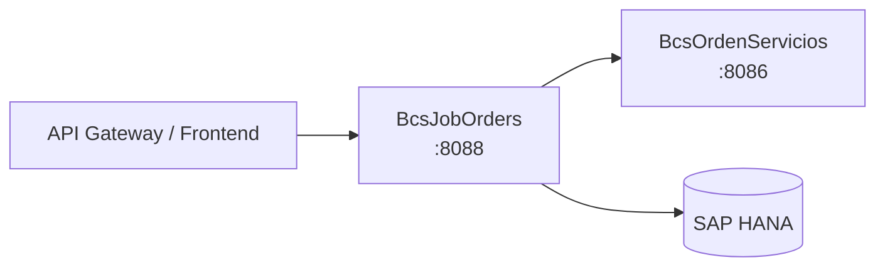

# BcsJobOrders

## Descripción

Microservicio de asignación cronológica de órdenes bursátiles. Implementa el algoritmo de matching y asignación que empareja órdenes de compra con transacciones de venta (y viceversa) de forma cronológica dentro de un libro de órdenes. Soporta dos tipos de asignación: por lote (tipo L, matching por cantidad) y por monto (tipo M). Es consumido por el API Gateway para lanzar el proceso de asignación al cierre de la jornada bursátil y para verificar el estado de un libro de órdenes antes de ejecutar.

## Tecnología

- **Framework:** Spring Boot 4.1.1 / Java 25
- **Puerto:** 8088
- **Artifact:** `cl.bcs:bcs-job-orders`
- **Base de datos:** SAP HANA (via `com.sap.db.jdbc.Driver`)

## Requisitos

| Variable | Descripción |
|---|---|
| `HANA_URL` | URL JDBC de la base de datos SAP HANA |
| `HANA_USER` | Usuario de conexión a HANA |
| `HANA_PASSWORD` | Contraseña de conexión a HANA |

## Endpoints

| Método | Ruta | Descripción |
|---|---|---|
| `POST` | `/api/asignacion/cronologica/ejecutar` | Ejecuta la asignación cronológica para un libro de órdenes (requiere HANA) |
| `POST` | `/api/asignacion/cronologica/verificar` | Verifica si el libro está activo y si existe una asignación automática activa (requiere HANA) |

**Cuerpo de ambos endpoints:** `{ "idLibroOrdenes": "123" }`

**Respuesta de `/ejecutar`:** `{ "idLibroOrdenes": "123", "asignaciones": N }`

**Respuesta de `/verificar`:** `{ "libroActivo": true/false, "asignacionActivaExiste": true/false }`

## Dependencias de runtime

| Servicio | Rol |
|---|---|
| SAP HANA | Lectura de órdenes y transacciones del libro; escritura de asignaciones en `BSCL.Orden.BD::POS.Asignacion` |
| `BcsOrdenServicios` (8086) | Registro de asignaciones resultantes en el sistema de órdenes |

## Diagrama

## Notas de implementación

- **Comparación de fechas** (B-JOB-01): usa `SimpleDateFormat("yyyy-MM-dd HH:mm:ss")` — formato exacto del legacy. `fecha1 <= fechaActual` devuelve `true` tanto si es anterior como si es igual. Excepciones de parseo devuelven `false`. CANARY: invertir `d1.before(d2)` → `d2.before(d1)` rompe 4+ tests.
- **Matching COMPRA↔VENTA** (B-JOB-02): una orden de COMPRA se empareja con transacciones de VENTA y viceversa. Requiere misma clasificación y misma bolsa.
- **Asignación tipo L (lote)** (B-JOB-03): `cantidadAsignada = Math.min(cantDisponibleOrden, cantDisponibleTransaccion)`.
- **Asignación tipo M (monto)** (B-JOB-04): misma lógica que tipo L para la cantidad; el monto se deriva de `cantidad × precio`.
- **Algoritmo O(n²) pinneado**: el doble for del legacy no se optimizó para mantener equivalencia exacta en casos de asignación parcial. Candidato a optimización O(n log n) post-validación en staging.
- **Constantes hardcodeadas** (`ParametrosDefault`): `TIPO_OPERACION_COMPRA="COM"`, `TIPO_OPERACION_VENTA="VEN"`, `LOTE="L"`, `MONTO="M"` — copiadas del legacy.
- **HANA diferido**: `AsignacionRepository` lanza `UnsupportedOperationException` en todos sus métodos. Ambos endpoints devuelven 503 sin HANA. El algoritmo de asignación puro (`AsignacionCronologicaService`) funciona sin base de datos.
- **Thread-safety**: `AsignacionCronologicaService` es `@Service` singleton, pero todos sus métodos son `static` — no hay estado compartido.
- **Manejo de errores**: NPE→400, `IllegalArgumentException`→400, `UnsupportedOperationException`→503.
