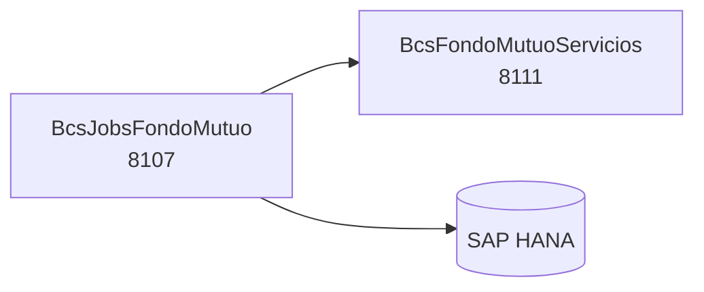

# BcsJobsFondoMutuo

## Descripción

Motor de jobs batch para el dominio de fondos mutuos. Expone 18 operaciones que corresponden a los jobs periódicos del legado TomEE (`BcsJob`), ahora como endpoints REST invocables por el orquestador. Incluye procesos de liquidez, cierre de series, carga masiva de solicitudes, certificación masiva, traspasos, generación de archivos AGF y FFMM, certificados 31, informes de rentabilidad, bonificación fiscal con reinversión y comisiones NN.

## Tecnología

- **Framework:** Spring Boot 4.1.1 / Java 25
- **Puerto:** 8107 (configurable con `SERVER_PORT`)
- **Artifact:** `cl.bcs:fondo-mutuo-jobs`
- **Arquitectura:** Hexagonal (adapter/in → service → port/out → adapter/out)
- **Base de datos:** SAP HANA (`NamedParameterJdbcTemplate`; `DataSourceAutoConfiguration` excluido en arranque)
- **Precisión numérica:** `BigDecimal` HALF_UP / HALF_DOWN para cálculos de bonificación fiscal (regla B-FMJ-17/19/20)

## Requisitos

| Variable de entorno | Descripción | Valor por defecto |
|---|---|---|
| `HANA_URL` | JDBC URL de SAP HANA | `jdbc:sap://localhost:30015` |
| `HANA_USER` | Usuario de SAP HANA | — |
| `HANA_PASSWORD` | Contraseña de SAP HANA | — |
| `SERVER_PORT` | Puerto HTTP | `8107` |
| `FONDO_MUTUO_URL` | URL base BcsFondoMutuoServicios | `http://localhost:8141` |
| `CUSTODIA_URL` | URL base BcsCustodiaServicios | `http://localhost:8143` |
| `PLATAFORMA_URL` | URL base BcsPlataformaServicios | `http://localhost:8080` |

## Endpoints

Todos los endpoints aceptan un body JSON con los parámetros del job y retornan el resultado de la operación.

| Método | Ruta | Descripción |
|---|---|---|
| `POST` | `/ffmm-jobs/administracion-liquidez` | Administración de liquidez del fondo |
| `POST` | `/ffmm-jobs/bloqueo-cierre-series` | Bloqueo y cierre automático de series — requiere HANA SP |
| `POST` | `/ffmm-jobs/carga-masiva-solicitudes` | Carga masiva de solicitudes; transacciones separadas por `;` (B-FMJ-01) |
| `POST` | `/ffmm-jobs/carga-online-agf` | Carga online AGF (HANA → SQL Server) — Phase 3 |
| `POST` | `/ffmm-jobs/certificacion-masiva-solicitudes` | Certificación masiva con filtros de serie, moneda, tipo solicitud, etc. (B-FMJ-05/06) |
| `POST` | `/ffmm-jobs/confirmar-traspaso` | Confirmación de traspasos pendientes en HANA |
| `POST` | `/ffmm-jobs/generar-archivo-agf` | Generación de archivo AGF por rango de fechas |
| `POST` | `/ffmm-jobs/generar-archivos-ffmm` | Generación de archivos FFMM (`INFORME_MOV_FFMM` o `INFORME_PARTICIPE_FFMM`) (B-FMJ-11/12) |
| `POST` | `/ffmm-jobs/generar-archivo-solicitud-aporte-rescate` | Generación de archivo de solicitudes de aporte/rescate |
| `POST` | `/ffmm-jobs/generar-certificado-31-ffmm` | Generación de certificado 31 (Crystal Reports) |
| `POST` | `/ffmm-jobs/generar-informe-rentabilidad-ffmm-extranjero` | Informe de rentabilidad FFMM extranjero (Crystal Reports) |
| `POST` | `/ffmm-jobs/ingresar-orden-bonificacion-fiscal-reinversion` | Bonificación fiscal con reinversión (B-FMJ-15/17/19/20/21) |
| `POST` | `/ffmm-jobs/notificar-traspaso` | Notificación de traspasos al servicio FFMM |
| `POST` | `/ffmm-jobs/procesar-comisiones-nn` | Procesamiento de comisiones NN; comisiones separadas por `,` (B-FMJ-15) |
| `POST` | `/ffmm-jobs/trx-c-file-manager` | Gestor de archivos TRX-C |
| `POST` | `/ffmm-jobs/trx-p-file-manager` | Gestor de archivos TRX-P |
| `POST` | `/ffmm-jobs/valor-cuota-file-manager` | Carga de valor cuota (HANA SP con `#temp_table`) — Phase 3 |
| `POST` | `/ffmm-jobs/valor-cuota-internacional-file-manager` | Carga de valor cuota internacional — Phase 3 |

## Dependencias de runtime

| Servicio | Puerto | Rol |
|---|---|---|
| BcsFondoMutuoServicios | 8111 | Operaciones de solicitudes, traspasos, archivos y reportes |
| SAP HANA | — | Consultas directas de traspasos, BF solicitudes, parámetros (`NamedParameterJdbcTemplate`) |

## Diagrama

## Notas de implementación

- **Lógica pura como `static`:** `CargaMasivaSolicitudesJob.parseTransacciones()`, `CertificacionMasivaSolicitudesJob.parseFiltros()` / `parseIdSolicitudes()`, `GenerarArchivosFFMMJob.validarTipoArchivo()`, `ProcesarComisionesNNJob.parseComisiones()`, `IngresarOrdenBonificacionFiscalReinversionJob.calcularPorcentaje()` / `calcularNumeroCuotasRescate()` / `aplicarCapCustodia()`.
- **Regla BF (B-FMJ-17):** Si `porcentaje=0` → `PorcentajeCalculado = NumeroCuotas * 100 / CantidadCustodia` (HALF_UP, escala=2).
- **Regla BF RESCATE (B-FMJ-19):** `cuotas = CantidadCustodia * effectivePct / 100` (HALF_DOWN, escala=`DecimalesCuota`).
- **Cap de custodia (B-FMJ-20):** Si `diff ≤ 1` → ajuste negativo de `NumeroCuotas` por el delta de exceso.
- **IdRegimenTributario (B-FMJ-21):** Siempre `"BF"` (hardcoded por dominio regulatorio).
- **SQL preservado:** Las queries HANA legadas (`.sql` resource files) están inlineadas como text blocks en `FondoMutuoJobsRepository`, incluyendo sintaxis HANA-específica.
- **REST client Phase 3:** `FondoMutuoServicioRestClient` lanza `UnsupportedOperationException` (503) en todos sus métodos hasta Phase 3. Configurar con `FONDO_MUTUO_URL`.
- **HANA SPs con `#temp_table` (Phase 3):** `CargarValorCuota`, `CargarValorCuotaInternacional`, `CierreBloqueoAutomaticoFondos` requieren `SimpleJdbcCall` con tablas temporales HANA.
- **Tests:** 34 tests pasando, 0 skipped; BUILD SUCCESS.
