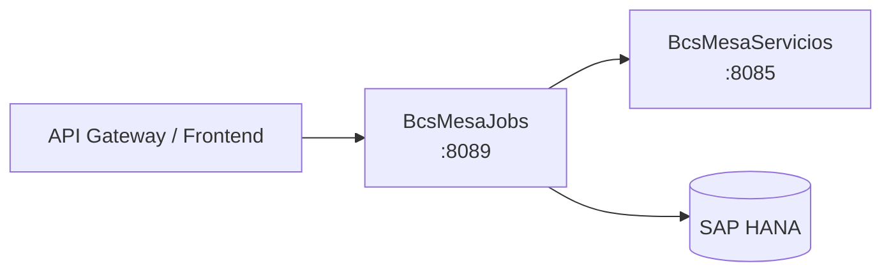

# BcsMesaJobs

## Descripción

Microservicio de jobs batch de la mesa de dinero. Expone 14 endpoints que disparan stored procedures de HANA para generar archivos regulatorios y operacionales (Anexo IX, Anexo XIX, OMA, depósitos, cartera propia, reporte mensual, etc.), procesar carga masiva de operaciones a término, ejecutar la valorización forward y liberar el bloqueo de edición de pactos. Actúa como orquestador batch que invoca a `BcsMesaServicios` para obtener datos de posición antes de lanzar los SPs en HANA.

## Tecnología

- **Framework:** Spring Boot 4.1.1 / Java 25
- **Puerto:** 8089
- **Artifact:** `cl.bcs:bcs-mesa-jobs`
- **Base de datos:** SAP HANA (via `com.sap.db.jdbc.Driver`)

## Requisitos

| Variable | Descripción |
|---|---|
| `HANA_URL` | URL JDBC de la base de datos SAP HANA |
| `HANA_USER` | Usuario de conexión a HANA |
| `HANA_PASSWORD` | Contraseña de conexión a HANA |

## Endpoints

Todos los endpoints siguen el patrón `POST /api/jobs/{nombre}/ejecutar` con cuerpo JSON `{ "idEmpresa", "fechaDesde", "fechaHasta", "rutaArchivo", "nombreArchivo", "formatoArchivo" }`.

### Generadores de archivo regulatorio / operacional

| Método | Ruta | SP HANA invocado |
|---|---|---|
| `POST` | `/api/jobs/generar-archivo-anexo-ix/ejecutar` | `BSCL.Mesa.BD.Servicios::GenerarAnexoIX` |
| `POST` | `/api/jobs/generar-archivo-anexo-xix/ejecutar` | `BSCL.Mesa.BD.Servicios::GenerarAnexoXIX` |
| `POST` | `/api/jobs/generar-archivo-ccccmmdd/ejecutar` | `BSCL.Mesa.BD.Servicios::GenerarArchivoCCccmmdd` |
| `POST` | `/api/jobs/generar-archivo-depositos-y-autodesembolsos/ejecutar` | `BSCL.Mesa.BD.Servicios::GenerarArchivoDepositosYAutodesembolsos` |
| `POST` | `/api/jobs/generar-archivo-informe-cartera-cuenta-propia/ejecutar` | `BSCL.Mesa.BD.Servicios::GenerarArchivoInformeCarteraCuentaPropia` |
| `POST` | `/api/jobs/generar-archivo-oma/ejecutar` | `BSCL.Mesa.BD.Servicios::GenerarArchivoOMA` |
| `POST` | `/api/jobs/generar-archivo-paccmmdd/ejecutar` | `BSCL.Mesa.BD.Servicios::GenerarArchivoPAccmmdd` |
| `POST` | `/api/jobs/generar-informe-saldos-cuenta-cambio/ejecutar` | `BSCL.Mesa.BD.Servicios::GenerarInformeSaldosCuentaCambio` |
| `POST` | `/api/jobs/generar-informe-utilidad-perdida/ejecutar` | `BSCL.Mesa.BD.Servicios::GenerarInformeUtilidadPerdida` |
| `POST` | `/api/jobs/generar-reporte-mensual-operaciones/ejecutar` | `BSCL.Mesa.BD.Servicios::GenerarReporteMensualOperaciones` |
| `POST` | `/api/jobs/puntasdatatec/ejecutar` | `BSCL.Mesa.BD.Servicios::PuntasDatatec` |
| `POST` | `/api/jobs/procesar-carga-masiva-archivo-operacion-termino/ejecutar` | `BSCL.Mesa.BD.Servicios::ProcesarCargaMasivaArchivoOperacionTermino` |
| `POST` | `/api/jobs/valorizacion-forward/ejecutar` | `BSCL.Mesa.BD.Servicios::ValorizacionForward` |

### Gestión de bloqueos

| Método | Ruta | Descripción |
|---|---|---|
| `POST` | `/api/jobs/libera-bloqueo-edicion-pactos/ejecutar` | Libera bloqueos de edición de pactos para una empresa y usuario (requiere HANA) |

**Cuerpo para libera-bloqueo:** `{ "idEmpresa": "...", "codigoUsuario": "..." }`

## Dependencias de runtime

| Servicio | Rol |
|---|---|
| SAP HANA | Ejecución de los 13 stored procedures de `BSCL.Mesa.BD.Servicios` y consulta de operaciones bloqueadas |
| `BcsMesaServicios` (8085) | Fuente de datos de posición y movimientos previos a la ejecución de jobs (consumidor upstream) |

## Diagrama

## Notas de implementación

- **Separador CSV** (B-MES-04): el separador usado es `';'` (punto y coma), no `','`. Es un canary: cambiarlo rompe tests inmediatamente.
- **Formato TXT** (B-MES-05): concatenación sin separador; campos `null` se convierten a cadena vacía `""`.
- **userId de bloqueo** (B-MES-03): la clave de bloqueo se construye como `idEmpresa + "_" + idUsuario` — misma lógica que el legacy.
- **`esCsv`/`esTxt`** (B-MES): comparación `compareTo() == 0` (case-sensitive) — `"csv"` no iguala a `"CSV"`.
- **HANA diferido**: todos los repositorios lanzan `UnsupportedOperationException` hasta que QA-HANA esté disponible. Todos los endpoints devuelven 503 sin HANA.
- **Scheduler**: migración de Quartz → Spring Scheduler pendiente como criterio de salida de Fase 3.
- **Encoding**: el legacy usaba `ISO-8859-1` en algunos archivos CSV con tildes; validar en QA-HANA contra los archivos legacy byte a byte.
- **Manejo de errores**: NPE→400, `IllegalArgumentException`→400, `UnsupportedOperationException`→503.
