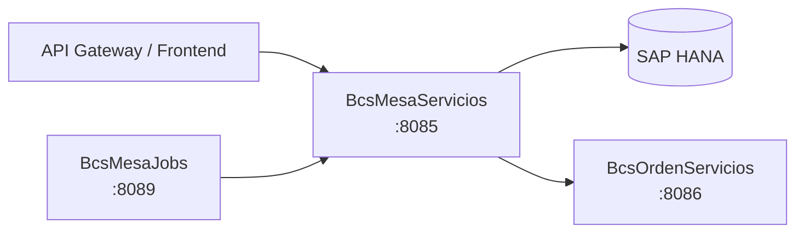

# BcsMesaServicios

## Descripción

Microservicio de la mesa de dinero. Implementa la calculadora spot: filtra y clasifica operaciones de compra/venta de divisas en el mercado spot, calcula posiciones iniciales por moneda, utilidades de operaciones interbancarias y de distribución, promedios ponderados de compra/venta, y el punto de equilibrio (break-even) de la mesa. Es consumido por `BcsMesaJobs` para procesamiento batch y por el API Gateway/frontend para visualización en tiempo real del blotter de la mesa.

## Tecnología

- **Framework:** Spring Boot 4.1.1 / Java 25
- **Puerto:** 8085
- **Artifact:** `cl.bcs:mesa-service`
- **Base de datos:** SAP HANA (via `com.sap.db.jdbc.Driver`)

## Requisitos

| Variable | Descripción |
|---|---|
| `HANA_URL` | URL JDBC de la base de datos SAP HANA |
| `HANA_USER` | Usuario de conexión a HANA |
| `HANA_PASSWORD` | Contraseña de conexión a HANA |

## Endpoints

### Calculadora Spot

| Método | Ruta | Descripción |
|---|---|---|
| `GET` | `/api/mesa/spot/movimientos` | Obtiene movimientos spot vigentes para una fecha de operación (requiere HANA) |
| `POST` | `/api/mesa/spot/resumen` | Calcula el resumen de operaciones spot (anuladas, compras, ventas, total) a partir de una lista de movimientos |
| `POST` | `/api/mesa/spot/breakeven` | Calcula el break-even y la posición inicial para una moneda y fecha dadas (requiere HANA para posiciones) |

## Endpoint interno de dispatcher

### `POST /internal/java-call`
Recibe despachos J-type desde `BcsPlataformaWeb/CallController`. No expuesto en el gateway.

**Body:**
```json
{
  "class": "cl.bcs.dominio.NombreClase",
  "params": { ... },
  "skip": 0,
  "take": -1
}
```

**Activación progresiva:** Para registrar una clase JavaCall migrada, agregar un `case` en `InternalJavaCallController`:
```java
case "cl.bcs.dominio.NombreClase" -> service.ejecutar(params);
```

**Estado actual:** Todas las clases retornan 503 → BcsGateway hace fallback a TomEE.

## Dependencias de runtime

| Servicio | Rol |
|---|---|
| SAP HANA | Movimientos spot (`SP_OBTENER_MOVIMIENTOS_SPT`) y posiciones iniciales (`POSICION_INICIAL_T`) |
| `BcsOrdenServicios` (8086) | Coordinación de órdenes generadas por la mesa (consumidor downstream) |

## Diagrama



## Notas de implementación

- **Filtro de vigentes** (B-MSP-VIG): estados válidos son `VIG`, `PEL` y `PDA`; los `ANU` y demás se excluyen del cálculo.
- **Clasificación de operaciones**: las interbancarias (`INTERB`/`ARBINT`) excluyen canal `FWD`; las de distribución (`DISTRI`/`ARBDIS`) no tienen exclusión por canal.
- **Break-even** (B-MSP-BE): `breakEven = equivalenteEnPesos / posicionActual`, escala 4 decimales con `HALF_UP`.
- **Paridad** (B-MSP-PARIDAD): para tipo `BIDASK`, posición ≥ 0 usa `BID`; posición < 0 usa `ASK`; cualquier otro tipo usa precio de mercado.
- **Utilidades interbancarias** (B-MSP-UTIL-INTERB): compra = `monto × (precioCalculadora − tipoCambioCierre)`; venta = `monto × (tipoCambioCierre − precioCalculadora)`.
- **Utilidades distribución** (B-MSP-UTIL-DISTRI): compra = `monto × (tipoCambioCosto − tipoCambioCierre)`; venta = `monto × (tipoCambioCierre − tipoCambioCosto)`.
- **Dominio mutable**: `MovimientoSpot`, `PosicionInicial`, `Paridad` y `BreakEvenResult` usan campos públicos mutables para mantener equivalencia con el patrón de inner-class del legacy (asignación directa en el legado).
- **Acceso HANA diferido**: `/api/mesa/spot/movimientos` y la parte de posiciones en `/breakeven` devuelven 503 hasta que QA-HANA esté disponible. `/api/mesa/spot/resumen` opera en modo puro sin base de datos.
- **Manejo de errores**: NPE→400, `IllegalArgumentException`→400, `UnsupportedOperationException`→503.
