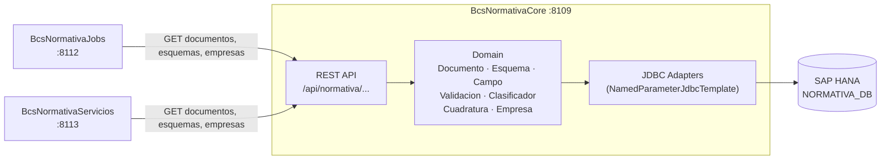

# BcsNormativaCore

## Descripcion

Motor de datos regulatorios para el cumplimiento normativo ante la CMF (Comision para el Mercado Financiero). Expone via REST el catalogo de documentos, esquemas, campos, validaciones, clasificadores, cuadraturas, parametros de empresa y configuracion del sistema. Es la fuente de verdad consultada por `BcsNormativaJobs` y `BcsNormativaServicios` para obtener metadatos regulatorios sin acceder directamente a HANA.

## Tecnologia

- **Framework:** Spring Boot 4.1.1 / Java 25
- **Puerto:** 8109
- **Artifact:** `cl.bcs:bcs-normativa-core`
- **Base de datos:** SAP HANA — esquema `NORMATIVA_DB`
- **Acceso a datos:** `NamedParameterJdbcTemplate` (adaptadores JDBC hexagonales)

## Requisitos

| Variable de entorno | Descripcion | Ejemplo |
|---|---|---|
| `NORMATIVA_DB_URL` | URL JDBC de la base HANA | `jdbc:sap://hana-host:39013` |
| `NORMATIVA_DB_USER` | Usuario de base de datos | `BSCL_APP` |
| `NORMATIVA_DB_PASSWORD` | Contrasena de base de datos | _(secreto — no hardcodear)_ |

> Las tres variables son obligatorias en produccion. El valor por defecto de `NORMATIVA_DB_URL` apunta a `localhost:39013`; `NORMATIVA_DB_USER` y `NORMATIVA_DB_PASSWORD` no tienen default y causan falla de conexion si estan vacios.

## Endpoints

| Metodo | Ruta | Descripcion |
|---|---|---|
| `GET` | `/api/normativa/documentos/{id}` | Busca un documento regulatorio por id |
| `PATCH` | `/api/normativa/documentos/{id}/en-proceso` | Actualiza el indicador `EnProceso` de un documento |
| `GET` | `/api/normativa/esquemas/{nombre}/{version}` | Devuelve esquema con sus campos |
| `GET` | `/api/normativa/esquemas/{nombre}/{version}/validaciones` | Lista las validaciones activas del esquema |
| `GET` | `/api/normativa/empresas/{idEmpresa}` | Busca datos de empresa |
| `GET` | `/api/normativa/empresas/{idEmpresa}/corredora?idBolsa=` | Codigo de corredora para una bolsa |
| `GET` | `/api/normativa/empresas/{idEmpresa}/configuracion/{codigo}` | Valor de configuracion de empresa |
| `GET` | `/api/normativa/esquemas/{nombre}/{version}/parametros/{codigo}` | Valor de parametro de esquema |

### Mapeo de errores (`GlobalExceptionHandler`)

| Excepcion | HTTP |
|---|---|
| `NullPointerException` | 400 Bad Request |
| `IllegalArgumentException` | 400 Bad Request |
| `NumberFormatException` | 400 Bad Request |
| `UnsupportedOperationException` | 503 Service Unavailable |

## Dependencias de runtime

| Servicio | Rol |
|---|---|
| SAP HANA (`NORMATIVA_DB`) | Unica fuente de datos; tablas de documentos, esquemas, empresas, configuracion |

## Diagrama

## Notas de implementacion

### Arquitectura hexagonal

El modulo sigue el patron ports-and-adapters:
- `domain/` — POJOs puros sin dependencias de framework
- `port/in/` — interfaces de casos de uso (ej. `FindDocumentoUseCase`)
- `port/out/` — interfaces de repositorio (ej. `DocumentoPort`, `EsquemaPort`)
- `service/` — implementaciones `@Service`; logica pura como metodos `public static`
- `adapter/in/` — `@RestController`
- `adapter/out/` — un adaptador JDBC por grupo de dominio (no una clase monolitica)

### Adaptadores JDBC separados

Java no permite que una misma clase implemente dos interfaces con la misma firma de metodo pero distinto tipo de retorno (ej. `DocumentoPort.buscarPorId(long)` vs `EmpresaPort.buscarPorId(long)`). Solucion: un adaptador por grupo.

| Adaptador | Implementa |
|---|---|
| `DocumentoJdbcAdapter` | `DocumentoPort` |
| `EsquemaJdbcAdapter` | `EsquemaPort`, `CampoPort` |
| `ValidacionJdbcAdapter` | `ValidacionPort` |
| `ClasificadorJdbcAdapter` | `ClasificadorPort` |
| `CuadraturaJdbcAdapter` | `CuadraturaPort` |
| `EmpresaJdbcAdapter` | `EmpresaPort` |
| `ConfiguracionJdbcAdapter` | `ConfiguracionPort`, `ParametroPort` |
| `ResumenJdbcAdapter` | `ResumenCargaPort`, `ResumenGeneracionPort` |

### Generacion de IDs

El legacy usaba `MAX(ID)+1` (sin secuencias ni auto-increment). Patron preservado en `ResumenJdbcAdapter.nextId(tabla)`.

### Tests

- 52 tests totales, 0 fallos, 1 skipped (`scheduleProcess_requiresHana` — requiere HANA real)
- Cobertura: `DataParserServiceTest` (20), `EsquemaTest` (12), `NormativaCoreIntegrationTest` (20 con H2)
