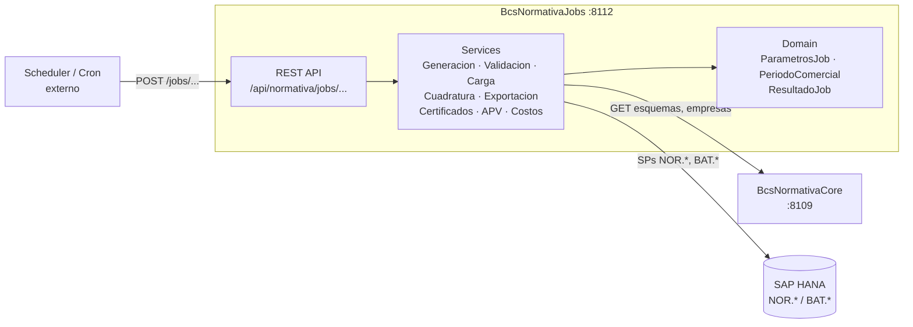

# BcsNormativaJobs

## Descripcion

Servicio de ejecucion de jobs regulatorios para el cumplimiento ante la CMF. Orquesta la generacion de interfaces CMF (DJ1871, NCG365, NCG380, NCG499), la emision de certificados tributarios APV, la valoracion de declaraciones y el procesamiento de costos y servicios. Cada job se dispara via HTTP POST (llamada desde scheduler externo o cron) y delega la logica HANA-dependiente a procedimientos almacenados, mientras que la logica pura (nombres de archivo DJ1, parametros, validaciones) se ejecuta directamente en el servicio.

## Tecnologia

- **Framework:** Spring Boot 4.1.1 / Java 25
- **Puerto:** 8112
- **Artifact:** `cl.bcs:bcs-normativa-jobs`
- **Base de datos:** SAP HANA (procedimientos almacenados `NOR.*`, `BAT.*`)
- **Acceso a datos:** `NamedParameterJdbcTemplate`

## Requisitos

| Variable de entorno | Descripcion | Ejemplo |
|---|---|---|
| `HANA_URL` | URL JDBC de SAP HANA | `jdbc:sap://hana-host:30015` |
| `HANA_USER` | Usuario de base de datos | `BSCL_JOBS` |
| `HANA_PASSWORD` | Contrasena de base de datos | _(secreto — no hardcodear)_ |
| `NORMATIVA_LOG_BASE_PATH` | Directorio base para archivos de salida | `/data/archivos` |
| `NORMATIVA_SCHEMA` | Esquema HANA de trabajo | `BSCL` |
| `SERVER_PORT` | Puerto del servidor (opcional) | `8112` |

> `HANA_URL` usa `localhost:30015` como default. `HANA_USER` y `HANA_PASSWORD` no tienen default y fallan en ejecucion si estan vacios.

## Endpoints

| Metodo | Ruta | Job legacy equivalente |
|---|---|---|
| `GET` | `/api/normativa/jobs/health` | — (healthcheck) |
| `POST` | `/api/normativa/jobs/generacion` | `BcsJobGeneracion` |
| `POST` | `/api/normativa/jobs/validacion` | `BcsJobValidacion` |
| `POST` | `/api/normativa/jobs/carga` | `BcsJobCarga` |
| `POST` | `/api/normativa/jobs/cuadratura` | `BcsJobCuadratura` |
| `POST` | `/api/normativa/jobs/exportacion` | `BcsJobExportacion` |
| `POST` | `/api/normativa/jobs/exportacion-ncg380` | `BcsJobExportacionNCG380` |
| `POST` | `/api/normativa/jobs/procesar-serv` | `BcsJobProcesarServ` |
| `POST` | `/api/normativa/jobs/valorizar-ncg499` | `BcsJobValorizarNCG499` |
| `POST` | `/api/normativa/jobs/valorizar-declaracion` | `BcsJobValorizarDeclaracion` |
| `POST` | `/api/normativa/jobs/certificados-tributarios` | `BcsJobGenerarCertificadosTributarios` |
| `POST` | `/api/normativa/jobs/reporte-apv` | `BcsJobGenerarReporteAPV` |
| `POST` | `/api/normativa/jobs/cargar-datos-apv` | `BcsJobCargarDatosReporteAPV` |
| `POST` | `/api/normativa/jobs/procesar-costos` | `BcsJobProcesarCostos` |

> Los jobs de generacion de interfaces CMF (C08, C40, P40, DCI, DPD, etc.) estan cableados internamente pero retornan HTTP 503 hasta que HANA este disponible, ya que delegan completamente en procedimientos almacenados.

### Mapeo de errores (`GlobalExceptionHandler`)

| Excepcion | HTTP |
|---|---|
| `NullPointerException` | 400 Bad Request |
| `IllegalArgumentException` | 400 Bad Request |
| `NumberFormatException` | 400 Bad Request |
| `UnsupportedOperationException` | 503 Service Unavailable |

## Dependencias de runtime

| Servicio | Rol |
|---|---|
| SAP HANA | SPs `NOR.*` (logica de negocio), `BAT.*` (registro de programas) |
| `BcsNormativaCore` (:8109) | Consulta metadatos de documentos, esquemas y configuracion |

## Diagrama



## Notas de implementacion

### Arquitectura hexagonal

```
cl.bcs.normativa.jobs/
├── domain/          ParametrosJob, PeriodoComercial, ResultadoJob
├── port/out/        ConfiguracionPort, NormativaHanaPort, ProgramaLogPort
├── service/         un service por familia de jobs
├── adapter/in/      NormativaJobsController
└── adapter/out/     NormativaRepository (HANA + Configuracion + ProgramaLog)
```

### PeriodoComercial y nomenclatura DJ1

La clase `PeriodoComercial` encapsula dos reglas criticas de negocio probadas con 17 tests:

- **`periodicidadEfectiva(periodicidad, rectifica)`** — cuando `rectifica=S` y `periodicidad=M`, retorna `"C"` (rectificacion mensual se trata como periodicidad comercial).
- **`construirNombreArchivoDJ1(...)`** — construye el nombre del archivo DJ1 reemplazando tokens de plantilla, eliminando guiones del RUT y del periodo. Aplicable a DJ1871, NCG365, NCG380, NCG499.

### ParametrosJob

Contrato de extraccion de parametros del request body:

- `requerido(nombre)` — lanza `IllegalArgumentException` si ausente o en blanco
- `requeridoLong(nombre)` — lanza `NumberFormatException` si no es numerico
- `opcional(nombre, default)` — retorna el default si el parametro esta ausente o en blanco

### CertificadosTributariosService

- `parsearAnoTributario(ano)` — valida que el ano sea de 4 digitos en el rango `[1900, 2100]`; lanza `IllegalArgumentException` fuera de rango.

### Jobs con HANA (@Disabled en tests)

Los jobs de generacion de interfaces CMF (C08, C40, P40, ClientesEnLinea, LavadoDinero, etc.) estan implementados en `InterfazService` pero sus tests de integracion estan marcados `@Disabled("requires HANA")`. En produccion ejecutan el SP HANA correspondiente; en entornos sin HANA retornan 503.

### Tests

- 64 tests totales, 0 fallos, 10 skipped (requieren HANA)
- 54 tests activos: logica pura de `ParametrosJob`, `PeriodoComercial`, validadores, `GlobalExceptionHandler`, H2 integration (context load + health)
