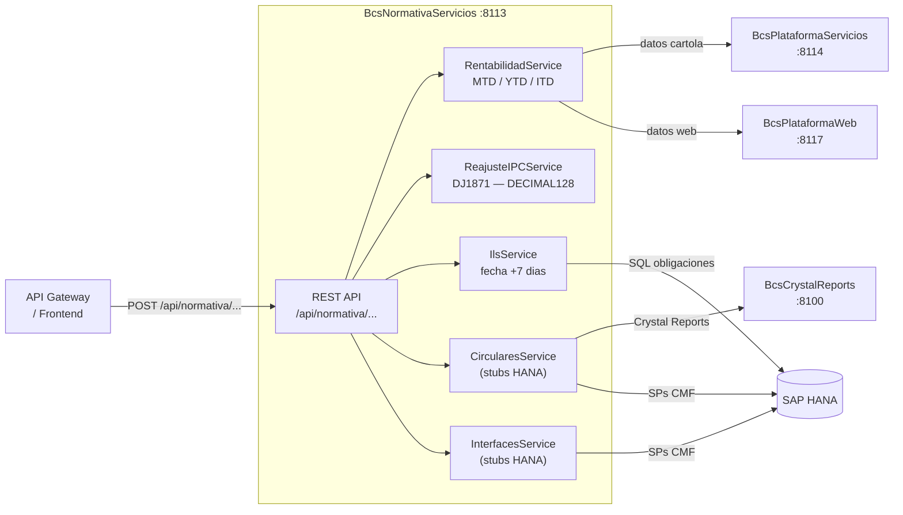

# BcsNormativaServicios

## Descripcion

API de calculos regulatorios para el cumplimiento ante la CMF. Expone servicios de rentabilidad de cartolas de inversion (MTD/YTD/ITD), reajuste por IPC de declaraciones juradas (DJ1871), calculo de obligaciones ILS (Indicadores de Liquidez y Solvencia), generacion de circulares CMF (NCG365, NCG380, Circular 1720, 1985) y generacion de interfaces regulatorias (C08, C40, P40, SIG, etc.). Es el punto de entrada desde el API Gateway o el frontend para toda la operacion regulatoria que requiere computo.

## Tecnologia

- **Framework:** Spring Boot 4.1.1 / Java 25
- **Puerto:** 8113
- **Artifact:** `cl.bcs:normativa-service`
- **Base de datos:** SAP HANA
- **Acceso a datos:** `NamedParameterJdbcTemplate`

## Requisitos

| Variable de entorno | Descripcion | Ejemplo |
|---|---|---|
| `HANA_URL` | URL JDBC de SAP HANA | `jdbc:sap://hana-host:30015?databaseName=BCS` |
| `HANA_USER` | Usuario de base de datos | `BSCL_SVC` |
| `HANA_PASSWORD` | Contrasena de base de datos | _(secreto — no hardcodear)_ |
| `PLATAFORMA_URL` | URL base de BcsCrystalReports / Plataforma | `http://bcs-crystal:8100` |
| `AUTORIZACION_URL` | URL base del servicio de autorizacion | `http://bcs-autorizacion:8120` |
| `SERVER_PORT` | Puerto del servidor (opcional) | `8113` |

> `HANA_URL` usa `localhost:30015` como default. `HANA_USER` y `HANA_PASSWORD` no tienen default y fallan en ejecucion si estan vacios.

## Endpoints

### Cartola / Rentabilidad

| Metodo | Ruta | Descripcion |
|---|---|---|
| `POST` | `/api/normativa/cartola/calcular-rentabilidad` | Calcula rentabilidad MTD/YTD/ITD de una cartola de inversion |

### ILS — Indicadores de Liquidez y Solvencia

| Metodo | Ruta | Descripcion |
|---|---|---|
| `POST` | `/api/normativa/ils/calcular-obligaciones` | Calcula obligaciones y derechos en moneda extranjera (+7 dias) |

### Circulares CMF

| Metodo | Ruta | Descripcion |
|---|---|---|
| `POST` | `/api/normativa/circulares/generar-archivo-circular-1720` | Genera archivo Circular 1720 (Crystal Reports + HANA SP) |
| `POST` | `/api/normativa/circulares/generar-ncg-380-custodia` | Genera NCG380 custodia (HANA SP) |
| `POST` | `/api/normativa/circulares/generar-ncg-380` | Genera NCG380 (HANA SP) |
| `POST` | `/api/normativa/circulares/notificar-circular-1985` | Notifica Circular 1985 (Crystal Reports + HANA SP) |
| `POST` | `/api/normativa/circulares/generar-anexo1-circular-20` | Genera Anexo 1 Circular 20 (Crystal Reports + HANA SP) |
| `POST` | `/api/normativa/circulares/notificar-ncg-365-ffmm` | Notifica NCG365 FFMM (HANA SP) |
| `POST` | `/api/normativa/circulares/consolidar-clientes` | Consolida clientes (HANA SP) |
| `POST` | `/api/normativa/circulares/generar-informe-mensual-inversionistas` | Informe mensual inversionistas RV13419 (HANA SP) |
| `POST` | `/api/normativa/circulares/generar-datos-fatca` | Genera datos FATCA (HANA SP) |

### Interfaces CMF

| Metodo | Ruta | Descripcion |
|---|---|---|
| `POST` | `/api/normativa/interfaces/c08-cartera-normal` | Interface C08 — cartera normal |
| `POST` | `/api/normativa/interfaces/c08-cartera-intermediada` | Interface C08 — cartera intermediada |
| `POST` | `/api/normativa/interfaces/c08-cartera-pacteada` | Interface C08 — cartera pacteada |
| `POST` | `/api/normativa/interfaces/c08-informacion-contable` | Interface C08 — informacion contable |
| `POST` | `/api/normativa/interfaces/c40-cartera-normal` | Interface C40 — cartera normal |
| `POST` | `/api/normativa/interfaces/c40-cartera-intermediada` | Interface C40 — cartera intermediada |
| `POST` | `/api/normativa/interfaces/c40-informacion-contable` | Interface C40 — informacion contable |
| `POST` | `/api/normativa/interfaces/p40` | Interface P40 |
| `POST` | `/api/normativa/interfaces/p40-sbif` | Interface P40 SBIF |
| `POST` | `/api/normativa/interfaces/icu` | Interface ICU |
| `POST` | `/api/normativa/interfaces/cliente` | Interface Cliente |
| `POST` | `/api/normativa/interfaces/ordenes` | Interface Ordenes |
| `POST` | `/api/normativa/interfaces/sig` | Interface SIG |
| `POST` | `/api/normativa/interfaces/lavado-dinero` | Interface Lavado de Dinero |
| `POST` | `/api/normativa/interfaces/instrumentos-financieros` | Interface Instrumentos Financieros |
| `POST` | `/api/normativa/interfaces/archivo-cm` | Interface Archivo CM |
| `POST` | `/api/normativa/interfaces/asignaciones` | Interface Asignaciones |
| `POST` | `/api/normativa/interfaces/polizas` | Interface Polizas |
| `POST` | `/api/normativa/interfaces/montos-intermediados` | Interface Montos Intermediados |

> Los endpoints de Circulares e Interfaces retornan HTTP 503 en entornos sin HANA (stubs con `UnsupportedOperationException`). Los endpoints de Cartola e ILS tienen logica pura implementada.

### Mapeo de errores (`GlobalExceptionHandler`)

| Excepcion | HTTP |
|---|---|
| `NullPointerException` | 400 Bad Request |
| `IllegalArgumentException` | 400 Bad Request |
| `NumberFormatException` | 400 Bad Request |
| `UnsupportedOperationException` | 503 Service Unavailable |

## Endpoint interno de dispatcher

### `POST /internal/java-call`

Recibe despachos J-type desde `BcsPlataformaWeb/CallController`. No expuesto en el gateway.

**Body:**
```json
{
  "class": "cl.bcs.dominio.NombreClase",
  "params": { ... },
  "skip": 0,
  "take": -1
}
```

**Activacion progresiva:** Para registrar una clase JavaCall migrada, agregar un `case` en `InternalJavaCallController`:
```java
case "cl.bcs.dominio.NombreClase" -> service.ejecutar(params);
```

**Estado actual:** Todas las clases retornan 503 → BcsGateway hace fallback a TomEE.

## Dependencias de runtime

| Servicio | Rol |
|---|---|
| SAP HANA | Procedimientos almacenados para circulares e interfaces CMF; datos ILS |
| `BcsPlataformaServicios` (:8114) | Datos de plataforma para calculo de cartolas |
| `BcsPlataformaWeb` (:8117) | Integracion web de plataforma |
| `BcsCrystalReports` (:8100) | Generacion de reportes PDF (Circular 1720, 1985, Anexo 1 Circular 20) |

## Diagrama



## Notas de implementacion

### RentabilidadService — MTD / YTD / ITD

Portado de `CalcularRentabilidad.java` (legacy). Todos los metodos son `static` — testeables sin contexto Spring.

Formula base:
```
numerador   = (patrimonio - saldoInicial) - aportes + rescates
denominador = saldoInicial + aportesPeriodo - rescatesPeriodo
rentabilidad = numerador / denominador
```

- **MTD** (Month-To-Date): acumulado del mes
- **YTD** (Year-To-Date): acumulado del ano
- **ITD** (Inception-To-Date): acumulado desde inicio

### ReajusteIPCService — reajuste DJ1871

Portado de `declaraciones/DJ1871/ReajustarValorIPC.java`. Todos los metodos son `static`.

- Usa `MathContext.DECIMAL128` y redondeo `HALF_UP` para evitar perdida de precision en valores monetarios.
- Aplica a DJ1871 (implementado completamente). DJ1889 y DJ1899 siguen el mismo patron y estan pendientes de conexion HANA.

### IlsService — fecha de obligaciones

Regla de negocio critica portada de `ils/CalcularObligacionesDerechosMonedaExtranjera.java`:

- `calcularFechaHasta(fechaDesde)` — suma **+7 dias calendario** a la fecha de inicio del periodo ILS.
- La parte SQL/persistencia del calculo ILS esta como stub `@Disabled("requires HANA")`.

### Deuda tecnica identificada

| Item | Estado |
|---|---|
| Crystal Reports incompatible con Java 25 | Sigue en `BcsCrystalReports` (Java 11) |
| PDF417 para cartolas | No portado — tercero incompatible |
| DJ1889, DJ1899, DJ1922 IPC | Mismo patron que DJ1871 — pendiente conexion HANA |
| FlujoPatrimonial | Logica compleja — pendiente P2 |
| Interfaces BCC (REPO 2p1, 2p2, 3p1) | Pendiente P2 |
| `CalcularObligacionesDerechos` SQL | Conectar `NamedParameterJdbcTemplate` cuando HANA disponible |

### Tests

- 22 tests totales, 0 fallos, 2 skipped (`CircularesControllerTest` — requieren HANA)
- 20 tests activos: 6 rentabilidad + 7 reajuste IPC + 5 ILS + 2 integracion de controladores (H2)
