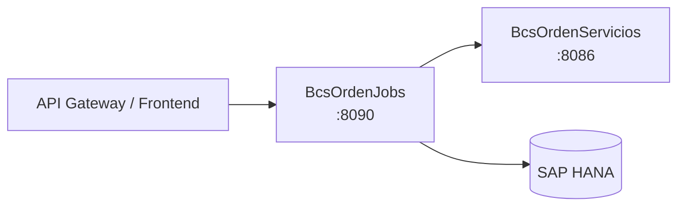

# BcsOrdenJobs

## Descripción

Microservicio de jobs batch de órdenes bursátiles. Expone 27 endpoints que disparan stored procedures de HANA para el procesamiento de órdenes del mercado: asignación automática, carga de archivos de transacciones, control de mercado (FIX, MME, BEC, mercado de palos), market data de instrumentos y puntas por mercado (OP, RF, RV, SIM), creación de órdenes postreras, drop-copy RV, generación de informes estadísticos y refacturación de movimientos. Es el orquestador batch que invoca a `BcsOrdenServicios` para registrar el resultado de cada job.

## Tecnología

- **Framework:** Spring Boot 4.1.1 / Java 25
- **Puerto:** 8090
- **Artifact:** `cl.bcs:bcs-orden-jobs`
- **Base de datos:** SAP HANA (via `com.sap.db.jdbc.Driver`)

## Requisitos

| Variable | Descripción |
|---|---|
| `HANA_URL` | URL JDBC de la base de datos SAP HANA |
| `HANA_USER` | Usuario de conexión a HANA |
| `HANA_PASSWORD` | Contraseña de conexión a HANA |

## Endpoints

Todos los endpoints siguen el patrón `POST /api/jobs/ordenes/{nombre}/ejecutar` con cuerpo JSON `{ "idEmpresa": "...", "idUsuario": "..." }` y devuelven `{ "status": "ok" }`.

### Asignación y carga

| Método | Ruta | Descripción |
|---|---|---|
| `POST` | `/api/jobs/ordenes/asignacion-automatica/ejecutar` | Ejecuta asignación automática de órdenes |
| `POST` | `/api/jobs/ordenes/cargar-archivo-ordenes-transacciones/ejecutar` | Carga archivo de órdenes y transacciones |
| `POST` | `/api/jobs/ordenes/cargar-transacciones-bolsa-electronica/ejecutar` | Carga transacciones de bolsa electrónica (BEC) |

### Control de mercado

| Método | Ruta | Descripción |
|---|---|---|
| `POST` | `/api/jobs/ordenes/control-mercado-carga-modificacion-ruebas/ejecutar` | Control mercado: carga y modificación de RUEBAs |
| `POST` | `/api/jobs/ordenes/control-mercado-fix/ejecutar` | Control mercado vía protocolo FIX |
| `POST` | `/api/jobs/ordenes/control-mercado-fix-mme/ejecutar` | Control mercado FIX para Mercado de Monedas Extranjeras |
| `POST` | `/api/jobs/ordenes/control-mercado-market-data-palos-bec/ejecutar` | Market data palos vía BEC |
| `POST` | `/api/jobs/ordenes/control-mercado-market-data-palos-if/ejecutar` | Market data palos instrumentos financieros |
| `POST` | `/api/jobs/ordenes/control-mercado-market-data-palos-op/ejecutar` | Market data palos operaciones |
| `POST` | `/api/jobs/ordenes/control-mercado-market-data-palos-rf/ejecutar` | Market data palos renta fija |
| `POST` | `/api/jobs/ordenes/control-mercado-market-data-palos-rv/ejecutar` | Market data palos renta variable |
| `POST` | `/api/jobs/ordenes/control-mercado-market-data-palos-sim/ejecutar` | Market data palos SIM |
| `POST` | `/api/jobs/ordenes/control-mercado-modificacion-palos-ruebas/ejecutar` | Control mercado: modificación de palos RUEBAs |
| `POST` | `/api/jobs/ordenes/control-mercado-palos-rv-mme/ejecutar` | Control mercado palos renta variable MME |
| `POST` | `/api/jobs/ordenes/control-mercado-transacciones-bolsa-electronica/ejecutar` | Control mercado transacciones BEC |

### Órdenes y market data

| Método | Ruta | Descripción |
|---|---|---|
| `POST` | `/api/jobs/ordenes/crear-ordenes-postreras/ejecutar` | Crea órdenes postreras del día |
| `POST` | `/api/jobs/ordenes/drop-copy-rv-marca-negociacion/ejecutar` | Drop-copy renta variable — marca de negociación |
| `POST` | `/api/jobs/ordenes/generar-informe-estadisticas/ejecutar` | Genera informe de estadísticas de órdenes |
| `POST` | `/api/jobs/ordenes/market-data-op-instrumentos/ejecutar` | Market data operaciones: instrumentos |
| `POST` | `/api/jobs/ordenes/market-data-op-precio-instrumentos/ejecutar` | Market data operaciones: precios de instrumentos |
| `POST` | `/api/jobs/ordenes/market-data-op-puntas/ejecutar` | Market data operaciones: puntas |
| `POST` | `/api/jobs/ordenes/market-data-rv-instrumentos/ejecutar` | Market data renta variable: instrumentos |
| `POST` | `/api/jobs/ordenes/market-data-rv-instrumentos-mme/ejecutar` | Market data renta variable MME: instrumentos |
| `POST` | `/api/jobs/ordenes/market-data-rv-puntas/ejecutar` | Market data renta variable: puntas |
| `POST` | `/api/jobs/ordenes/market-data-rv-puntas-mme/ejecutar` | Market data renta variable MME: puntas |
| `POST` | `/api/jobs/ordenes/procesamiento-transacciones-operadores/ejecutar` | Procesamiento de transacciones de operadores |
| `POST` | `/api/jobs/ordenes/refacturar-movimiento/ejecutar` | Refactura un movimiento existente |

## Dependencias de runtime

| Servicio | Rol |
|---|---|
| SAP HANA | Ejecución de los 27 stored procedures de órdenes y control de mercado |
| `BcsOrdenServicios` (8086) | Registro del resultado de jobs de órdenes |

## Diagrama

## Notas de implementación

- **Clave de control de mercado** (B-ORD-05/06): clave = `tradeID + fechaSistema + "COM"` (compra) o `+ "VEN"` (venta). Constantes `COMPRA="COM"`, `VENTA="VEN"`.
- **Comparación de transacciones** (B-ORD-09): usa `BigDecimal.compareTo() == 0` en 8 campos numéricos — no `equals()`. `new BigDecimal("1.0").equals(new BigDecimal("1.00"))` es `false`; `compareTo` es `0`. Bug de escala pinneado explícitamente.
- **INSERT por reflexión** (B-ORD-04): bug pinneado — si el último campo del array tiene prefijo `_`, el campo anterior recibe coma trailing en el SQL generado. Comportamiento idéntico al legacy.
- **`eliminarTabla`** (B-ORD-02): el SQL generado es `"drop table NAME"` en minúsculas — CANARY. Cambiar a mayúsculas rompe 2 tests.
- **MOTIVO_ANULACION** (B-ORD-08): constante `"ANULACION POR SISTEMA BURSATIL"` con espacio, no guion — pinneado.
- **HANA diferido**: `OrdenJobRepository` lanza `UnsupportedOperationException` en todos sus métodos. Todos los endpoints devuelven 503 sin HANA.
- **Scheduler**: migración de Quartz → Spring Scheduler pendiente como criterio de salida de Fase 3.
- **Idempotencia**: los 27 jobs deben ser re-ejecutables sin duplicar datos (validación pendiente en QA-HANA).
- **Manejo de errores**: NPE→400, `IllegalArgumentException`→400, `UnsupportedOperationException`→503.
