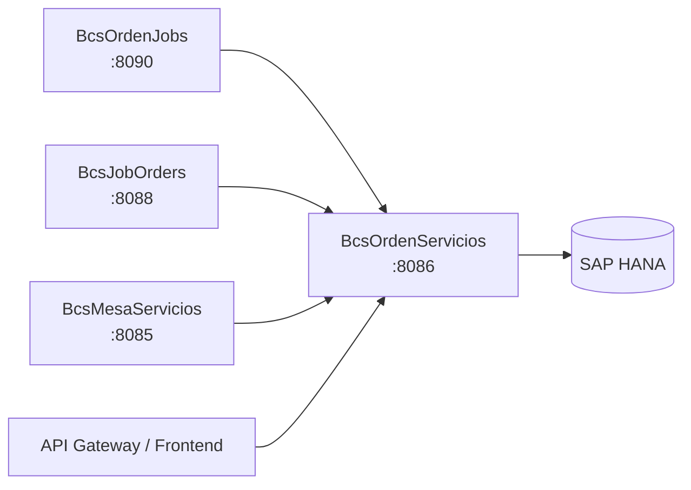

# BcsOrdenServicios

## Descripción

Microservicio de gestión de órdenes de compra/venta de instrumentos financieros. Expone la lógica de negocio para crear órdenes, construir claves de bloqueo únicas para evitar duplicados, calcular montos con paridad cambiaria, y consultar las constantes de estado del ciclo de vida de una orden. Es consumido por `BcsOrdenJobs`, `BcsJobOrders` y `BcsMesaServicios` para el procesamiento de órdenes del mercado bursátil.

## Tecnología

- **Framework:** Spring Boot 4.1.1 / Java 25
- **Puerto:** 8086
- **Artifact:** `cl.bcs:bcs-orden-servicios`
- **Base de datos:** SAP HANA (via `com.sap.db.jdbc.Driver`)

## Requisitos

| Variable | Descripción |
|---|---|
| `HANA_URL` | URL JDBC de la base de datos SAP HANA |
| `HANA_USER` | Usuario de conexión a HANA |
| `HANA_PASSWORD` | Contraseña de conexión a HANA |

## Endpoints

### Constantes de estado

| Método | Ruta | Descripción |
|---|---|---|
| `GET` | `/api/ordenes/constantes/estado-inicial` | Devuelve los estados iniciales de una orden: `PENDIENTE_AUTORIZAR` y `AUTORIZADA` |

### Creación y bloqueo de órdenes

| Método | Ruta | Descripción |
|---|---|---|
| `POST` | `/api/ordenes/bloqueo-id` | Construye la clave de bloqueo única para una orden (combinación de portafolio, instrumento, tipo, cantidad, precio y fecha) |
| `POST` | `/api/ordenes/crear` | Registra una nueva orden en HANA con estado inicial `PENDIENTE_AUTORIZAR` (requiere HANA) |

### Cálculo de monto

| Método | Ruta | Descripción |
|---|---|---|
| `POST` | `/api/ordenes/monto-paridad` | Calcula el monto de una orden aplicando factor de paridad cambiaria |

**Parámetros de `/api/ordenes/bloqueo-id` y `/api/ordenes/monto-paridad`:** query params `idPortafolio`, `idInstrumento`, `idTipoOperacion`, `cantidad`, `precioLimite`, `fechaSistema` / `precio`, `cantidad`, `factor`.

## Endpoint interno de dispatcher

### `POST /internal/java-call`

Recibe despachos J-type desde `BcsPlataformaWeb/CallController`. No expuesto en el gateway.

**Body:**
```json
{
  "class": "cl.bcs.dominio.NombreClase",
  "params": { ... },
  "skip": 0,
  "take": -1
}
```

**Activación progresiva:** Para registrar una clase JavaCall migrada, agregar un `case` en `InternalJavaCallController`:
```java
case "cl.bcs.dominio.NombreClase" -> service.ejecutar(params);
```

**Estado actual:** Todas las clases retornan 503 → BcsGateway hace fallback a TomEE.

## Dependencias de runtime

| Servicio | Rol |
|---|---|
| SAP HANA | Registro de órdenes via `SP_CREAR_ORDEN` y consultas de módulo |

## Diagrama



## Notas de implementación

- **Clave de bloqueo** (B-ORD-CRE-01): concatenación de `idPortafolio_idInstrumento_idTipoOperacion_cantidad_precioLimite_fechaSistema` para garantizar idempotencia.
- **GeneraSpot** (B-ORD-CRE-02): la condición de generación spot es `COMPRA` con `USD` O `CLP+USD` en liquidación — comparación case-insensitive. Canary: invertir `COMPRA`→`VENTA` rompe 6 tests.
- **Monto con paridad** (B-ORD-MONTO-01): `y = precio × factor`; si `y < 0.5`, escala(3, DOWN); si `y ≥ 0.5`, escala(2, HALF_UP); resultado = `y × cantidad`.
- **Resolución de campos nulos**: múltiples campos con fallback explícito — `p_Estado` null/vacío → `"ACT"`, `p_IdPersonaBrokerExtranjero` null → `0L`, `IdBoveda` "0"/null → null, `EsVentaCorta` null → `"N"`, etc.
- **VentaCorta** (B-ORD-CRE-16): solo válida con canal `MAN`; cualquier otro canal con venta corta es inválido.
- **Acceso HANA diferido**: `/api/ordenes/crear` devuelve 503 sin HANA. `/api/ordenes/bloqueo-id`, `/monto-paridad` y `/constantes/estado-inicial` funcionan en modo puro.
- **Dominio mutable**: `OrdenProceso` usa campo público mutable `errores` — el algoritmo `limpiarOrdenes` lo modifica durante iteración (equivalente al legacy).
- **Manejo de errores**: NPE→400, `IllegalArgumentException`→400, `UnsupportedOperationException`→503.
