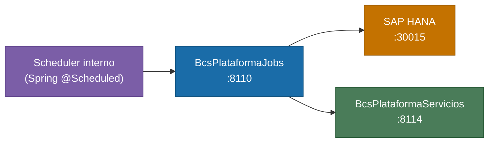

# BcsPlataformaJobs

## Descripción

Servicio de jobs de plataforma. Ejecuta y coordina procesos batch del sistema: actualizacion de parametros financieros (IPC, dolar observado, paridad USD) y la pauta diaria de apertura/cierre del mercado. Implementa completamente la logica pura de `ActualizarParametrosFinancierosService` y `LaPautaService`; el resto de los 75+ pasos de pauta y 30+ jobs adicionales estan en modo stub hasta que se disponga de conectividad HANA.

## Tecnología

- **Framework:** Spring Boot 4.1.1 / Java 25
- **Puerto:** 8110
- **Artifact:** `cl.bcs:plataforma-jobs`
- **Arquitectura:** Hexagonal (domain / port/out / adapter/out / service / web)

## Requisitos

| Variable de entorno | Descripcion | Obligatoria |
|---|---|---|
| `HANA_URL` | URL JDBC de SAP HANA (ej. `jdbc:sap://host:30015`) | Si |
| `HANA_USER` | Usuario de HANA | Si |
| `HANA_PASSWORD` | Contrasena de HANA | Si |
| `SERVER_PORT` | Puerto HTTP. Por defecto: `8110` | No |
| `PLA_LOG_BASE_PATH` | Ruta base para archivos de log de jobs. Por defecto: `/data/archivos` | No |
| `PLATAFORMA_URL` | URL base de BcsPlataformaServicios. Por defecto: `http://localhost:8110` | No |

## Endpoints

| Metodo | Ruta | Descripcion |
|---|---|---|
| `GET` | `/plataforma-jobs/health` | Health check del servicio |

> Los jobs no exponen endpoints de activacion directa en esta fase. Son invocados por el scheduler interno de Spring (`@Scheduled`) o por llamada programatica desde la pauta.

## Dependencias de runtime

| Servicio | Puerto | Rol |
|---|---|---|
| SAP HANA | 30015 | Fuente y destino de parametros financieros y estado de pauta |
| BcsPlataformaServicios | 8114 | Servicios de plataforma invocados por los jobs |

## Diagrama



## Notas de implementacion

### Reglas de negocio implementadas (logica pura con tests)

| ID | Descripcion |
|---|---|
| **B-PLJ-01** | Corrección de fecha de IPC: se resta 1 mes y se fija al dia 1. El WS entrega el IPC con un mes de adelanto. |
| **B-PLJ-02** | Corrección de fecha del dólar observado: se resta 1 dia. El WS entrega el valor con 1 dia de adelanto. |
| **B-PLJ-03** | Paridad en USD = `rawValor / dolarObservado`, redondeado a 8 decimales con modo `FLOOR`. |
| **B-PLJ-04** | Deteccion de brecha en dia no habil. |
| **B-PLJ-10** | Formateo de fecha/hora con offset de segundos (tipos: Fecha, Hora, Ambos). |
| **B-PLJ-11** | Guardia de modulo abierto: un modulo no-SIS en estado ABT bloquea la ejecucion de la pauta. |
| **B-PLJ-12** | Busqueda de proceso dependiente (case-insensitive). |
| **B-PLJ-14** | Truncamiento de mensajes de log a 500 caracteres. |

### Jobs completamente implementados

- **`ActualizarParametrosFinancierosService`** — Actualiza IPC, dolar observado y paridad USD aplicando las correcciones de fecha B-PLJ-01/B-PLJ-02/B-PLJ-03.
- **`LaPautaService`** — Orquesta la pauta diaria de procesos del sistema (logica de estado, orden de ejecucion, deteccion de inhabiles).

### Jobs en modo stub (requieren HANA)

75+ pasos de pauta (`PautaAbrirSistema`, `PautaEntregarSistema`, `PautaTerminarPauta`, valorizaciones de cartera, vencimientos, replicas, etc.) y 30+ jobs adicionales (carga de archivos, notificaciones, exportaciones) lanzan `UnsupportedOperationException` → HTTP 503.

**Plan de habilitacion:**
1. Implementar `PlataformaJobsRepository` con queries HANA para seguimiento de ejecucion de pauta
2. Implementar `ConfiguracionAdapter` para leer `PLA.FechaSistema` y otros parametros
3. Conectar `LaPautaService.ejecutarPauta()` a los adaptadores HANA
4. Habilitar `PautaAbrirSistema` como primer proceso, y avanzar secuencialmente

### Arquitectura hexagonal

```
service/pauta/LaPautaService.java              <- IMPLEMENTADO (logica pura)
service/parametros/ActualizarParametrosFinancierosService.java  <- IMPLEMENTADO
service/pauta/PautaProcessStubs.java           <- 75+ stubs UOE
service/parametros/ParametrosStubs.java        <- 30+ stubs UOE
port/out/PautaRepositoryPort                   <- interfaz de salida
adapter/out/PlataformaJobsRepository           <- stub HANA
web/HealthController.java                      <- GET /plataforma-jobs/health
```

### Manejo de errores

| Excepcion | HTTP |
|---|---|
| `NullPointerException` | 400 |
| `IllegalArgumentException` | 400 |
| `NumberFormatException` | 400 |
| `UnsupportedOperationException` | 503 |

### Tests

41 tests — 14 de `ActualizarParametrosFinancierosService`, 25 de `LaPautaService`, 2 canarios. 2 deshabilitados (requieren HANA). BUILD SUCCESS.
