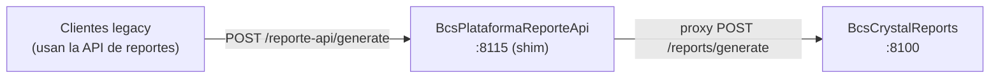

# BcsPlataformaReporteApi

## Descripción

Shim de compatibilidad transitorio que mantiene activa la superficie REST de la API de reportes Crystal Reports durante la ventana de migración canary, mientras el sistema TomEE legado permanece activo. No procesa reportes directamente; actúa como proxy hacia `BcsCrystalReports` (puerto 8100), que contiene la implementación real. Este módulo debe ser dado de baja (decommissioned) una vez que todos los consumidores hayan migrado a `CrystalReportsPort` de `bcs-utils` y el TomEE sea apagado.

## Tecnología

- **Framework:** Spring Boot 4.1.1 / Java 25
- **Puerto:** 8115
- **Artifact:** `cl.bcs:BcsPlataformaReporteApi`

## Requisitos

### Variables de entorno / configuración

| Propiedad | Variable de entorno | Descripción | Default |
|---|---|---|---|
| `crystal.reports.url` | — | URL base de BcsCrystalReports | `http://bcs-crystal-reports:8100` |

### Dependencias externas

- **BcsCrystalReports (8100):** Destino de todas las peticiones de generación de reportes.

## Endpoints

| Método | Ruta | Descripción |
|---|---|---|
| `GET` | `/reporte-api/health` | Health check — devuelve `200 OK` con `BcsPlataformaReporteApi UP` |
| `POST` | `/reporte-api/generate` | Proxy de generación de reporte hacia BcsCrystalReports |

### Cuerpo de la petición — POST /reporte-api/generate

Mismo formato que `POST /reports/generate` en BcsCrystalReports (DTO compartido `CrystalReportRequest` de `bcs-utils`):

```json
{
  "templateId":   "<UUID>",
  "format":       "pdf | excel | word | rtf | txt",
  "beanData":     { "campo": "valor" },
  "imageBase64":  "<base64>",
  "imageName":    "<nombre campo imagen>",
  "barcodeData":  "<datos barcode>",
  "barcodeName":  "<nombre campo barcode>"
}
```

**Respuesta:** Binario del reporte con `Content-Type` apropiado (delegado desde BcsCrystalReports).

## Dependencias de runtime

| Dependencia | Tipo | Descripción |
|---|---|---|
| BcsCrystalReports | Servicio HTTP (8100) | Generación real de reportes Crystal Reports |

## Diagrama



## Notas de implementación

- **Este módulo es temporal.** Debe ser eliminado siguiendo el plan de 5 pasos en `TRANSFORMATION_NOTES.md`:
  1. Verificar que todos los llamadores usan `CrystalReportsPort` (bcs-utils) en lugar de los endpoints de este shim.
  2. Confirmar ausencia de tráfico en `POST /reporte-api/generate` en logs de producción.
  3. Apagar las instancias TomEE.
  4. Eliminar `<module>BcsPlataformaReporteApi</module>` del `pom.xml` padre.
  5. Eliminar este directorio.
- La lógica real de generación de reportes (lectura de templates `.rpt` de HANA, binding de datos, exportación con Crystal SDK) vive completamente en `BcsCrystalReports` (Java 11, Spring Boot 2.7.18). La decisión de aislar Crystal Reports en un sidecar Java 11 se debió a la incompatibilidad del SDK con Java 12+.
- Los módulos ya migrados usan `CrystalReportsRestClient` de `bcs-utils`, que llama directamente a `POST http://bcs-crystal-reports:8100/reports/generate`, sin pasar por este shim.
