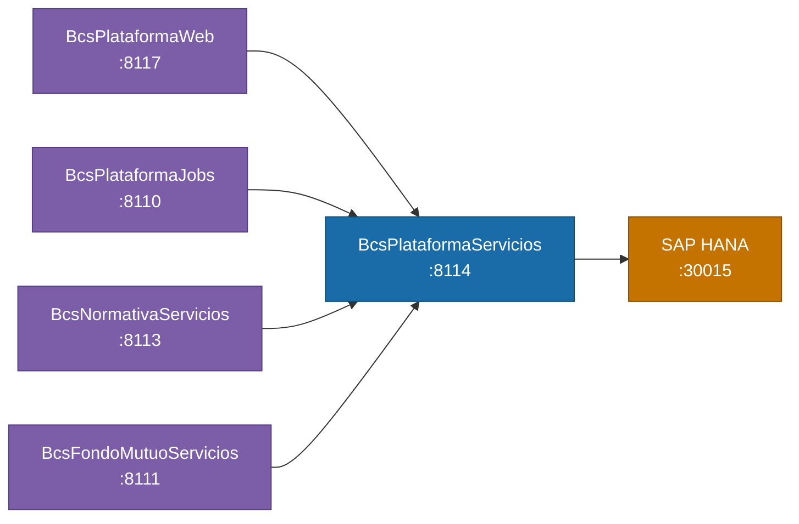

# BcsPlataformaServicios

## Descripción

Microservicio central de logica de plataforma. Expone mas de 430 servicios de negocio heredados del sistema TomEE/JavaCall como endpoints REST. Implementa completamente `ConvertirMontoEscritoService` (conversion de montos a letras y numeros romanos); el resto de los 430+ servicios (acceso, comercial, pauta, instrumentos, autorizacion, conciliacion, etc.) devuelven HTTP 503 — los despachos J-type llegan via `POST /internal/java-call` y BcsGateway hace fallback a TomEE hasta que cada clase sea migrada progresivamente.

## Tecnología

- **Framework:** Spring Boot 4.1.1 / Java 25
- **Puerto:** 8114
- **Artifact:** `cl.bcs:plataforma-service`
- **Arquitectura:** Hexagonal (domain / port / service / adapter/in/rest / adapter/out/jdbc)

## Requisitos

| Variable de entorno | Descripcion | Obligatoria |
|---|---|---|
| `HANA_URL` | URL JDBC de SAP HANA (ej. `jdbc:sap://host:30015?databaseName=BCS`) | Si |
| `HANA_USER` | Usuario de HANA | Si |
| `HANA_PASSWORD` | Contrasena de HANA | Si |
| `SERVER_PORT` | Puerto HTTP. Por defecto: `8114` | No |

## Endpoints

### Implementados

| Metodo | Ruta | Descripcion |
|---|---|---|
| `GET` | `/api/plataforma/health` | Health check |
| `POST` | `/api/plataforma/conversor-monto/letras` | Convierte monto numerico a palabras en espanol |
| `POST` | `/api/plataforma/conversor-monto/romanos` | Convierte entero a numeracion romana (1-3999) |
| `POST` | `/api/plataforma/conversor-monto/letras/batch` | Conversion en lote de multiples montos |

### Stubs — dominio Plataforma (HTTP 503)

| Metodo | Ruta | Descripcion |
|---|---|---|
| `POST` | `/api/plataforma/parametros/consultar` | Consultar parametros PLA |
| `POST` | `/api/plataforma/parametros/modificar` | Modificar parametros PLA |
| `POST` | `/api/plataforma/log/agregar` | Agregar entrada de log |
| `POST` | `/api/plataforma/log/insertar-servicio` | Log de llamada a servicio |
| `POST` | `/api/plataforma/log/insertar-ventana` | Log de apertura de ventana |
| `POST` | `/api/plataforma/fecha/cambiar` | Cambiar fecha del sistema |
| `POST` | `/api/plataforma/fecha/ajustar` | Ajustar fecha del sistema |
| `POST` | `/api/plataforma/dias/anterior` | Calcular dia habil anterior |
| `POST` | `/api/plataforma/dias/siguiente` | Calcular dia habil siguiente |
| `POST` | `/api/plataforma/dias/plazo` | Calcular plazo en dias habiles |
| `POST` | `/api/plataforma/dias/habiles-anteriores` | Dias habiles anteriores |
| `POST` | `/api/plataforma/dias/habil-multiples-paises` | Dia habil en multiples paises |
| `POST` | `/api/plataforma/dias/cargar-inhabiles` | Cargar dias inhabiles |
| `POST` | `/api/plataforma/flujo-caja/consultar` | Consultar flujo de caja |
| `POST` | `/api/plataforma/flujo-caja/saldo` | Saldo de flujo de caja |
| `POST` | `/api/plataforma/grilla/guardar-usuario` | Guardar configuracion de grilla por usuario |
| `POST` | `/api/plataforma/grilla/guardar-predeterminado` | Guardar grilla predeterminada |
| `POST` | `/api/plataforma/diccionario/agregar` | Agregar entrada al diccionario |
| `POST` | `/api/plataforma/diccionario/modificar` | Modificar entrada del diccionario |
| `POST` | `/api/plataforma/monitor` | Estado del monitor de plataforma |
| `POST` | `/api/plataforma/solicitud-cambio/crear` | Crear solicitud de cambio |
| `POST` | `/api/plataforma/solicitud-cambio/consultar` | Consultar solicitudes de cambio |
| `POST` | `/api/plataforma/formato-moneda` | Formatear moneda segun formato |
| `POST` | `/api/plataforma/apertura-mesas` | Apertura de mesas y modulos |
| `POST` | `/api/plataforma/mapa-relaciones/consultar` | Consultar mapa de relaciones |
| `POST` | `/api/plataforma/websocket/mensaje` | Enviar mensaje WebSocket |
| `POST` | `/api/plataforma/carga-masiva` | Carga masiva de datos |
| `POST` | `/api/plataforma/data-historica/gestionar` | Gestionar data historica |
| `POST` | `/api/plataforma/data-historica/limpiar` | Limpiar data historica |

### Stubs — dominio Acceso (HTTP 503)

| Metodo | Ruta | Descripcion |
|---|---|---|
| `POST` | `/api/plataforma/acceso/usuario/crear` | Crear usuario |
| `POST` | `/api/plataforma/acceso/usuario/actualizar` | Actualizar usuario |
| `POST` | `/api/plataforma/acceso/usuario/bloqueo-vigencia` | Bloquear usuario por vigencia |
| `POST` | `/api/plataforma/acceso/usuario/cambiar-clave` | Cambiar clave de usuario |
| `POST` | `/api/plataforma/acceso/usuario/validar-clave` | Validar clave de usuario |
| `POST` | `/api/plataforma/acceso/usuario/validar-sesion` | Validar sesion de usuario |
| `POST` | `/api/plataforma/acceso/usuario/obtener-token-optimus` | Obtener token Optimus |
| `POST` | `/api/plataforma/acceso/rol/crear` | Crear rol |
| `POST` | `/api/plataforma/acceso/rol/actualizar` | Actualizar rol |
| `POST` | `/api/plataforma/acceso/rol/agregar-usuario` | Agregar usuario a rol |
| `POST` | `/api/plataforma/acceso/rol/eliminar-usuario` | Eliminar usuario de rol |
| `POST` | `/api/plataforma/acceso/rol/exportar` | Exportar roles |
| `POST` | `/api/plataforma/acceso/perfil/crear` | Crear perfil |
| `POST` | `/api/plataforma/acceso/perfil/actualizar` | Actualizar perfil |
| `POST` | `/api/plataforma/acceso/perfil/asignar-rol` | Asignar rol a perfil |
| `POST` | `/api/plataforma/acceso/perfil/eliminar-rol` | Eliminar rol de perfil |
| `POST` | `/api/plataforma/acceso/perfil/exportar` | Exportar perfiles |
| `POST` | `/api/plataforma/acceso/autorizado-orden/crear` | Crear autorizado de orden |
| `POST` | `/api/plataforma/acceso/clave-icliente/crear` | Crear clave iCliente |

### Stubs — dominio Comercial (HTTP 503)

| Metodo | Ruta | Descripcion |
|---|---|---|
| `POST` | `/api/plataforma/comercial/cobros/calcular` | Calcular cobros |
| `POST` | `/api/plataforma/comercial/cobros/consultar-plantilla` | Consultar plantilla de cobros |
| `POST` | `/api/plataforma/comercial/cobros/consultar-portafolio` | Consultar cobros de portafolio |
| `POST` | `/api/plataforma/comercial/cobros/consultar-corresponsal` | Consultar cobros de corresponsal |
| `POST` | `/api/plataforma/comercial/matriz-operacional/consultar` | Consultar matriz operacional |
| `POST` | `/api/plataforma/comercial/matriz-operacional/exportar-excel` | Exportar matriz operacional |
| `POST` | `/api/plataforma/comercial/productos/consultar-plantilla` | Consultar plantilla de productos |
| `POST` | `/api/plataforma/comercial/productos/consultar-portafolio` | Consultar productos de portafolio |
| `POST` | `/api/plataforma/comercial/contrato-comision/crear` | Crear contrato de comision |
| `POST` | `/api/plataforma/comercial/contrato-comision/crear-detalle` | Crear detalle de contrato |
| `POST` | `/api/plataforma/comercial/perfil-cobros/crear` | Crear perfil de cobros |
| `POST` | `/api/plataforma/comercial/perfil-cobros/modificar` | Modificar perfil de cobros |
| `POST` | `/api/plataforma/comercial/perfil-producto/crear` | Crear perfil de producto |
| `POST` | `/api/plataforma/comercial/perfil-producto/modificar` | Modificar perfil de producto |

> Todos los endpoints stub responden **HTTP 503** con `UnsupportedOperationException`. Ver seccion de notas para el plan de implementacion.

## Endpoint interno de dispatcher

### `POST /internal/java-call`

Recibe despachos J-type desde `BcsPlataformaWeb/CallController`. No expuesto en el gateway.

**Body:**
```json
{
  "class": "cl.bcs.dominio.NombreClase",
  "params": { ... },
  "skip": 0,
  "take": -1
}
```

**Activacion progresiva:** Para registrar una clase JavaCall migrada, agregar un `case` en `InternalJavaCallController`:
```java
case "cl.bcs.dominio.NombreClase" -> service.ejecutar(params);
```

**Estado actual:** Todas las clases retornan 503 → BcsGateway hace fallback a TomEE.

## Dependencias de runtime

| Servicio | Puerto | Rol |
|---|---|---|
| SAP HANA | 30015 | Base de datos principal |
| BcsPlataformaWeb | 8117 | Consumidor principal |
| BcsPlataformaJobs | 8110 | Jobs que invocan servicios de plataforma |
| BcsNormativaServicios | 8113 | Consumidor de servicios de plataforma |
| BcsFondoMutuoServicios | 8111 | Consumidor de servicios de plataforma |

## Diagrama



## Notas de implementacion

### Estado del dispatcher PLA.Servicio

El sistema legacy tenia 1 817+ registros en `PLA.Servicio` (tabla HANA) que mapeaban nombres de clases `JavaCall` a rutas de servicio. Los despachos J-type que llegan a `BcsPlataformaWeb/CallController` son redirigidos a `POST /internal/java-call` en este servicio; mientras una clase no este migrada, BcsGateway hace fallback a TomEE automaticamente. Esto desbloquea la operacion continua sin necesidad de exportar `PLA.Servicio` previamente. Todos los endpoints fuera de `ConvertirMontoEscrito` devuelven **HTTP 503** — el fallback TomEE los cubre.

Para migrar progresivamente cada dominio:

1. Implementar la logica en un `@Service` Spring usando `NamedParameterJdbcTemplate`
2. Registrar la clase en `InternalJavaCallController` con un `case` adicional
3. Orden de prioridad sugerido: `ConsultarParametros` → `ObtenerDiaSiguiente`/`Anterior` → `InsertarLogServicio` → `FormatearMonedaFormato` → `ValidarClaveUsuario`

### ConvertirMontoEscritoService — COMPLETAMENTE IMPLEMENTADO

Logica pura sin dependencias de HANA. Comportamientos verificados contra legado:
- `"VeintiUn "` con U mayuscula — replica el arreglo `UNIDADES[]` del legado
- `"Millon "` sin acento — evita problemas de encoding

### Arquitectura hexagonal

```
adapter/in/rest/    <- un Controller por dominio (uno implementado, el resto stub)
service/            <- ConvertirMontoEscritoService (static, sin Spring)
port/in/            <- ConvertirMontoEscritoUseCase
port/out/           <- ParametroRepository, FeriadoRepository
adapter/out/jdbc/   <- ParametroJdbcAdapter, FeriadoJdbcAdapter (stubs HANA)
```

### Manejo de errores

| Excepcion | HTTP |
|---|---|
| `NullPointerException` | 400 |
| `IllegalArgumentException` | 400 |
| `NumberFormatException` | 400 |
| `UnsupportedOperationException` | 503 |

### Tests

46 tests — 34 unitarios (`ConvertirMontoEscritoServiceTest`), 12 de integracion. BUILD SUCCESS.
