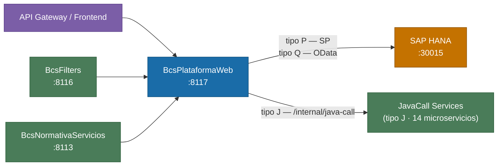

# BcsPlataformaWeb

## Descripcion

Punto de entrada web principal del sistema Optimus Corredores. Gestiona la creacion de sesiones, autenticacion SSO (Google, BofA, Local-Google), actualizacion de credenciales, descarga de archivos blob, configuracion de parametros del sistema y auditoria de transacciones. Expone el dispatcher central `/call` — portado de `CallServlet.java` de TomEE — que enruta llamadas de servicios de negocio consultando el registro `PLA.Servicio` de HANA (tipos P, Q y J activos).

## Tecnologia

- **Framework:** Spring Boot 4.1.1 / Java 25
- **Puerto:** 8117
- **Artifact:** `cl.bcs:bcs-plataforma-web`
- **Arquitectura:** Hexagonal (domain / port / service / adapter/in / adapter/out / config)

## Requisitos

| Variable de entorno | Descripcion | Obligatoria |
|---|---|---|
| `HANA_URL` | URL JDBC de SAP HANA (ej. `jdbc:sap://host:30015`) | Si |
| `HANA_USER` | Usuario de HANA | Si |
| `HANA_PASSWORD` | Contrasena de HANA | Si |
| `AUDIT_HANA_URL` | URL JDBC para la base de datos de auditoria (por defecto, igual a `HANA_URL`) | No |
| `AUDIT_HANA_USER` | Usuario de auditoria (por defecto, igual a `HANA_USER`) | No |
| `AUDIT_HANA_PASSWORD` | Contrasena de auditoria (por defecto, igual a `HANA_PASSWORD`) | No |
| `SECURITY_REHASH_ENABLED` | Habilita re-hashing de contrasenas SHA-256 legacy a BCrypt en cada login. `false` = modo canario (acepta ambos sin re-hashear). Por defecto: `false` | No |
| `COR_SESSION_TIMEOUT_MINUTES` | Tiempo de inactividad (minutos) para expirar sesiones en el dispatcher `/call`. Por defecto: `30` | No |
| `BCS_PLATAFORMA_SERVICIOS_URL` | URL JavaCall de BcsPlataformaServicios (tipo J). Por defecto: `http://bcs-plataforma-servicios:8114` | No |
| `BCS_SOCIO_NEGOCIO_SERVICIOS_URL` | URL JavaCall de BcsSocioNegocioServicios. Por defecto: `http://bcs-socio-negocio-servicios:8098` | No |
| `BCS_ORDEN_SERVICIOS_URL` | URL JavaCall de BcsOrdenServicios. Por defecto: `http://bcs-orden-servicios:8086` | No |
| `BCS_NORMATIVA_SERVICIOS_URL` | URL JavaCall de BcsNormativaServicios. Por defecto: `http://bcs-normativa-servicios:8113` | No |
| `BCS_MESA_SERVICIOS_URL` | URL JavaCall de BcsMesaServicios. Por defecto: `http://bcs-mesa-servicios:8085` | No |
| `BCS_CUSTODIA_SERVICIOS_URL` | URL JavaCall de BcsCustodiaServicios. Por defecto: `http://bcs-custodia-servicios:8097` | No |
| `BCS_FONDO_MUTUO_SERVICIOS_URL` | URL JavaCall de BcsFondoMutuoServicios. Por defecto: `http://bcs-fondo-mutuo-servicios:8111` | No |
| `BCS_APV_SERVICIOS_URL` | URL JavaCall de BcsAPVServicios. Por defecto: `http://bcs-apv-servicios:8083` | No |
| `BCS_TESORERIA_SERVICIOS_URL` | URL JavaCall de BcsTesoreriaServicios. Por defecto: `http://bcs-tesoreria-servicios:8073` | No |
| `BCS_FACTURACION_SERVICIOS_URL` | URL JavaCall de BcsFacturacionServicios. Por defecto: `http://bcs-facturacion-servicios:8099` | No |
| `BCS_CUENTA_INVERSION_SERVICIOS_URL` | URL JavaCall de BcsCuentaInversionServicios. Por defecto: `http://bcs-cuenta-inversion-servicios:8080` | No |
| `BCS_CONTABILIDAD_SERVICIOS_URL` | URL JavaCall de BcsContabilidadServicios. Por defecto: `http://bcs-contabilidad-servicios:8081` | No |
| `BCS_PORTAFOLIO_SERVICIOS_URL` | URL JavaCall de BcsPortafolioServicios. Por defecto: `http://bcs-portafolio-servicios:8076` | No |
| `BCS_CANAL_AGENTE_SERVICIOS_URL` | URL JavaCall de BcsCanalAgenteServicios. Por defecto: `http://bcs-canal-agente-servicios:8102` | No |

## Endpoints

| Metodo | Ruta | Descripcion | Estado |
|---|---|---|---|
| `POST` | `/call` | Dispatcher central de servicios (tipos P/Q/J) | Completo |
| `GET` | `/call` | Dispatcher central de servicios (tipos P/Q/J) | Completo |
| `POST` | `/internal/java-call` | Router interno de JavaCall para los jobs (token interno, sin sesion; ver seccion final) | Completo (paso 5b) |
| `POST` | `/CallBatch` | Ejecutor de batch/plugins | Pendiente |
| `GET` | `/bootstrap` | Pagina de bootstrap HTML (carga inicial) | Parcial (HANA) |
| `POST` | `/bootstrap` | Pagina de bootstrap HTML (carga inicial) | Parcial (HANA) |
| `POST` | `/CrearSesion` | Crea una sesion de usuario autenticado | Completo |
| `GET` | `/CrearSesion` | Consulta sesion existente | Completo |
| `GET` | `/Ping` | Health check del servicio | Completo |
| `POST` | `/Ping` | Health check del servicio | Completo |
| `GET` | `/Configuraciones` | Consulta parametros de configuracion del sistema | Completo |
| `POST` | `/Configuraciones` | Consulta parametros de configuracion del sistema | Completo |
| `POST` | `/AuditoriaWS` | Registra evento de auditoria de transaccion | Completo |
| `POST` | `/ProcesarIdTransaccion` | Procesa y registra un identificador de transaccion | Completo |
| `POST` | `/FileBlobManager` | Sube un archivo blob al repositorio HANA | Completo |
| `GET` | `/FileBlobManager` | Descarga un archivo blob del repositorio HANA | Completo |
| `POST` | `/ActualizarClave` | Actualiza la contrasena del usuario | Completo |
| `POST` | `/ValidaClaveProvisoria` | Valida una clave provisoria de primer acceso | Completo |
| `GET` | `/SSOInit` | Inicia flujo SSO | Completo |
| `POST` | `/SSOInit` | Inicia flujo SSO | Completo |
| `GET` | `/SSOLogonGoogle` | Callback OAuth2 de Google | Completo |
| `POST` | `/SSOLogonGoogle` | Callback OAuth2 de Google | Completo |
| `GET` | `/SSOLogonBofa` | Callback SSO de Bank of America | Completo |
| `POST` | `/SSOLogonBofa` | Callback SSO de Bank of America | Completo |
| `GET` | `/SSOLogonLocalGoogle` | Callback SSO Local-Google | Completo |
| `POST` | `/SSOLogonLocalGoogle` | Callback SSO Local-Google | Completo |
| `GET` | `/SSOLogout` | Cierra la sesion SSO | Completo |

## Dependencias de runtime

| Servicio | Puerto | Rol |
|---|---|---|
| SAP HANA | 30015 | Base de datos principal (sesiones, configuracion, auditoria, archivos) |
| BcsFilters | 8116 | Filtros de seguridad HTTP compartidos |
| BcsNormativaServicios | 8113 | Servicios de normativa (consumidos por frontend via este gateway) |
| BcsPlataformaServicios | 8114 | JavaCall tipo J — paquetes `cl.bcs.plataforma` |
| BcsSocioNegocioServicios | 8098 | JavaCall tipo J — paquetes `cl.bcs.socionegocio`, `cl.bcs.SocioNegocio` |
| BcsOrdenServicios | 8086 | JavaCall tipo J — paquetes `cl.bcs.ordenes` |
| BcsMesaServicios | 8085 | JavaCall tipo J — paquetes `cl.bcs.mesa`, `cl.bcs.Mesa` |
| BcsCustodiaServicios | 8097 | JavaCall tipo J — paquetes `cl.bcs.custodia`, `cl.bcs.Custodia` |
| BcsFondoMutuoServicios | 8111 | JavaCall tipo J — paquetes `cl.bcs.fondomutuo`, `cl.bcs.fondoMutuo`, `cl.bcs.FondoMutuo` |
| BcsAPVServicios | 8083 | JavaCall tipo J — paquetes `cl.bcs.APV`, `cl.bcs.apv` |
| BcsTesoreriaServicios | 8073 | JavaCall tipo J — paquetes `cl.bcs.tesoreria`, `cl.bcs.Tesoreria` |
| BcsFacturacionServicios | 8099 | JavaCall tipo J — paquetes `cl.bcs.facturacion`, `cl.bcs.Facturacion` |
| BcsCuentaInversionServicios | 8080 | JavaCall tipo J — paquetes `cl.bcs.cuentaInversion` |
| BcsContabilidadServicios | 8081 | JavaCall tipo J — paquetes `cl.bcs.contabilidad` |
| BcsPortafolioServicios | 8076 | JavaCall tipo J — paquetes `cl.bcs.portafolio`, `cl.bcs.Portafolio` |
| BcsCanalAgenteServicios | 8102 | JavaCall tipo J — paquetes `cl.bcs.canalagente`, `cl.bcs.CanalAgente` |

## Diagrama



## Dispatcher `/call`

Implementa el endpoint central del sistema legacy. Reemplaza `CallServlet.java` de TomEE.

### Protocolo

```
GET/POST /call?t={IdServicio}&r={resultKey}&ch={canal}
Header:   X-SESSION-TOKEN: {token}
Body:     JSON con parametros del servicio (POST)
```

Parametros OData adicionales soportados: `$select`, `$filter`, `$orderby`, `$top`, `$skip`, `$inlinecount`, `skip`, `take`.

### Tipos de servicio (PLA.Servicio.TipoServicio)

| Tipo | Descripcion | Cantidad | Estado |
|---|---|---|---|
| P | HANA Stored Procedure | 826 | Implementado (SPs escalares via `ProcedureDispatcherService`) |
| Q | OData View Query | 1,347 | Implementado completo (via `QueryDispatcherService`) |
| J | JavaCall → Spring Boot | 977 | Routing activo, activacion progresiva (via `JavaCallRouterService`) |

### Flujo de validacion de sesion (`SessionValidatorService`)

1. Resuelve metadatos del servicio en `PLA.Servicio` usando `IdServicio` y `IdCanal`.
2. Si `RegistraUso = 'N'`, omite la validacion de sesion (servicios publicos).
3. Valida el token contra `ACC.Sesion`; la sesion expira por inactividad segun `COR_SESSION_TIMEOUT_MINUTES`.
4. Carga datos del usuario desde `ACC.Usuario`; rechaza si `IdEstado != 'A'`.

### Routing JavaCall (tipo J)

`JavaCallRouterService` extrae el FQN de la clase desde `RutaServicio` (formatos: `PLUGIN_XXX.jar@cl.bcs.pkg.ClassName`, `PLUGIN_XXX@cl.bcs.pkg.ClassName`, o FQN directo), resuelve el microservicio destino por prefijo de paquete Java y llama a `POST /internal/java-call` reenviando el token como `X-SESSION-TOKEN`.

Si el paquete no esta mapeado retorna HTTP 503, permitiendo que BcsGateway haga fallback a TomEE para esa clase.

### Variables de entorno JavaCall

| Propiedad (`application.properties`) | Variable de entorno | Puerto por defecto |
|---|---|---|
| `plataforma.javacall.url.bcs-plataforma-servicios` | `BCS_PLATAFORMA_SERVICIOS_URL` | 8114 |
| `plataforma.javacall.url.bcs-socio-negocio-servicios` | `BCS_SOCIO_NEGOCIO_SERVICIOS_URL` | 8098 |
| `plataforma.javacall.url.bcs-orden-servicios` | `BCS_ORDEN_SERVICIOS_URL` | 8086 |
| `plataforma.javacall.url.bcs-normativa-servicios` | `BCS_NORMATIVA_SERVICIOS_URL` | 8113 |
| `plataforma.javacall.url.bcs-mesa-servicios` | `BCS_MESA_SERVICIOS_URL` | 8085 |
| `plataforma.javacall.url.bcs-custodia-servicios` | `BCS_CUSTODIA_SERVICIOS_URL` | 8097 |
| `plataforma.javacall.url.bcs-fondo-mutuo-servicios` | `BCS_FONDO_MUTUO_SERVICIOS_URL` | 8111 |
| `plataforma.javacall.url.bcs-apv-servicios` | `BCS_APV_SERVICIOS_URL` | 8083 |
| `plataforma.javacall.url.bcs-tesoreria-servicios` | `BCS_TESORERIA_SERVICIOS_URL` | 8073 |
| `plataforma.javacall.url.bcs-facturacion-servicios` | `BCS_FACTURACION_SERVICIOS_URL` | 8099 |
| `plataforma.javacall.url.bcs-cuenta-inversion-servicios` | `BCS_CUENTA_INVERSION_SERVICIOS_URL` | 8080 |
| `plataforma.javacall.url.bcs-contabilidad-servicios` | `BCS_CONTABILIDAD_SERVICIOS_URL` | 8081 |
| `plataforma.javacall.url.bcs-portafolio-servicios` | `BCS_PORTAFOLIO_SERVICIOS_URL` | 8076 |
| `plataforma.javacall.url.bcs-canal-agente-servicios` | `BCS_CANAL_AGENTE_SERVICIOS_URL` | 8102 |

## Notas de implementacion

### Codificacion de contrasenas (HybridPasswordEncoder)

`HybridPasswordEncoder` (en BcsUtils) acepta tanto BCrypt (`$2a$`, `$2b$`, `$2y$` prefix) como SHA-256 legacy (hex de 64 caracteres sin salt). En modo canario (`SECURITY_REHASH_ENABLED=false`) ambos formatos se aceptan sin re-hashear, lo que permite coexistencia entre instancias TomEE y Spring Boot sobre la misma tabla `ACC.Usuario`.

### Cache de configuracion

`ConfiguracionCacheService` usa Guava `CacheBuilder` con TTL de 1 minuto y carga lazy. La consulta UNION ALL de 11 esquemas HANA solo se ejecuta en el primer acceso.

### Manejo de errores

| Excepcion | HTTP |
|---|---|
| `NullPointerException` | 400 |
| `IllegalArgumentException` | 400 |
| `NumberFormatException` | 400 |
| `UnsupportedOperationException` | 503 |
| `Throwable` (fallback) | 500 |

### Tests

42 tests pasan, 3 deshabilitados (requieren HANA live). Reglas cubiertas: B-PLA-01 a B-PLA-12.

## Router interno `POST /internal/java-call` (paso 5b)

Los adaptadores de colaboradores de los jobs y servicios mandan `POST {JAVACALL_URL}/internal/java-call` con `{"class","params"}` y `X-Internal-Token`. Este modulo es quien atiende `JAVACALL_URL`.

- **Autenticacion**: `InternalTokenFilter` (solo rutas bajo `/internal`, normalizadas: `//`, `;param`, `%xx`, `.`/`..`, mayusculas). Secreto `services.internal-token` / `INTERNAL_TOKEN`; secreto vacio = rechaza todo (falla cerrado); comparacion en tiempo constante; unica ruta publica: `/actuator/health`. NO hay sesion de usuario y NO se impone `IdEmpresa/IdUsuario` (los params los manda un job de confianza). Las rutas existentes (`/call`, `/CrearSesion`, ...) no cambian ni piden token.
- **Cuerpo**: `{"class": "cl.bcs.pkg.Clase", "params": {...}, "skip": n, "take": n, "idServicio": n}`; solo `class` es obligatorio. Maximo `plataforma.javacall.internal.max-body-bytes` (16 MiB). Cuerpo mal formado, vacio, sobre el limite, `params` no objeto: 400. Nombre que no es una clase Java (p. ej. `BSCL.Plataforma.BD.Servicios::X`) o `tipoServicio` distinto de `J`: 422 `type not routable by this endpoint`. `cl.bcs.APV.ValidarMandatosPAC.logica` es solo en proceso: 422 (con o sin habilitar).
- **Enrutamiento** (misma regla que `/call`, `JavaCallRouterService`): clase en `plataforma.javacall.clases-habilitadas` (por defecto vacia = todo a TomEE) y con destino en `plataforma.javacall.destinos` -> estrategia del dueno; el resto -> TomEE (`{TOMEE_URL}/call?t={IdServicio}`, params intactos, sin token interno, sin cabecera de idempotencia). Solo HTTP 503 del dueno o conexion rechazada reintentan en TomEE; cualquier otro error se propaga igual (status y cuerpo; un timeout de lectura es 504 y otro fallo de transporte 502, con cuerpo fijo y `correlationId`, sin eco del mensaje de la excepcion).
- **TomEE necesita `IdServicio`**: se toma de `idServicio` del cuerpo o del export del registro (`plataforma.javacall.registro-servicios`, ubicacion Spring, p. ej. `file:/ruta/pla_servicio_trim.csv`, columnas `IdServicio,RutaServicio,TipoServicio`; clase con dos ids = ambigua = sin ruta). Sin id: 422. `X-SESSION-TOKEN` se reenvia a TomEE solo si el llamador lo manda (los jobs no tienen sesion: ver preguntas abiertas en TRANSFORMATION_NOTES).

### Configuracion

| Propiedad | Variable | Defecto |
|---|---|---|
| `services.internal-token` | `INTERNAL_TOKEN` | vacio (rechaza todo) |
| `plataforma.javacall.internal-token` | (ninguna) | si no esta vacio, es el token enviado a los duenos; si no, `services.internal-token` |
| `plataforma.javacall.clases-habilitadas` | `PLATAFORMA_JAVACALL_CLASES_HABILITADAS` | vacio |
| `plataforma.javacall.destinos` | `PLATAFORMA_JAVACALL_DESTINOS` | los 4 duenos de abajo, con sus `BCS_*_SERVICIOS_URL` |
| `plataforma.javacall.registro-servicios` | `PLATAFORMA_JAVACALL_REGISTRO_SERVICIOS` | vacio |
| `plataforma.javacall.internal.{max-body-bytes,connect-timeout-ms,read-timeout-ms}` | | 16777216 / 3000 / 60000 |

`destinos` = entradas separadas por coma `prefijo.=ESTRATEGIA@urlBase` (gana el prefijo mas largo): `cl.bcs.APV.=APV_REST@http://bcs-apv-servicios:8083`, `cl.bcs.tesoreria.=JAVACALL@...:8073`, `cl.bcs.cuentaInversion.=JAVACALL@...:8080`, `cl.bcs.contabilidad.=JAVACALL@...:8081`.

### Que es ruteable y que no

| Dueno | Estrategia | Que llama | No ruteable aun (marcador) |
|---|---|---|---|
| Contabilidad, Tesoreria, CuentaInversion | `JAVACALL` | su `POST /internal/java-call` ya existente (cuerpo `{"class","params"}` y respuesta sin tocar) | clases que el dueno no sirve: responde 503 y el router cae a TomEE (3 del export: `contabilidad.ModificarConfigConceptoCtaInv`, `cuentaInversion.ConsultarCuentasPorPagarCobrarUI`, `cuentaInversion.ConsultarResumenCuentasPagarCobrar`) |
| APV | `APV_REST` | registro `ApvJavaCallRegistro` (`bcs-apv-javacall-adapter`): params legacy -> record tipado (mismo mapper que en proceso) -> ruta REST tipada (POST/PUT con JSON; GET con query de escalares) -> Resultado tipado -> JSON legacy | clase sin ruta tipada (`ValidarMandatosPAC.call`, `ValidarBancoPrevired`, o ausente del registro): cae a TomEE; `ValidarMandatosPAC.logica`: solo en proceso, 422 |

Los 14 colaboradores del grupo M del inventario resuelven a destino o a marcador (`src/test/resources/javacall/grupo-m.txt`, `ContratoDestinosTest`).

### Alcance: solo tipo J (export de `PLA.Servicio`, HANA QA)

El export tiene 3.163 filas: Q=1.347 (consultas SQL), J=981 (clases Java; 980 con `JAR.jar@clase`), P=826 (procedimientos almacenados), X=6, O=2, A=1. J por paquete: plataforma 180, socionegocio 163, custodia 129, ordenes 90, mesa 84, normativa 81, fondomutuo 67, APV 56, tesoreria 35, facturacion 30, cuentaInversion 27, contabilidad 21, portafolio 13, sura 3, canalagente 1. Este endpoint sirve JavaCall tipo J unicamente: los Q y P los ejecuta la propia plataforma contra HANA (`QueryDispatcherService`, `ProcedureDispatcherService`, hoy detras del stub de `/call`, que responde 503) y X/O/A no tienen despachador; `/internal/java-call` los rechaza con 422 `type not routable by this endpoint` (el codigo de `/call` NO los ejecuta hoy, asi que no hay nada que reutilizar). Fixture reducido del export: `src/test/resources/javacall/pla_servicio_trim.csv`. Con el export, de las 139 clases J de duenos migrados: 56 APV con ruta tipada, 80 con ruta del dueno, 3 con el dueno respondiendo 503 (a TomEE), 0 sin ruta tipada de APV. El mapa completo hacia los demas servicios (plataforma, socionegocio, custodia, ...) sigue siendo configuracion explicita por prefijo en `destinos` + `clases-habilitadas`.
