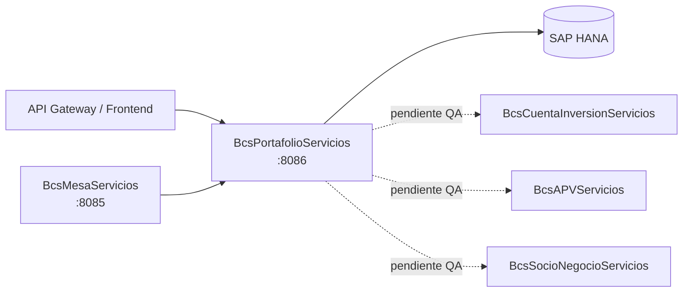

# BcsPortafolioServicios

## Descripción

Microservicio de gestión de portafolios de inversión de clientes (carteras). Expone operaciones de ciclo de vida completo: creación (con y sin réplica APV), modificación, eliminación y cambio de estado. Gestiona autorización y rechazo masivo de portafolios, consulta de consumos en línea y límites, preferencias de pago, cuentas custodio y la matriz agrupador NO-APV. Es el módulo central consultado por la mesa de dinero y el frontend para toda operación sobre la cartera de un cliente.

## Tecnología

- **Framework:** Spring Boot 4.1.1 / Java 25
- **Puerto:** 8086
- **Artifact:** `cl.bcs:bcs-portafolio-servicios`
- **Base de datos:** SAP HANA (via `com.sap.db.jdbc.Driver`)

## Requisitos

Las siguientes variables de entorno son obligatorias en tiempo de ejecución:

| Variable | Descripción |
|---|---|
| `HANA_URL` | URL JDBC de la base de datos SAP HANA |
| `HANA_USER` | Usuario de conexión a HANA |
| `HANA_PASSWORD` | Contraseña de conexión a HANA |

## Endpoints

### Portafolio

| Método | Ruta | Descripción |
|---|---|---|
| `POST` | `/portafolio/crear` | Crea un nuevo portafolio de cliente |
| `POST` | `/portafolio/crear-con-replica` | Crea un portafolio con réplica APV |
| `POST` | `/portafolio/eliminar-sin-transacciones` | Elimina un portafolio si no tiene transacciones |
| `POST` | `/portafolio/modificar` | Modifica datos de un portafolio existente |
| `POST` | `/portafolio/modificar-estado` | Cambia el estado de un portafolio |

### Autorización masiva

| Método | Ruta | Descripción |
|---|---|---|
| `POST` | `/portafolio/autorizar-masivo` | Autoriza una lista de portafolios en lote |
| `POST` | `/portafolio/rechazar-masivo` | Rechaza una lista de portafolios en lote |

### Consumo y límites

| Método | Ruta | Descripción |
|---|---|---|
| `POST` | `/portafolio/consumo/en-linea` | Consulta el consumo en línea de un portafolio |
| `POST` | `/portafolio/consumo/limite` | Consulta el límite de consumo de un portafolio |

### Preferencia de pago

| Método | Ruta | Descripción |
|---|---|---|
| `POST` | `/portafolio/preferencia/crear` | Registra la preferencia de pago de un portafolio |
| `PUT` | `/portafolio/preferencia/actualizar` | Actualiza la preferencia de pago |

### Cuenta custodio

| Método | Ruta | Descripción |
|---|---|---|
| `POST` | `/portafolio/custodio/consultar` | Consulta la cuenta custodio asociada |
| `PUT` | `/portafolio/custodio/actualizar` | Actualiza la cuenta custodio |

### Matriz agrupador

| Método | Ruta | Descripción |
|---|---|---|
| `POST` | `/portafolio/matriz/consultar` | Consulta la matriz agrupador NO-APV de un portafolio |

## Endpoint interno de dispatcher

### `POST /internal/java-call`

Recibe despachos J-type desde `BcsPlataformaWeb/CallController`. No expuesto en el gateway.

**Body:**
```json
{
  "class": "cl.bcs.dominio.NombreClase",
  "params": { ... },
  "skip": 0,
  "take": -1
}
```

**Activación progresiva:** Para registrar una clase JavaCall migrada, agregar un `case` en `InternalJavaCallController`:
```java
case "cl.bcs.dominio.NombreClase" -> service.ejecutar(params);
```

**Estado actual:** Todas las clases retornan 503 → BcsGateway hace fallback a TomEE.

## Dependencias de runtime

| Servicio | Rol |
|---|---|
| SAP HANA | Persistencia principal: tablas `POR.Portafolio`, `POR.PlantillaLimites`, `SOL.SolicitudCambio` y stored procedures |
| `BcsMesaServicios` (8085) | Calcula paridad para órdenes (llamada cross-service, pendiente activación en QA) |
| `BcsCuentaInversionServicios` | Consulta saldo cuenta inversión (RestClient pendiente) |
| `BcsAPVServicios` | Réplica de portafolio APV (RestClient pendiente) |
| `BcsSocioNegocioServicios` | Notificación de cambio de ejecutivo (RestClient pendiente) |

## Diagrama



## Notas de implementación

- **Portafolio EUR** (B-POR-05): la comparación `.compareTo("S") == 0` es case-sensitive; una "s" minúscula omite la creación de cuenta EUR. Comportamiento heredado del legacy, pinneado por tests.
- **Doble escritura** (B-POR-03): cuando `matrizAgrupador > 0`, se asigna `RequiereAutorizacion="N"` Y `RequiereAutOrigen="N"` mediante dos sentencias if independientes, no un if-else.
- **APV** (B-POR-02): `IdPerfilCobros.trim()` debe ser igual a `"APV_EXENTO"` (case-insensitive).
- **Eliminación** (B-POR-15): cualquier tabla con `Cantidad > 0` bloquea la eliminación del portafolio.
- **Plantilla override** (B-POR-06): si `p_IdPlantillaCobro` es no nulo y no vacío, sustituye al `IdPerfilCobros` del perfil comercial.
- **Glosa** (B-POR-04): para personas jurídicas (tipo="J") usa `RazonSocial`; para naturales usa `Nombres ApPat ApMat`.
- **Acceso HANA diferido**: los repositorios lanzan `UnsupportedOperationException` hasta que QA-HANA esté disponible (Fase 4). Los endpoints REST de lógica pura funcionan sin HANA; los HANA-dependientes devuelven HTTP 503.
- **Puertos separados por SRP**: `PortafolioCRUDPort`, `AutorizacionPort`, `ConsumoPort`, `CustodioPreferenciaPort` — cada servicio inyecta solo su propio puerto.
- **Manejo de errores**: `GlobalExceptionHandler` mapea NPE→400, `IllegalArgumentException`→400, `UnsupportedOperationException`→503.
