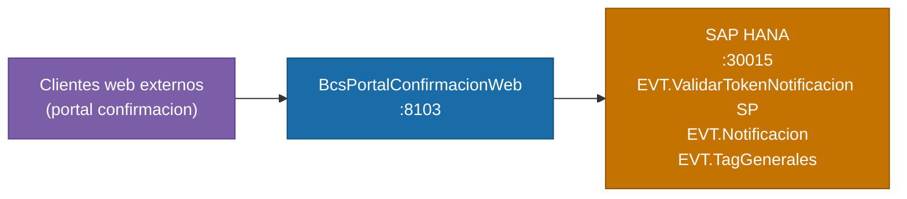

# BcsPortalConfirmacionWeb

## Descripción

Portal web para la confirmacion de operaciones financieras por parte de clientes externos. Recibe un token de notificacion, valida su autenticidad contra HANA, renderiza una pagina HTML con el detalle de la operacion usando plantillas FreeMarker, y procesa la accion de aceptacion o rechazo del cliente. Este servicio es el punto de entrada para clientes web externos que confirman operaciones desde correos electronicos o notificaciones.

## Tecnología

- **Framework:** Spring Boot 4.1.1 / Java 25
- **Puerto:** 8103
- **Artifact:** `cl.bcs.portalconfirmacion:bcs-portal-confirmacion-web`
- **Arquitectura:** Hexagonal (domain / port/in / port/out / service / adapter/in / adapter/out)

## Requisitos

| Variable de entorno | Descripcion | Obligatoria |
|---|---|---|
| `HANA_URL` | URL JDBC de SAP HANA | Si |
| `HANA_USER` | Usuario de HANA | Si |
| `HANA_PASSWORD` | Contrasena de HANA | Si |

## Endpoints

| Metodo | Ruta | Descripcion |
|---|---|---|
| `GET` | `/validate` | Valida token de notificacion y presenta o procesa la confirmacion |
| `POST` | `/validate` | Valida token de notificacion y presenta o procesa la confirmacion |

### Parametros de `/validate`

| Parametro | Tipo | Descripcion | Requerido |
|---|---|---|---|
| `token` | String | Token de notificacion | Si (400 si nulo) |
| `rut` | String | RUT del cliente que confirma | No |
| `accion` | String | `"1"` = aceptar, `"2"` = rechazar | No |
| `observacion` | String | Observacion libre del cliente | No |

### Flujo de respuesta

| Condicion | Comportamiento |
|---|---|
| `token` o URL nulos | HTTP 400 |
| Sin `rut` | Obtiene `rut` desde HANA e inyecta token en HTML; retorna pagina de presentacion |
| Con `rut`, sin `accion` | Retorna template HTML + footer `\|\|1\|\|0\|\|rut\|\|token` |
| `accion = "1"` | Registra aceptacion (ACP) en HANA; retorna confirmacion |
| `accion = "2"` | Registra rechazo (RZD) en HANA; retorna confirmacion |

## Dependencias de runtime

| Servicio | Puerto | Rol |
|---|---|---|
| SAP HANA | 30015 | SP de validacion de token, tabla de notificaciones, tags generales, configuracion |

## Diagrama

## Notas de implementacion

### Reglas de negocio

| ID | Descripcion |
|---|---|
| **B-CONF-01** | Token nulo o URL nula → HTTP 400. |
| **B-CONF-02** | Sin `rut` → obtener desde HANA e inyectar token en HTML de presentacion. |
| **B-CONF-03** | Con `rut`, sin `accion` → retornar template + footer `\|\|1\|\|0\|\|rut\|\|token`. |
| **B-CONF-04** | `accion="1"` → ACP (aceptar); `accion="2"` → RZD (rechazar). |
| **B-CONF-05** | `EvalTemplate.eval()` → evaluacion de plantilla FreeMarker con contexto JSON. |
| **B-CONF-06** | `EvalTemplate.Agrupa()` → agrupa `KeyValues` por `codigo` en array JSON por codigo. |
| **B-CONF-07** | `EvalTemplate.NoAgrupa()` → agrupa `KeyValues` por `codigo` en objeto JSON por codigo. |

### Bugs corregidos respecto al legado

1. **Thread-safety** — El legado guardaba `reqObj` como campo de instancia de `EvalTemplate`, causando corrupcion bajo peticiones concurrentes. La version modernizada usa solo variables locales.

2. **NPE en verificacion de template** — Legado: `if (template != null || !template.equals("-1"))` siempre es `true` cuando `template != null`, y lanza `NPE` cuando es `null`. Corregido a `template != null && !"-1".equals(template)`.

3. **Constructor URL deprecado** — Java 20+ depreca `new URL(String)`. Reemplazado por `URI.create().toURL()`.

4. **Credenciales HANA hardcodeadas** — El servlet legado tenia IP, usuario y contrasena de HANA literales en el codigo. Eliminados completamente; toda la conectividad pasa por variables de entorno.

### Dependencias HANA y estado de tests

| Operacion | Artefacto HANA | Estado del test |
|---|---|---|
| `validateToken()` | SP `BSCL.Plataforma.BD.Servicios::EVT.ValidarTokenNotificacion` | `@Disabled("requires HANA")` |
| `validateTokenAndId()` | SP `BSCL.Plataforma.BD.Servicios::EVT.ValidarConfirmarNotificacion` | `@Disabled("requires HANA")` |
| `getConfirmationMacro()` | Tabla `EVT.TagGenerales` | H2-compatible |
| `getUrlHana()` | Tabla `PLA.Configuracion` | H2-compatible |
| `acceptOrReject()` | Tabla `EVT.Notificacion` (`CURRENT_UTCTIMESTAMP`) | H2-compatible (usa `CURRENT_TIMESTAMP`) |

### Dependencias adicionales

| Libreria | Motivo |
|---|---|
| `org.freemarker:freemarker` | Evaluacion de plantillas HTML de notificacion |
| `com.google.code.gson:gson` | Modelo JSON de contexto de plantillas |
| `org.apache.commons:commons-text:1.12.0` | `StringEscapeUtils` (reemplaza `commons-lang:2.x` deprecado) |

### Manejo de errores

| Excepcion | HTTP |
|---|---|
| `NullPointerException` | 400 |
| `IllegalArgumentException` | 400 |
| `NumberFormatException` | 400 |
| `UnsupportedOperationException` | 503 |

### Tests

24 tests — 15 unitarios (`EvalTemplateServiceTest`, sin Spring ni HANA), 9 de integracion Spring Boot + H2 (2 deshabilitados: requieren SPs HANA). BUILD SUCCESS.
