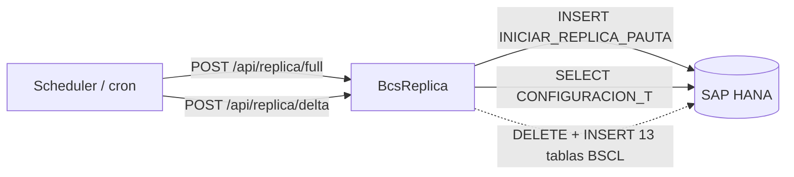

# BcsReplica — Replicación de Datos entre Esquemas HANA

## Descripción

Servicio de **replicación de datos entre esquemas SAP HANA**. Inicia réplicas completas (`Full`) y diferenciales (`Delta`) insertando entradas en la tabla de workstack `INICIAR_REPLICA_PAUTA`, extrae el período contable (`COD_PER`) de la fecha de sistema, y ejecuta el respaldo Sebra condicionalmente según el parámetro de configuración `PLA.RespaldoReplicaTablasSebra`. La transferencia real de datos entre los 13 esquemas BSCL (DELETE + INSERT) está diferida por ser 100% dependiente de HANA.

## Tecnología

- **Framework:** Spring Boot 4.1.1 / Java 25
- **Puerto:** 8093
- **Artifact:** `cl.bcs:BcsReplica`
- **Persistencia:** SAP HANA (`com.sap.db.jdbc.Driver`)

## Requisitos

| Variable | Descripción |
|---|---|
| `HANA_URL` | URL JDBC de la base de datos HANA |
| `HANA_USER` | Usuario de HANA |
| `HANA_PASSWORD` | Contraseña de HANA |

## Endpoints

| Método | Ruta | Descripción |
|---|---|---|
| `POST` | `/api/replica/full` | Inicia réplica completa — inserta workstack con `QueryReplica` y `Action="F"` |
| `POST` | `/api/replica/delta` | Inicia réplica diferencial — inserta workstack con `QueryReplicaDelta` y `Action="F"` |
| `GET` | `/api/replica/cod-per/{fechaSistema}` | Extrae período contable `YYYY-MM` de la fecha de sistema |
| `POST` | `/api/replica/respaldo` | Ejecuta respaldo Sebra si `RespaldoReplicaTablasSebra=="S"` (retorna 503 con HANA activo) |

**Body de `/full` y `/delta`:** `{"idEmpresa": <Long>, "idUsuario": <Long>}`

## Dependencias de runtime

| Dependencia | Tipo | Descripción |
|---|---|---|
| SAP HANA | Base de datos | Tabla `INICIAR_REPLICA_PAUTA` (workstack), `CONFIGURACION_T` (fecha sistema y parámetro Sebra), tablas BSCL de réplica |
| Scheduler / cron | Consumidor | Dispara las réplicas programadas (Full y Delta) |

## Diagrama

## Notas de implementación

- **Formato de parámetros workstack (B-REP-01):** `"BCS_query:<queryName>;Fecha:<fechaSistema>"` — construido por `ReplicaService.buildParametersString()`.
- **Full vs Delta (B-REP-02):** ambos usan `Action="F"` en `WORKSTACK_T`; se diferencian únicamente por el nombre de query (`QueryReplica` vs `QueryReplicaDelta`).
- **Gate de respaldo Sebra (B-REP-03):** `"S".equalsIgnoreCase(configValue)` activa el respaldo; cualquier otro valor lo omite silenciosamente.
- **`extractCodPer` (B-REP-04):** `fechaSistema.substring(0, 7)` — extrae `YYYY-MM` para el parámetro `COD_PER`.
- **`EnviarTablaReplica.java` no migrado:** ~24 000 LOC de SQL puro DELETE+INSERT sobre 13 tablas BSCL (`TBCTCIRV`, `TBCTCURV` y otras 11). Sin lógica pura extraíble — diferido.
- **`ejecutarRespaldoSebra` siempre lanza UOE en H2:** el respaldo real requiere HANA. El `GlobalExceptionHandler` mapea `UnsupportedOperationException` → HTTP 503.
- **Sin credenciales hardcoded:** todas las conexiones via variables de entorno `${HANA_URL}`, `${HANA_USER}`, `${HANA_PASSWORD}`.
