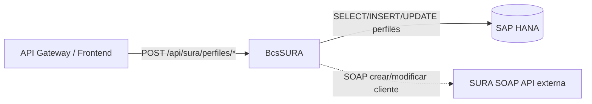

# BcsSURA — Conector SURA AFP

## Descripción

Conector con **SURA AFP** para la gestión de perfiles de portafolio APV (Ahorro Previsional Voluntario). Procesa solicitudes de modificación de perfiles de inversión: filtra candidatos a INSERT e indicadores a UPDATE, valida el indicador de forma de cobro para portafolios con propósito APV, y fusiona datos de forma de cobro entre la respuesta de HANA y el input original. La integración con los servicios SOAP de SURA (creación y modificación de clientes) está diferida a Fase 4.

## Tecnología

- **Framework:** Spring Boot 4.1.1 / Java 25
- **Puerto:** 8092
- **Artifact:** `cl.bcs:sura-service`
- **Persistencia:** SAP HANA (`com.sap.db.jdbc.Driver`)

## Requisitos

| Variable | Descripción |
|---|---|
| `HANA_URL` | URL JDBC de la base de datos HANA |
| `HANA_USER` | Usuario de HANA |
| `HANA_PASSWORD` | Contraseña de HANA |

## Endpoints

| Método | Ruta | Descripción |
|---|---|---|
| `POST` | `/api/sura/perfiles/validar-apv` | Valida indicador de forma de cobro: portafolios con propósito `PROPOSITOAPV` → `ActualizarFormaCobro="N"` |
| `POST` | `/api/sura/perfiles/filtrar-insertar` | Filtra entidades con `IdIndicador==0` → candidatas a INSERT en tabla de indicadores |
| `POST` | `/api/sura/perfiles/filtrar-modificar` | Filtra entidades con `IdIndicador!=0 AND ActualizarFormaCobro=="S"` → candidatas a UPDATE |
| `POST` | `/api/sura/perfiles/filtrar-con-forma-cobro` | Excluye entidades con `IdFormaCobro` vacío |
| `POST` | `/api/sura/perfiles/crear-cliente` | Creación de cliente via SURA SOAP (diferido a Fase 4 — retorna 503) |
| `POST` | `/api/sura/perfiles/modificar-cliente` | Modificación de cliente via SURA SOAP (diferido a Fase 4 — retorna 503) |

## Dependencias de runtime

| Dependencia | Tipo | Descripción |
|---|---|---|
| SAP HANA | Base de datos | Tablas `PERFILES_COMERCIALES_T`, `PORTAFOLIOS_T`, `PERFILES_PORTAFOLIO_T`, `INDICADORES_PORTAFOLIO_T` |
| SURA SOAP WS | Servicio externo | `CrearClienteFullWSModificarPerfilesPortafolio`, `ModificarClienteModificarPerfilesPortafolioWS` (Fase 4) |

## Diagrama

## Notas de implementación

- **Regla APV (B-SURA-01):** Portfolios con `Proposito=="PROPOSITOAPV"` fuerzan `ActualizarFormaCobro="N"` independientemente del valor original.
- **Flujo INSERT (B-SURA-02):** `IdIndicador==0` identifica registros nuevos sin indicador asignado.
- **Flujo UPDATE (B-SURA-03):** Sólo se actualizan registros con indicador existente (`IdIndicador!=0`) y `ActualizarFormaCobro=="S"`.
- **Fusión forma de cobro (B-SURA-04):** Si el resultado de HANA no trae `IdFormaCobro`, se copia desde el input original por `IdPortafolio`.
- **Dominio mutable:** `IdsEntidadYPerfiles` usa campos públicos mutables (`actualizarFormaCobro="S"` por defecto) para equivalencia con el patrón `BcsPojo` del legacy.
- **Endpoints SOAP diferidos:** retornan HTTP 503 via `GlobalExceptionHandler`.
- **Tabla temporal HANA:** `generarTablaTemporal` / `obtenerPerfilesFiltradosPorTablaTemporal` diferidos a Fase 4.
