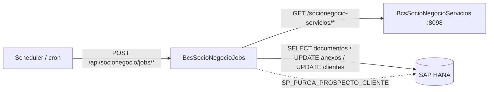

# BcsSocioNegocioJobs — Jobs de Socios de Negocio

## Descripción

Servicio de **ejecución de jobs de gestión de socios de negocio**. Implementa el job de bloqueo automático de clientes por fecha de vencimiento de documentos: recalcula fechas de vigencia, marca anexos vencidos y bloquea clientes cuyo documento expiró hoy y tienen el flag `BloquearAlVencer=="S"`. También expone el job de purga de prospectos (via SP HANA) y consultas de fecha de sistema.

## Tecnología

- **Framework:** Spring Boot 4.1.1 / Java 25
- **Puerto:** 8094
- **Artifact:** `cl.bcs:socionegocio-jobs`
- **Persistencia:** SAP HANA (`com.sap.db.jdbc.Driver`)

## Requisitos

| Variable | Descripción |
|---|---|
| `HANA_URL` | URL JDBC de la base de datos HANA |
| `HANA_USER` | Usuario de HANA |
| `HANA_PASSWORD` | Contraseña de HANA |

## Endpoints

| Método | Ruta | Descripción |
|---|---|---|
| `POST` | `/api/socionegocio/jobs/bloquear-por-vencimiento` | Ejecuta job de bloqueo automático de clientes con documentos vencidos hoy |
| `POST` | `/api/socionegocio/jobs/purga-prospectos` | Purga prospectos via SP HANA `SP_PURGA_PROSPECTO_CLIENTE` (retorna 503 sin HANA) |
| `GET` | `/api/socionegocio/jobs/fecha-sistema` | Retorna fecha de sistema configurada para la empresa |

## Dependencias de runtime

| Dependencia | Tipo | Descripción |
|---|---|---|
| SAP HANA | Base de datos | Documentos de clientes, anexos, configuración de días de vencimiento, SP de purga |
| BcsSocioNegocioServicios (8098) | Servicio interno | Lógica de identidad y socios de negocio |

## Diagrama

## Notas de implementación

- **Flujo de bloqueo (B-BLQ-01 a B-BLQ-07):**
  1. Lee `FechaSistema` y `diasVencimiento` desde `CONFIGURACION_T`.
  2. Consulta documentos con `FECHA_VIGENCIA` asignada.
  3. Recalcula `FechaVigencia = FechaModificacion + diasVencimiento` (omite docs con `FechaModificacion==null` o `IdEstado=="PEN"`).
  4. Actualiza anexos cuya `FechaVigencia == hoy` → estado `VEN`.
  5. Bloquea clientes donde `FechaVigencia == hoy AND BloquearAlVencer=="S"`.
- **Tipo de bloqueo hardcoded:** `IdTipoBloqueo="BAUTOM"`, `ComentarioBloqueo="Cliente bloqueado automaticamente por fecha de vencimiento"` (B-BLQ-05).
- **Gate de pauta anterior (B-BLQ-02):** si el `IdEstadoPrograma` de la pauta previa no es `"TER"`, el job no se ejecuta.
- **No portados (dependencias HANA SP):** `CargaCelebracionNacimientosJob` (tablas temporales HANA + 2 SPs), `PautaBloqueoDesbloqueoAutomaticoPortafolio`, `PautaDesbloqueoAutomaticoClientes`.
- **Entrypoint migrado de TomEE:** el scheduler TomEE EJB se reemplaza por invocación REST `POST /api/socionegocio/jobs/bloquear-por-vencimiento`.
- **Manejo de errores:** `GlobalExceptionHandler` mapea `UnsupportedOperationException` → HTTP 503, NPE/IAE → HTTP 400.
