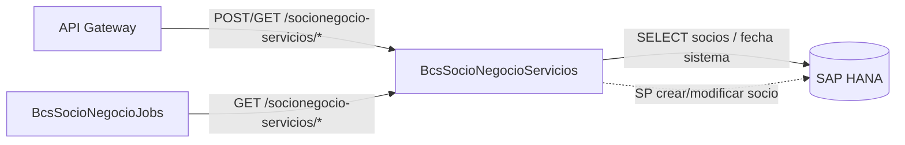

# BcsSocioNegocioServicios — Servicios de Socios de Negocio

## Descripción

Servicio REST de **gestión de contrapartes y socios de negocio**. Expone operaciones de identidad de entidades financieras: generación del IUP (Identity Unique Prefix de 14 caracteres), extracción del documento asociado a un IUP, ofuscación de documentos de identidad (RUT y pasaporte via SHA-256), y consultas de socios de negocio y fecha de sistema desde HANA. La creación de socios via stored procedures HANA está diferida.

## Tecnología

- **Framework:** Spring Boot 4.1.1 / Java 25
- **Puerto:** 8098
- **Artifact:** `cl.bcs:bcs-socionegocio-servicios`
- **Persistencia:** SAP HANA (`com.sap.db.jdbc.Driver`)

## Requisitos

| Variable | Descripción |
|---|---|
| `HANA_URL` | URL JDBC de la base de datos HANA |
| `HANA_USER` | Usuario de HANA |
| `HANA_PASSWORD` | Contraseña de HANA |

## Endpoints

| Método | Ruta | Descripción |
|---|---|---|
| `POST` | `/socionegocio-servicios/iup/generar` | Genera IUP de 14 caracteres para un documento de identidad y tipo |
| `POST` | `/socionegocio-servicios/iup/documento-asociado` | Extrae el documento de identidad asociado a un IUP |
| `POST` | `/socionegocio-servicios/ofuscar` | Ofusca un documento de identidad (RUT → pseudo-RUT; pasaporte → 10 letras SHA-256) |
| `GET` | `/socionegocio-servicios/socios/{idEmpresa}` | Consulta socios de negocio por empresa (SQL plano, H2-testeable) |
| `GET` | `/socionegocio-servicios/fecha-sistema/{idEmpresa}` | Retorna fecha de sistema configurada para la empresa |
| `POST` | `/socionegocio-servicios/crear` | Crea socio de negocio via SP HANA (retorna 503 sin HANA) |

## Endpoint interno de dispatcher

### `POST /internal/java-call`

Recibe despachos J-type desde `BcsPlataformaWeb/CallController`. No expuesto en el gateway.

**Body:**
```json
{
  "class": "cl.bcs.dominio.NombreClase",
  "params": { ... },
  "skip": 0,
  "take": -1
}
```

**Activación progresiva:** Para registrar una clase JavaCall migrada, agregar un `case` en `InternalJavaCallController`:
```java
case "cl.bcs.dominio.NombreClase" -> service.ejecutar(params);
```

**Estado actual:** Todas las clases retornan 503 → BcsGateway hace fallback a TomEE.

## Dependencias de runtime

| Dependencia | Tipo | Descripción |
|---|---|---|
| SAP HANA | Base de datos | Tablas `SOCIOS_NEGOCIO_T`, `CONFIGURACION_T`; SP de creación de socio |
| BcsSocioNegocioJobs | Consumidor | Invoca lógica de socios desde los jobs de bloqueo de clientes |
| API Gateway | Consumidor | Exposición de servicios de identidad a capas superiores |

## Diagrama



## Notas de implementación

- **IUP — prefijos fijos por tipo de documento:** cada tipo tiene un código de 2 caracteres y longitud de padding fija (`ConfiguracionDocumentoIdentidad` enum). El IUP final siempre tiene exactamente 14 caracteres (rightPad con `"0"`).
- **Tipo FIC:** tiene tres sub-variantes — `FIC_J` (jurídica), `FIC_M` (mixta), `FIC_N` (natural/default).
- **CEX, CE y RUT** mapean al mismo código `"20"`, longitud 8.
- **Tipo desconocido:** mapea a config `ERROR` (`"EE"`, longitud 0).
- **Ofuscación de RUT (B-OFU-01/03):** patrón `^\d{7,8}-[0-9kK]{1}$` (sin puntos) → genera pseudo-RUT con DV deliberadamente inválido (no coincide con el Luhn correcto). Determinístico via SHA-256.
- **Ofuscación de pasaporte (B-OFU-02):** cualquier input que no sea RUT → SHA-256 → 10 letras mayúsculas.
- **`obtenerIdEstadoAutorizacion(true)` → `"ING"`; cualquier otro valor (incluido null) → `"PEN"`.**
- **`obtenerCampoRegistroTruncado`:** trunca a exactamente 40 caracteres; null-safe.
- **Inputs nulos/vacíos:** pasan sin cambio en la ofuscación.
