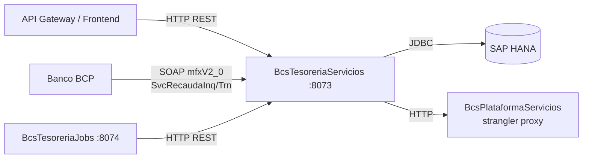

# BcsTesoreriaServicios

## Descripción

Servicio de tesorería que gestiona el ciclo de vida de comprobantes de ingreso/egreso,
mandatos PAC y la integración SOAP con el banco BCP para la recaudación electrónica.
Implementa los flujos: creación de ingreso/egreso, girado, liquidación, confirmación/
rechazo/anulación de movimientos y gestión de mandatos PAC (alta, revocación, anulación).
También expone dos endpoints SOAP legacy para el banco BCP (`SvcRecaudaInqV1`,
`SvcRecaudaTrnV1`) con el namespace original `http://mfxV2_0`.

## Tecnología

- **Framework:** Spring Boot 4.1.1 / Java 25
- **Puerto:** 8073
- **Artifact:** `cl.bcs:tesoreria-service`
- **Patrón:** Hexagonal (ports-and-adapters), strangler-fig; SOAP vía JAX-WS (`@WebService`)

## Requisitos

Variables de entorno requeridas:

| Variable | Descripción |
|---|---|
| `HANA_URL` | URL JDBC SAP HANA (`jdbc:sap://<host>:<port>`) |
| `HANA_USER` | Usuario HANA |
| `HANA_PASSWORD` | Contraseña HANA |
| `PLATAFORMA_BASE_URL` | URL base de BcsPlataformaServicios (por defecto `http://localhost:8080`) |

## Endpoints

### REST (orquestador interno y jobs)

| Método | Ruta | Descripción |
|---|---|---|
| `GET` | `/actuator/health` | Health check Spring Boot Actuator |

> Los servicios de dominio (`CrearIngresoEgreso`, `LiquidarComprobante`, etc.) son
> invocados por el orquestador `BcsTesoreraOrchestrator` vía beans de Spring.
> El API REST externo se completará en el siguiente pass de implementación.

### SOAP — BCP Recaudación (namespace `http://mfxV2_0`)

| Servicio SOAP | Port Name | Operación | Descripción |
|---|---|---|---|
| `SvcRecaudaInqV1Service` | `SvcRecaudaInqV1Port` | `svcRecaudaInq` | Consulta existencia y estado de depositante BCP |
| `SvcRecaudaTrnV1Service` | `SvcRecaudaTrnV1Port` | `svcRecaudaTrn` | Procesa transacción de recaudación BCP |

**Códigos de respuesta BCP:**

| Código | Endpoint | Severidad | Significado |
|---|---|---|---|
| `CP0000` | Ambos | INFORMACION | Operación exitosa |
| `CP0010` | InqV1 | ERROR | Depositante no encontrado |
| `CP0139` | TrnV1 | ERROR | Transacción fallida |
| `CP0138` | Ambos | ERROR | Error genérico |

**Monedas soportadas (`ServicioBCPMoneda`):** `2000` → PEN, `2001` → USD

## Endpoint interno de dispatcher

### `POST /internal/java-call`

Recibe despachos J-type desde `BcsPlataformaWeb/CallController`. No expuesto en el gateway.

**Body:**
```json
{
  "class": "cl.bcs.dominio.NombreClase",
  "params": { ... },
  "skip": 0,
  "take": -1
}
```

**Activación progresiva:** Para registrar una clase JavaCall migrada, agregar un `case` en `InternalJavaCallController`:
```java
case "cl.bcs.dominio.NombreClase" -> service.ejecutar(params);
```

**Estado actual:** Todas las clases retornan 503 → BcsGateway hace fallback a TomEE.

## Dependencias de runtime

| Sistema | Detalles |
|---|---|
| **SAP HANA** | Repositorio principal (`TesoreriaJdbcRepository`); métodos en stub `UnsupportedOperationException` — wiring SQL en siguiente pass |
| **BcsPlataformaServicios** | `PlataformaRestClient` sobre `PLATAFORMA_BASE_URL`; provee `validarRequisitosBasicos`, `obtenerFechaSistema`, consulta depositante BCP, procesamiento transacción BCP |

## Diagrama



## Notas de implementación

- **SOAP namespace preservado:** `targetNamespace = "http://mfxV2_0"` es el contrato
  externo con BCP; no debe modificarse sin confirmación de ese equipo.
- **portName cambiado:** El port name CXF legacy `SvcRecaudaInqV1_SoapHttpPort` fue
  cambiado a `SvcRecaudaInqV1Port` (sufix de transporte CXF eliminado). Pendiente
  confirmación de SME/BCP si el consumidor direcciona el port por nombre.
- **TesoreriaJdbcRepository en stub:** Todos los métodos lanzan `UnsupportedOperationException`.
  El wiring completo de SQL HANA está diferido al siguiente pass (Phase 3).
- **53 servicios de tesorería pendientes:** El piloto portó 8 servicios directamente
  testeados; los restantes son stubs con el mismo patrón.
- **Sin `@Transactional` aún (M3):** Las operaciones multi-paso (crear comprobante +
  persistir detalle) pueden dejar estado parcial ante fallos hasta que se confirme el
  soporte XA de HANA.
- **`simulaOperacion`:** El flag se propaga verbatim a cada `ContextoServicioTesoreria`;
  con `"S"` se omite `persistirIngresoEgreso`.
- **Acumulación de errores:** `erroresContador += 1` por excepción (comportamiento
  aditivo, no asignación como el legacy — DEV-05).
- **Mandato PAC — revocación con CSC:** Si existen contratos CSC, se llama a
  `revocarContratoCSC` antes de actualizar el mandato.
