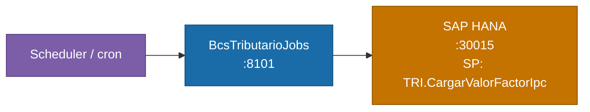

# BcsTributarioJobs

## Descripción

Servicio de jobs tributarios. Ejecuta la carga del valor del factor IPC (Indice de Precios al Consumidor) hacia SAP HANA mediante el stored procedure `TRI.CargarValorFactorIpc`. Este proceso es parte del modulo tributario (`TRI`) del sistema Optimus Corredores y se activa por scheduler/cron.

## Tecnología

- **Framework:** Spring Boot 4.1.1 / Java 25
- **Puerto:** 8101
- **Artifact:** `cl.bcs:tributario-jobs`
- **Arquitectura:** Hexagonal (domain / port/out / adapter/in / adapter/out / service)

## Requisitos

| Variable de entorno | Descripcion | Obligatoria |
|---|---|---|
| `HANA_URL` | URL JDBC de SAP HANA (ej. `jdbc:sap://host:30015`) | Si |
| `HANA_USER` | Usuario de HANA | Si |
| `HANA_PASSWORD` | Contrasena de HANA | Si |
| `SERVER_PORT` | Puerto HTTP. Por defecto: `8101` | No |

## Endpoints

| Metodo | Ruta | Descripcion |
|---|---|---|
| `POST` | `/api/tributario/jobs/carga-ipc` | Ejecuta el job de carga del factor IPC en HANA |

### Parametros del request (body JSON)

| Campo | Tipo | Descripcion | Requerido |
|---|---|---|---|
| `idModulo` | String | Identificador del modulo (ej. `"TRI"`) | Si |
| `simularOperacion` | String | `"S"` para simular, `"N"` para ejecutar real | Si |
| `usaReglasNegocio` | String | `"S"` para aplicar reglas de negocio | Si |
| `idEmpresa` | Long | Id de empresa. Por defecto legado: `1` | No |
| `idUsuario` | Long | Id de usuario. Por defecto legado: `3` | No |

## Dependencias de runtime

| Servicio | Puerto | Rol |
|---|---|---|
| SAP HANA | 30015 | Stored procedure `BSCL.Normativa.BD.Servicios::TRI.CargarValorFactorIpc` |

## Diagrama



## Notas de implementacion

### Reglas de negocio

| ID | Descripcion |
|---|---|
| **B-TRI-01** | `idModulo`, `simularOperacion` y `usaReglasNegocio` deben ser no-nulos o se rechaza con 400. |
| **B-TRI-02** | Si `erroresContador > 0` (OUT param 7 del SP) → rollback y excepcion. |
| **B-TRI-03** | Si `erroresContador == 0` → commit y retorna resultado exitoso. |
| **B-TRI-04** | Valores por defecto del legado: `idEmpresa = 1`, `idUsuario = 3` cuando los parametros estan ausentes. |

### Bug corregido — indice de parametro erroneo

El codigo legacy verificaba el resultado del SP usando `sp.getObject(4)` (parametro IN `SimularOperacion`) en lugar del verdadero contador de errores en la posicion OUT 7. El bug era latente porque `SimularOperacion` siempre era `""` o `"0"`, haciendo que `Integer.parseInt("0") == 0` y la rama de rollback jamas se activara.

**Legado (incorrecto):**
```java
if (Integer.parseInt(sp.getObject(4).toString()) > 0) { // indice 4 = SimularOperacion
```

**Modernizado (correcto):**
```java
if (!resultado.exitoso()) { // verifica erroresContador desde OUT param 7
```

### Stored procedure HANA

**Nombre:** `BSCL.Normativa.BD.Servicios::TRI.CargarValorFactorIpc`

| Pos | Dir | Tipo | Campo |
|---|---|---|---|
| 1 | IN | BIGINT | `idEmpresa` |
| 2 | IN | BIGINT | `idUsuario` |
| 3 | IN | VARCHAR | `IdModulo` |
| 4 | IN | VARCHAR | `SimularOperacion` |
| 5 | IN | VARCHAR | `UsaReglasNegocio` |
| 6 | OUT | INTEGER | `advertenciasContador` |
| 7 | OUT | INTEGER | `erroresContador` |
| 8-10 | ? | ? | reservados |

El SP retorna 3 result sets: `p_out_Resultado`, lista de advertencias y lista de errores.

### Test canario (B-TRI-07)

Verifica que `CargaIpcHanaAdapter.SP_NOMBRE` sea exactamente igual al nombre del SP de HANA. Si la constante se modifica, el test falla de inmediato, previniendo silenciosamente llamadas al SP equivocado.

### Manejo de errores

| Excepcion | HTTP |
|---|---|
| `NullPointerException` | 400 |
| `IllegalArgumentException` | 400 |
| `NumberFormatException` | 400 |
| `UnsupportedOperationException` | 503 |

### Tests

17 tests — 14 unitarios (`CargaIpcJobServiceTest`), 3 de integracion (1 deshabilitado: requiere HANA live). BUILD SUCCESS.
