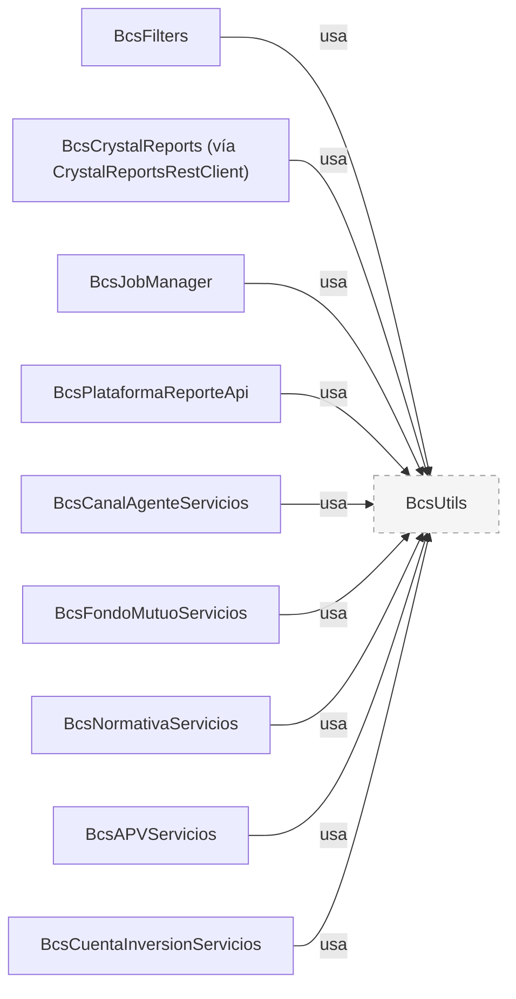

# BcsUtils

## Descripción

Librería compartida de utilidades de plataforma para el sistema BCS (Bolsa Corredores). Proporciona herramientas transversales de uso común a todos los microservicios del sistema: validación de RUT chileno, fechas (`Fecha`, `DateUtil`, `Timer`), cadenas y colecciones (`Utils`, `StringUtils`, `BcsPojo`), archivos y ZIP, deserializadores Gson, el contrato `JavaCall`, la política de claves (`cl.bcs.utils.clave`, RULE-031..034) y la política de sesión como funciones puras (`cl.bcs.utils.sesion`, RULE-021/024/025/071), además de `HybridPasswordEncoder` y un cliente HTTP tipado para invocar BcsCrystalReports. El alcance (librería común pura, decisión 2026-10-16) y lo no migrado están en `TRANSFORMATION_NOTES.md`. No expone ningún endpoint REST; se distribuye como JAR y se declara como dependencia en cada módulo que la necesita.

## Tecnología

- **Framework:** Spring Boot 4.1.1 / Java 25
- **Puerto:** N/A (librería, no servicio REST)
- **Artifact:** `cl.bcs:bcs-utils`
- **Empaquetado:** JAR (`<packaging>jar</packaging>`)

## Requisitos

No requiere variables de entorno ni acceso a base de datos: las políticas reciben sus parámetros (`PLA.Configuracion`) como entrada.

### Dependencias declaradas

| Librería | Uso |
|---|---|
| `com.google.code.gson` | `GsonDateDeserializer`, `GsonTimestampDeserializer`, `JavaCall` |
| `commons-io` | `JavaCall.loadResourceToString` |
| `spring-boot-starter-web` (opcional) | `CrystalReportsRestClient` (RestClient) |
| `spring-security-crypto` (opcional) | `HybridPasswordEncoder` |
| `commons-codec` | Hash SHA-256 de passwords legados y Base64 tolerante de `Utils.decodificarEvento` |
| `slf4j-api` | Logging de `Timer` y diagnóstico |

## Clases principales

| Clase | Responsabilidad |
|---|---|
| `RutUtil` | Validación de RUT chileno (módulo 11, dígito K) |
| `Fecha`, `DateUtil`, `Timer` | Fechas y offsets, parsing y aritmética de días, métricas de tiempo |
| `Utils`, `StringUtils`, `StreamUtils`, `BcsPojo` | Subconjunto puro de `Utils` legacy (texto, tokens, JSON, `List2Hash`, `copyPojo`, ZIP de archivo) |
| `FileUtils`, `ZipUtil` | Operaciones de archivo y ZIP |
| `clave.ValidadorClave`, `clave.PoliticaClave` | Política de claves RULE-031..034 (RULE-032: mínimo de dígitos `ACC.numDigitos`) |
| `sesion.TokenSesion`, `sesion.PoliticaInactividad`, `sesion.RelojUtcCacheado` | Token de sesión RULE-021, timeout por canal RULE-024/025 (COR: `PLA.IdleMaxTimeCOR`), caché UTC RULE-071 |
| `HybridPasswordEncoder` | Encoder dual: verifica hashes SHA-256 legados y reencripta en BCrypt |
| `GsonDateDeserializer`, `GsonTimestampDeserializer` | Deserialización de fechas en Gson (tolerante, como el legacy) |
| `CrystalReportsRestClient` | Cliente HTTP hacia `BcsCrystalReports` (`POST /reports/generate`) |
| `JavaCall`, `JavaCallExtra`, `JavaCallMetadata`, `JavaUtil` | Contrato JavaCall y carga de recursos del classpath |

## Diagrama

## Notas de implementación

- **RULE-032 (PasswordScanner) corregida:** El legado usaba `\W` para detectar caracteres especiales, lo cual ignoraba silenciosamente los dígitos. La nueva implementación cuenta dígitos en `ScanResult.digits()` separados de `specials()`.
- **RULE-025 (SessionTimeout) corregida:** El canal `COR` caía al `default` del switch legado y recibía 30 minutos hardcodeados. La nueva implementación devuelve la clave de configuración `PLA.IdleMaxTimeCOR` para que ops la configure vía HANA.
- **`DateFormatException`** reemplaza `java.lang.Exception` en `DateUtil` para permitir captura específica sin checked-exceptions.
- **`BcsUtils` no tiene contexto Spring.** Se usa como clase de utilidad pura (no bean). Los llamadores la invocan directamente o inyectan `CrystalReportsRestClient` cuando Spring está disponible.
- La validación de contraseñas respaldada por SP de HANA (`ValidarNuevaClave`) está diferida a integración con HANA QA; `PasswordScanner` recibe los 4 umbrales como parámetros directos.
