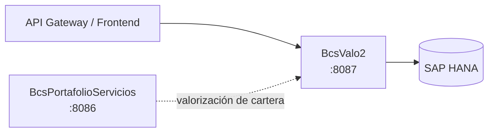

# BcsValo2

## Descripción

Microservicio de valorización de instrumentos financieros a precio de mercado. Implementa los motores matemáticos de valorización usados por la mesa de dinero: cálculo de precio de pagarés (captación y rescate), valorización de bonos, conteo de días bajo distintas convenciones internacionales (30/360, Act/360, Act/365, ActAct-ISDA, BUS/252, etc.) y algoritmos financieros avanzados como TIR (Newton-Raphson), Duration de Macaulay y Convexidad. Es consultado desde el frontend y el API Gateway para obtener precios de mercado de los instrumentos de la cartera.

## Tecnología

- **Framework:** Spring Boot 4.1.1 / Java 25
- **Puerto:** 8087
- **Artifact:** `cl.bcs:bcs-valo2`
- **Base de datos:** SAP HANA (via `com.sap.db.jdbc.Driver`)

### Configuración específica

| Parámetro | Valor por defecto | Descripción |
|---|---|---|
| `valo2.config.escala-precios` | `6` | Decimales para precios de instrumentos |
| `valo2.config.escala-tasas` | `6` | Decimales para tasas de interés |

## Requisitos

| Variable | Descripción |
|---|---|
| `HANA_URL` | URL JDBC de la base de datos SAP HANA |
| `HANA_USER` | Usuario de conexión a HANA |
| `HANA_PASSWORD` | Contraseña de conexión a HANA |

## Endpoints

### Valorización de pagarés

| Método | Ruta | Descripción |
|---|---|---|
| `POST` | `/api/valorizar/pagares` | Calcula captación y rescate de un pagaré (simple o compuesto) |

### Valorización de bonos

| Método | Ruta | Descripción |
|---|---|---|
| `POST` | `/api/valorizar/bonos` | Valoriza un bono por nemotécnico (requiere HANA — devuelve 503 sin conexión) |

### Calendario financiero

| Método | Ruta | Descripción |
|---|---|---|
| `POST` | `/api/valorizar/calendario/dias` | Cuenta días entre dos fechas según una convención de días (Act/360, 30/360, BUS/252, etc.) |

## Dependencias de runtime

| Servicio | Rol |
|---|---|
| SAP HANA | Datos de bonos (curvas, feriados para BUS/252), indicadores y paridades de mercado |
| `BcsPortafolioServicios` (8086) | Consulta de portafolios para valorización de cartera (consumidor upstream) |

## Diagrama

## Notas de implementación

- **TIR Newton-Raphson** (B-VAL-06): valor inicial `TIR_INICIAL=0.1`, máx 100 iteraciones, `ε=1e-10`. El valor inicial es un canary: cambiarlo a `0.2` produce fallos inmediatos en los tests.
- **Convenciones de días** (B-VAL-09..17): implementa 8 convenciones — 30/360, 30E/360, Act/360, Act/365, ActAct-ISDA, NL/365, BUS/252. El dispatcher acepta alias como `"30_360"`, `"ACT_360"`, `"BUS_252"`.
- **BUS/252**: requiere feriados de HANA. Sin conexión, el endpoint devuelve HTTP 503 en lugar de un resultado silenciosamente incorrecto.
- **Pagarés sin HANA**: `/api/valorizar/pagares` y `/api/valorizar/calendario/dias` (excepto BUS/252) funcionan en modo puro sin base de datos.
- **Bonos**: `/api/valorizar/bonos` siempre requiere HANA para obtener los datos del instrumento; devuelve 503 hasta que QA-HANA esté disponible.
- **Métodos estáticos**: los servicios (`PagaresService`, `BonosService`, `FinancieraService`, `ContadorDiasService`) mantienen sus métodos como `static` para permitir tests sin contexto Spring.
- **Manejo de errores**: NPE→400, `IllegalArgumentException` (convención inválida)→400, `UnsupportedOperationException`→503.
